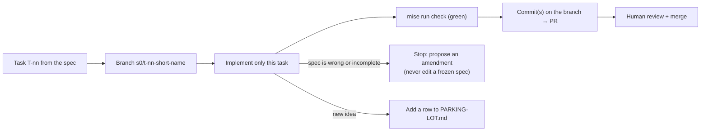

# AGENTS.md: Working on Atabey

> Shared instructions for every coding agent (Claude Code, OpenCode, Codex, …). Claude Code reads this through `CLAUDE.md`.

**Atabey** is a Tauri 2 desktop app (Rust core + React/TypeScript GUI) that explains any codebase in a rich GUI and builds features through spec-driven, multi-agent development, with mentorship and practice. The process is **Spec-Lite** (D-034): frozen specs, one task at a time, formal amendments.

## Read before any task

1. [`CONSTITUTION.md`](CONSTITUTION.md): non-negotiable engineering rules
2. The **active slice spec** in [`specs/`](specs/) (now: [`S0-foundations.md`](specs/S0-foundations.md)), especially the task you were given and the requirements and acceptance criteria it links to
3. [`ROADMAP.md`](ROADMAP.md) for where the task fits; [`adr/`](adr/) for why things are built the way they are

## The task loop

| Rule | Detail |
|---|---|
| **Scope** | Implement only the current task. Requirements from other tasks are out of scope even if they look easy |
| **Frozen documents** | `PRODUCT-SPEC.md`, `CONSTITUTION.md` and frozen specs are never edited directly. Add a proposed amendment row (delta + why) and stop |
| **Branches** | One branch per task: `s<slice>/t-<nn>-<short-name>` (e.g., `s0/t-09-project-model`). Never commit to `main` (D-126) |
| **Done** | Every acceptance criterion the task covers has an automated test; `mise run check` is green; CI is green on macOS + Windows |
| **ADRs** | A decision that isn't already in the spec gets an ADR in `adr/` (template: [`adr/README.md`](adr/README.md)) |
| **Dependencies** | Never weaken supply-chain settings (pnpm `minimumReleaseAge`, `deny.toml`, lockfiles) to make an install pass. If a version is too new, pin the previous release; if a rule must change, ask |
| **Tiers** | Every task has a tier (H / M / L) that decides which model plans, writes and reviews it: [`docs/process/model-routing.md`](docs/process/model-routing.md) |

## Commands

| Command | What it does |
|---|---|
| `mise install` | Installs pinned Node, pnpm, cargo-deny, gitleaks, nextest, insta (Rust comes from `rust-toolchain.toml`) |
| `pnpm install` | JS dependencies (lockfile committed) |
| `mise run check` | **The gate**: fmt + clippy (`-D warnings`) + Biome + cargo-deny + gitleaks + tests |
| `mise run fmt` | Format Rust and TS/JSON |
| `mise run test` | Rust (nextest) + TS tests |

## Hard rules (summary; the Constitution is authoritative)

| # | Rule |
|---|---|
| 1 | **Types are generated from Rust** (TS bindings, JSON Schemas, Ulak contracts). Never hand-write a duplicate. No `any` |
| 2 | **Files are the source of truth**; SQLite is a rebuildable index |
| 5 | **No secrets** in code, logs, fixtures or docs. Secrets live in the OS keychain only |
| 6 | **Vendor terms:** never bundle, patch or reverse-engineer vendor agents; never read or forward subscription credentials |
| 7 | **Only `crates/atabey-llm` calls model providers**, and always through the budget meter |
| 10 | **Licenses:** only those allowed in `deny.toml`. Add a dependency to `[workspace.dependencies]` first |
| 11 | **Production-grade examples and fixtures only.** No `foo`/`bar`, no `Animal`/`Dog`. No ASCII-art diagrams in docs (use Mermaid or tables) |

## Repository layout

See [S0 spec §5.2](specs/S0-foundations.md#52-repository-layout). Only `apps/desktop/src-tauri` may depend on Tauri. Everything else is plain Rust, testable without a window.
