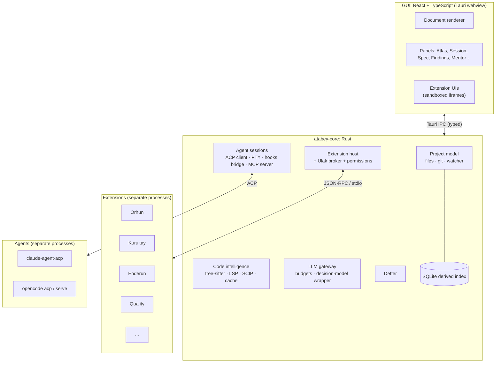

# Atabey: Product Spec

> **Consolidated from 4 brainstorming sessions** ([history](docs/brainstorm/README.md)). Every statement traces to a decision ID in [DECISIONS.md](docs/brainstorm/DECISIONS.md).
> **Frozen.** Changes only through an amendment (see [§15](#15-amendments) and [CONSTITUTION.md](CONSTITUTION.md) Article 12).

## Contents

1. [Vision](#1-vision)
2. [Users and goals](#2-users-and-goals)
3. [Pillars (modules)](#3-pillars-modules)
4. [Scope: v1.0](#4-scope-v10)
5. [Scope: v2.0 and later](#5-scope-v20-and-later)
6. [Non-goals](#6-non-goals)
7. [Agents and models](#7-agents-and-models)
8. [Architecture overview](#8-architecture-overview)
9. [Data and storage](#9-data-and-storage)
10. [Budget and cost model](#10-budget-and-cost-model)
11. [Quality bars](#11-quality-bars)
12. [Success measures](#12-success-measures)
13. [Top risks](#13-top-risks)
14. [Glossary](#14-glossary)
15. [Amendments](#15-amendments)

---

## 1. Vision

**Atabey** *(the Seljuk guardian-tutor of princes)* is a desktop app that helps one developer **understand any codebase without reading every line**, **build features with AI agents through a disciplined spec process**, and **become a better engineer while doing it**. *(D-004, D-006)*

| Purpose | Priority | In one sentence |
|---|---|---|
| **Understand code** | #1 | A rich, always-current atlas of any repo: architecture, modules, flows, decisions, "used by" |
| **Build with agents** | #2 | Spec → tasks → agent sessions → quality pipeline → multi-vendor review → docs, with you in control |
| **Learn** | Throughout | Debriefs, quizzes, spaced repetition, skill trees and practice scenarios built from *your* real work |

The GUI is the delivery surface: **everything is rendered richly** (no raw Markdown, no ASCII diagrams). *(D-022)*

---

## 2. Users and goals

| | |
|---|---|
| **Primary user** | You: a solo developer on macOS (primary) and Windows *(D-002, D-016)* |
| **Later** | Other developers, if open-sourced under **Apache-2.0** *(D-003, D-007)* |
| **Constraints** | Solo, no deadline, **AI budget under $3/day**, type safety, AI writes most code *(D-005)* |

---

## 3. Pillars (modules)

Themed names always appear with a plain-English subtitle. *(D-008)*

| Module | Subtitle | What it does | Decisions |
|---|---|---|---|
| **Orhun** | Codebase Atlas | tree-sitter facts, eager overview, lazy explanations cached by content hash, LSP "used by", SCIP snapshots, inferred ADRs for old code | D-050–052, D-090 |
| **Agent Session** | — | Native GUI over **ACP** (Claude Code first, OpenCode second) + one-click Terminal layout; permission gate; diffs; command cards; checkpoint commits | D-017, D-018, D-026 |
| **Divan** | Brainstorm Studio | Versioned sessions, summaries, decision ledger, question forms, topic tags | D-081, D-082 |
| **Tuğra** | Spec freeze | One spec per feature + product spec; freeze + formal amendments; Parking Lot; roadmap; SemVer tied to phases | D-030–033 |
| **Quality pipeline** | CI & guardrails | Pipeline Recipes (`pipeline.toml`) + local runner + generated GitHub Actions; analyzers → SARIF (diff-aware); change narratives | D-049, D-049a, D-049b |
| **Kurultay** | Observer Swarm | 3 vendors, read-only, after green CI; cross-examination; judge for splits; confirmed high/critical findings block acceptance | D-040–048 |
| **Defter** | Ledger & Logs | Every action logged per session; secrets redacted; retention 90 days raw + summaries forever | D-029 |
| **Enderun** | Mentor | Debrief mode, quizzes with stored AI feedback, notebook + FSRS, cross-project learner profile with git sync, AI-generated skill trees with "Not yet" 🌱 | D-060–068 |
| **Talimhane** | Practice Ground | Direct a deliberately weak agent through production-grade scenarios; the process is graded | D-069 |
| **Feedback overlay** | — | Global hotkey + tray; hide → capture → crop; defect vs idea routing | D-070–076 |
| **Bedesten** | Extension Library | GitHub registry + git URLs; permissions UI; dev kit + agent skills | D-027, D-080, D-101 |
| **Kervan** | Stack Packs | Tools (via `mise`), LSPs, grammars, analyzers, pipeline recipes, skills, conventions | D-092, D-103 |
| **Ulak** | Extension Messaging | Commands, events and typed services through the core broker | D-105 |

---

## 4. Scope: v1.0

Built as vertical slices S0 → S9; each slice ships engine + GUI together. *(D-013, D-025)*

| Slice | Delivers |
|---|---|
| **S0 Foundations** | Tauri shell · `atabey-core` · Rust→TS types · document renderer (Markdown + Mermaid + typed blocks) · theme system (Monokai ships) · Defter · settings, providers, budget meter · extension host v0 · Ulak v0 · macOS + Windows CI |
| **S1 Orhun** | Codebase Atlas |
| **S2 Agent Session** | ACP native session + Terminal layout fallback |
| **S3 Divan + Spec** | Brainstorm Studio · specs · Tuğra · Parking Lot · roadmap |
| **S4 Quality** | Pipeline Recipes · SARIF analyzers · change narratives |
| **S5 Kurultay** | Observer swarm on OpenCode headless |
| **S6 Enderun** | Mentor + learner profile + git sync |
| **S7 Talimhane** | Practice scenarios |
| **S8 Overlay** | Feedback overlay |
| **S9 Bedesten + Kervan** | Public registry, dev kit, stack packs, more themes, Ulak 1.0 |

**First stack pack:** `kervan-rust-tauri-react` (Atabey builds Atabey). *(D-092)*

---

## 5. Scope: v2.0 and later

| Item | Source |
|---|---|
| More doc types: API, DB, UI/UX, refactor proposals | v0.2 |
| Deploy (CD) recipes via stack packs | D-102 |
| Public Talimhane library (CC BY 4.0) at ~10 good scenarios | D-069 |
| More agents certified: Codex, Gemini CLI, Copilot CLI | D-017 |
| Dagger as an optional pipeline backend | v0.3-Q10 (⭐ alternative) |
| "Export decisions dataset" from Defter | D-029 |
| Adaptive apprentice difficulty | v0.3-Q15 (⭐ alternative) |

---

## 6. Non-goals

| Not doing | Why |
|---|---|
| Our own coding-agent loop | Wrap existing agents *(D-010)* |
| A marketplace server | GitHub registry is enough *(D-101)* |
| Cloud hosting / accounts / telemetry | Local-first personal tool |
| Bundling or modifying vendor agent binaries | Terms of service *(D-041)* |
| Using roadmap.sh content | Your decision *(D-066)* |
| SonarQube as the main analyzer | Source-available + Java server *(D-049b)* |
| AI-written CI YAML | Pipeline Recipes instead *(D-049a)* |
| Toy examples in lessons | Production-grade only *(D-068)* |

---

## 7. Agents and models

| Role | Runtime | Model / plan | Billing |
|---|---|---|---|
| Main coding agent | **Claude Code** via `claude-agent-acp` (+ terminal fallback) | Your Claude subscription | Subscription limits (not $-metered) |
| Second agent | OpenCode via `opencode acp` | OpenCode Go | $10/mo |
| Kurultay observers (×3 vendors) | OpenCode headless, read-only agents | OpenCode Go | Included |
| Kurultay judge | OpenCode headless | Strongest Go model; **escalate button → Opus 5.5 via API key** | Included / pay-per-token |
| Talimhane apprentice | OpenCode via ACP | Cheap, weak Go model (user can change) | Included |
| Decision model (command gate etc.) | Core wrapper | **Jev via OpenRouter**; fail-closed | ~$0 |
| Explanations, narratives, lessons | Core LLM gateway | Cheap Go / OpenRouter models | Metered |

**Ban-safe rule** *(D-041, refined)*: subscriptions only through the vendor's **unmodified** binary, signed in through the **vendor's own flow**; Atabey never reads, stores or forwards subscription credentials, and never offers its own "Sign in with …" for a vendor.

---

## 8. Architecture overview

| Decision | Choice |
|---|---|
| Shell | Tauri, desktop from day one *(D-011)* |
| Languages | Rust core, React + TypeScript GUI, TS types generated from Rust *(D-014, D-015)* |
| Extensions | Core + bundled first-party extensions on one public API; backend = processes over JSON-RPC; UI = sandboxed iframes; API 0.x until 3+ users *(D-027, D-100)* |
| Code intel | tree-sitter (always) + LSP (when available) + SCIP at phase end; cache keyed by content hash + commit *(D-090)* |
| Sandbox | Containers for PoC tests; OS prompts + permission gate for the main agent *(D-021)* |

---

## 9. Data and storage

| Where | What | Rule |
|---|---|---|
| `<repo>/.atabey/` | Specs, ADRs, findings, docs, pipeline, Parking Lot | **Files are the source of truth** *(D-020, D-019)* |
| `~/.atabey/` | Learner profile (per-device append-only, git-syncable), settings, cross-project data | Local only *(D-065)* |
| SQLite | Derived index (rebuildable from files) | Never authoritative |
| Defter | Session ledgers 90 days raw + summaries forever; app logs 14 days; secrets redacted | *(D-029)* |
| Doc format | Markdown + frontmatter + typed fenced blocks (`atabey:*`), schemas from Rust types, auto-migration | *(D-023)* |

---

## 10. Budget and cost model

| Item | Cost | Notes |
|---|---|---|
| OpenCode Go | $10/month | Observers, judge, apprentice, second agent |
| Claude subscription | Your existing plan | Main coding agent; usage shown as plan allowance, not $ |
| Jev (OpenRouter) | ≈ $0 | $0.042 / M input tokens |
| Pay-per-token calls | **Caps: $1/day, $15/month (adjustable); pause and ask at the cap** | *(D-044, D-047)* |
| Opus 5.5 escalation | Pay-per-token, counted in the caps | Per finding, only when you click |

---

## 11. Quality bars

| Bar | Rule |
|---|---|
| Feature acceptance | Pipeline green → Kurultay → **no confirmed high/critical findings** *(D-043, D-046)* |
| Tests | Every acceptance criterion maps to a test |
| Platforms | CI on macOS + Windows from S0 *(D-016)* |
| Docs | ADRs (versioned), code map, feature docs *(D-050)* |
| Explanations | Every diff grouped by intent; every command/script has ❓ *(D-049)* |

---

## 12. Success measures

| Measure | Target (for you, personally) |
|---|---|
| Time to understand an unfamiliar repo's architecture | Under 30 minutes using Orhun |
| Features built with spec → session → pipeline → Kurultay | Every Atabey feature from S3 on |
| Kurultay precision on the seeded-bug benchmark | Better than a single strong model alone, or it gets simplified |
| AI spend | Within caps every month |
| Learning | Skill-tree nodes moving to "Verified" over time; FSRS reviews kept up |

---

## 13. Top risks

| Risk | Mitigation |
|---|---|
| Vendor terms change (Claude subscription via ACP/SDK) | Terminal fallback; never touch credentials; re-check before public release |
| Scope is large for one developer | Vertical slices; Parking Lot; rule of three before freezing APIs |
| Agents ignore the spec | Constitution + slice spec in context; frozen specs; pipeline gates |
| Swarm noise | Cross-examination, judge, precision weighting, benchmark |
| Name collision | Trademark/domain check before going public |

---

## 14. Glossary

| Term | Meaning |
|---|---|
| **ACP** | Agent Client Protocol: editor ↔ coding-agent protocol (like LSP for agents) |
| **MCP** | Model Context Protocol: agent ↔ tool-server protocol |
| **SARIF** | Standard JSON format for static-analysis results |
| **SCIP** | Code-intelligence index format (Sourcegraph) |
| **FSRS** | Modern spaced-repetition scheduling algorithm |
| **Slice** | A vertical piece of the product (engine + GUI) with its own frozen spec |
| **Amendment** | A formal, approved change to a frozen spec |

---

## 15. Amendments

| ID | Date | Change | Why | Status |
|---|---|---|---|---|
| A-1 | 2026-10-10 | §7 last row: direct gateway calls (explanations, narratives, lessons) use **OpenRouter** models. **OpenCode Go is used only through the OpenCode runtime** (`opencode run` / `serve` / `acp`), never called directly by the gateway | OpenCode Go's docs say it's "designed for OpenCode and other coding agents" and monitor traffic for abuse. Direct non-agent calls from our gateway are the "homemade client" risk rejected in v0.4-Q4 | 🟡 proposed: v0.5-Q10 |

