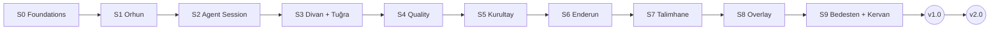

# Atabey Roadmap

> Slices are vertical (engine + GUI together). Each slice has its own spec in `specs/`, frozen before work starts. SemVer follows the phases *(D-033)*.

| Slice | Name | Delivers | Spec | Status |
|---|---|---|---|---|
| **S0** | Foundations | Shell, typed IPC, renderer, themes, Defter, settings/secrets, budget meter, extension host + Ulak v0, CI | [S0-foundations.md](specs/S0-foundations.md) | 🔏 frozen v1.0.0 · 🚧 in progress |
| S1 | Orhun · Codebase Atlas | tree-sitter facts, overview, lazy explanations, LSP "used by", cache | — | ⏳ |
| S2 | Agent Session | ACP native (Claude Code + OpenCode) + Terminal fallback, Jev gate, diffs, checkpoints | — | ⏳ |
| S3 | Divan + Tuğra | Brainstorm Studio, specs, freeze, amendments, Parking Lot, roadmap | — | ⏳ |
| S4 | Quality pipeline | Pipeline Recipes, SARIF analyzers, change narratives | — | ⏳ |
| S5 | Kurultay · Observer Swarm | OpenCode headless observers, cross-exam, judge + Opus escalation | — | ⏳ |
| S6 | Enderun · Mentor | Debriefs, quizzes, FSRS, learner profile + sync, skill trees | — | ⏳ |
| S7 | Talimhane · Practice Ground | Scenarios, apprentice sessions, process grading | — | ⏳ |
| S8 | Feedback overlay | Hotkey + tray, capture, defect/idea routing | — | ⏳ |
| S9 | Bedesten + Kervan | Public registry, dev kit, stack packs, themes, Ulak 1.0 | — | ⏳ |
| 🏁 | **v1.0** | Native GUI (ACP) by default + Terminal layout fallback | | |
| | **v2.0** | More doc types, CD recipes, public Talimhane library, more agents | | |

