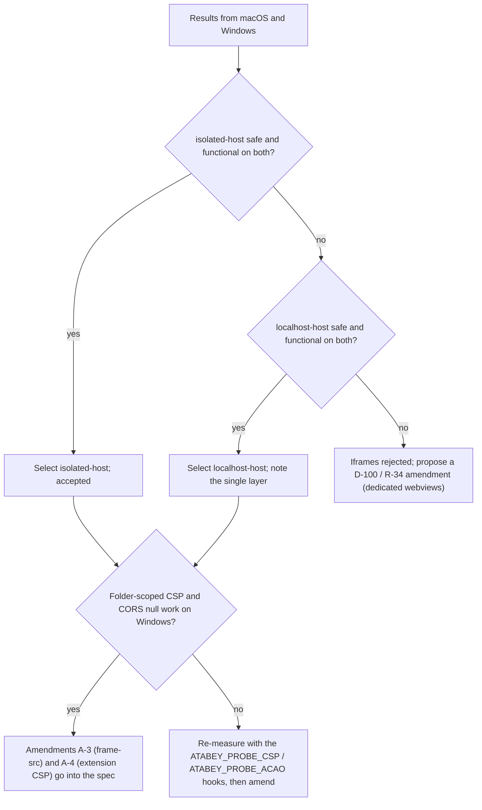

# ADR-0007: Extension UI isolation — sandboxed iframes on `atabey-ext://`

> **Status: proposed.** The macOS column is measured (T-04, 2026-10-12). The Windows column is **pending CI**: the probe runs in the `build` job of `.github/workflows/ci.yml` on `windows-latest`, and its job summary fills the last column. The decision below becomes final only when both columns are in (decision gate at the end).

## Context

R-34 puts extension UIs in `<iframe sandbox="allow-scripts">` served from `atabey-ext://`, and AC-17 requires that such a frame cannot call Atabey's internal API on macOS and Windows. The v0.5 design assumed that an opaque origin makes the frame "not the app". Reading Tauri 2.12.3 and wry 0.57.0 shows that this is not automatically true:

| Finding | Source (vendored crates) |
|---|---|
| Tauri classifies a frame by its **URL**, not by its origin. Every app-registered custom scheme counts as **local**. On macOS the test is the scheme; on Windows the URL must be `http(s)://<scheme>.localhost`, so a host that does not end in `.localhost` is **remote** | `tauri-2.12.3/src/webview/mod.rs:1961` (`is_local_url`) |
| App commands from a local frame skip the ACL; remote frames are denied unless a capability lists them. Plugin commands from a local frame use the capability of the frame's window | `tauri-2.12.3/src/webview/mod.rs:2079` |
| Init scripts (with `__TAURI_INTERNALS__` and the invoke key) are injected into **all sub-frames on Windows**, main frame only on macOS | `wry-0.57.0/src/lib.rs:1029`, `src/webview2/mod.rs:507`, `src/wkwebview/mod.rs:780` |
| The custom-protocol IPC needs a parseable `Origin` header; an opaque origin sends `null`, so the call is refused and the JS falls back to `postMessage`, which is attributed to the **frame URL** | `tauri-2.12.3/src/ipc/protocol.rs:487`, `scripts/ipc-protocol.js`; `wry-0.57.0/src/wkwebview/class/wry_web_view_delegate.rs:50`, `src/webview2/mod.rs:964` |
| Windows has no custom schemes: `atabey-ext://HOST/path` is served as `http://atabey-ext.HOST/path` and mapped back before the handler runs | `wry-0.57.0/src/custom_protocol_workaround.rs` |
| The CSP is read from the runtime config, so a probe build can widen `frame-src` with `Context::config_mut()` | `tauri-2.12.3/src/manager/mod.rs:361` |

So the spec-literal URL `atabey-ext://localhost/…` (on Windows `http://atabey-ext.localhost/…`) is classified as **local** by Tauri on both systems. Tauri's own guidance for untrusted content is a dedicated webview whose capability is bound to its label (GHSA-57fm-592m-34r7).

## Decision (proposed)

Serve extension pages from `atabey-ext://sandbox/<extension id>/…` (Windows: `http://atabey-ext.sandbox/…`) inside `<iframe sandbox="allow-scripts">`, with three header rules (measured, see "What the macOS run found"):

| Header | Value | Why |
|---|---|---|
| `Content-Security-Policy` | `default-src <origin>/<extension id>/` | **Amends §5.12** (`default-src 'self'` does not work, see below). Page can load only its own folder |
| `Access-Control-Allow-Origin` | `null` | Module scripts and `fetch()` from an opaque-origin page are CORS requests |
| `X-Content-Type-Options` / `Cache-Control` | `nosniff` / `no-store` | Module scripts need a JavaScript MIME type; no stale UI |

The host `sandbox` is never `localhost` and never ends in `.localhost` (unit test in `ext_scheme.rs`). On Windows that makes Tauri treat the frame as **remote**, so its commands need a capability that lists the origin, and none does. This is a second layer on top of the sandbox; it is preferred even if `localhost` also turns out to be safe.

The probe stays in CI as the regression guard for every Tauri/wry upgrade (`mise run probe`, T-04; T-24 extends it to the real extension host).

## How the probe works

A build of the real app (production mode, `tauri/custom-protocol`, real CSP, real main window) started with `--isolation-probe`. It embeds the two fixture extensions (`atabey.defter-viewer` declares `defter.query` and `defter.appended`; `atabey.git-pulse` declares nothing), and runs each of these as a sandboxed iframe in turn:

| Variant | iframe URL (macOS · Windows) | Role |
|---|---|---|
| `control` | the main frame itself runs the same attack code | Must **reach** the canary command, which proves the probe can see a breach |
| `localhost-host` | `atabey-ext://localhost/…` · `http://atabey-ext.localhost/…` | Spec-literal, observed, never fails the run |
| `isolated-host` | `atabey-ext://sandbox/…` · `http://atabey-ext.sandbox/…` | Candidate, asserted |

Rust observes independently of what the page claims: calls to the canary command, emissions of a probe-only breach event, and every bridge decision (with the sender taken from `event.source`). Exit code 0 = isolated, 1 = breach or missing functional check, 2 = watchdog (45 s). A sabotage run with `allow-same-origin` added made it exit 1 (storage reachable).

## Results

Cell values: **blocked / rejected / absent** are the safe outcomes; **reached / resolved** means the attack worked. Windows is pending CI.

| Check | control (main frame) | macOS `localhost-host` | macOS `isolated-host` | Windows `localhost-host` | Windows `isolated-host` |
|---|---|---|---|---|---|
| `location.origin` / `window.origin` | `tauri://localhost` | `atabey-ext://localhost` / `null` | `atabey-ext://sandbox` / `null` | pending CI | pending CI |
| `isSecureContext` | true | true | true | pending CI | pending CI |
| `__TAURI__` | absent | absent | absent | pending CI | pending CI |
| `__TAURI_INTERNALS__`, `isTauri`, `window.ipc` | present | absent | absent | pending CI | pending CI |
| `webkit.messageHandlers.ipc` | present | **present** | **present** | n/a | n/a |
| `chrome.webview` | absent | absent | absent | pending CI | pending CI |
| `invoke("probe_canary")` | **resolved** | unavailable | unavailable | pending CI | pending CI |
| `plugin:event\|emit` | **resolved** | unavailable | unavailable | pending CI | pending CI |
| forged `window.ipc` / `chrome.webview` / `webkit` post | rejected (key) | rejected (key) | rejected (key) | pending CI | pending CI |
| forged `fetch` to `ipc://` and `http://ipc.localhost` | rejected | rejected | rejected | pending CI | pending CI |
| `parent.document`, `parent.__TAURI_INTERNALS__` | reached (same window) | blocked | blocked | pending CI | pending CI |
| `top.location` navigation, `window.open` | n/a | blocked | blocked | pending CI | pending CI |
| `localStorage`, `indexedDB`, `document.cookie` | reached | blocked | blocked | pending CI | pending CI |
| fetch `tauri://localhost/index.html` | reached | blocked | blocked | pending CI | pending CI |
| fetch another extension's file | n/a | blocked | blocked | pending CI | pending CI |
| classic script, ES module, stylesheet, `fetch("./file.json")`, postMessage round trip | n/a | ok | ok | pending CI | pending CI |
| bridge: declared command / undeclared command / forged identity | n/a | allowed / denied / denied | allowed / denied / denied | pending CI | pending CI |
| **Rust: canary hits / breach events** | 1 / 1 | 0 / 0 | 0 / 0 | pending CI | pending CI |

(The table is the macOS probe run of 2026-10-12 under the proposed headers; three consecutive runs gave identical results. The full per-check detail strings are in the probe's job summary.)

### What the macOS run found

| # | Finding | Consequence |
|---|---|---|
| 1 | **`default-src 'self'` (spec §5.12) breaks the page.** In the sandboxed document WebKit does not match `'self'`: the HTML loads but its stylesheet, scripts and JSON are never requested | A-4 needed: use a source that names the origin, scoped to the extension folder |
| 2 | `default-src atabey-ext:` works but lets the page read other extensions' files and was replaced by `default-src atabey-ext://sandbox/<id>/`; with the folder-scoped form, fetching another extension's file is blocked | Folder-scoped CSP, generated per request |
| 3 | **CORS is required** for `<script type="module">` and `fetch("./file.json")`: without `Access-Control-Allow-Origin` both fail while classic scripts and stylesheets load. `null` and `*` both worked | `Access-Control-Allow-Origin: null` on every response |
| 4 | `location.origin` reports `atabey-ext://sandbox` even though the document is sandboxed; `window.origin` reports `null` and storage is blocked | Do not use `location.origin` to decide isolation |
| 5 | `isSecureContext` is `true` in the sandboxed frame | Do not rely on secure-context gating |
| 6 | On macOS `webkit.messageHandlers.ipc` **is present in the iframe** (WKWebView registers script message handlers for all frames) but a post is rejected because the iframe has no invoke key (init scripts are main-frame only) | Isolation on macOS rests on the missing key. Keep the forged-post checks in CI |
| 7 | `localhost-host` and `isolated-host` behave identically on macOS | The difference is expected only on Windows (pending CI) |
| 8 | A fetch to `ipc://localhost/…` from the main frame is aborted (does not answer) when the key is forged | None; recorded |
| 9 | `document.cookie = …` is silently ignored in the opaque origin instead of throwing; the probe reads the value back | Probe detail |

## Decision gate (applied after the Windows run)

## Alternatives considered

| Option | Pros | Cons |
|---|---|---|
| Sandboxed iframe, host `sandbox` (proposed) | Cheap; DOM overlays (menus, palette) work over panels; Tauri's own remote-origin denial on Windows is a second layer; regression-guarded in CI | Depends on per-platform Tauri behaviour; macOS isolation rests on the missing invoke key plus the sandbox |
| Sandboxed iframe, host `localhost` (spec-literal) | Matches v0.5 text | Tauri treats it as a local frame on both systems; on Windows it also receives the injected IPC script |
| Dedicated webview per extension (Tauri guidance) | Capabilities bind to webview labels | Needs the `unstable` multi-webview feature; native view sits above the DOM (z-order, layout sync). Fallback if both iframe variants fail |
| Process-level isolation (Electron `<webview>`) | Strongest | Not available in Tauri; same z-order cost |
| No UI isolation (Obsidian) | Simple | No security boundary, contradicts R-34 |

Other tools for context: VS Code serves webviews from a unique `vscode-webview://` origin with `postMessage`; Figma runs plugin UI in a null-origin iframe and plugin logic in a separate JS sandbox.

## Consequences

| Area | Effect |
|---|---|
| T-22 (extension host) | Reuses `ext_scheme.rs` (parse, traversal rejection, headers, URL forms). Serves installed extensions instead of the embedded fixtures. `PanelSlot` has no `Bottom` although §5.10's manifest and R-37 use a bottom panel: fix there |
| T-24 (security E2E) | Replaces the fixtures with the real extension host and asserts AC-17 "and logged" through Defter |
| T-25 | Add the "probe feature is off in release builds" check |
| Spec | Amendment **A-3**: main-window CSP gains `frame-src atabey-ext: <windows form>` for the selected variant. Amendment **A-4**: the §5.12 extension-page CSP row changes from `default-src 'self'` to the folder-scoped form, plus the CORS header. Both are proposals until the Windows run confirms |
| Probe in release | Double gate: cargo feature `isolation-probe` and the `--isolation-probe` flag. `ATABEY_PROBE_CSP` and `ATABEY_PROBE_ACAO` (experiment hooks that replace response headers) exist only in probe builds |
| Reversal | Replace the iframe host with dedicated webviews; the bridge protocol (`postMessage` + `event.source` authentication) carries over |
