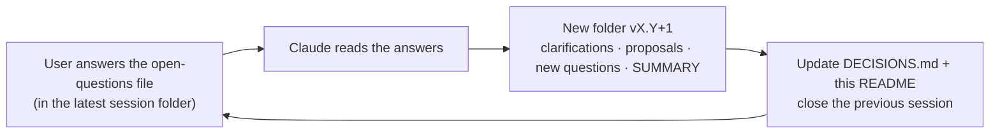

# Atabey Brainstorm

> Brainstorming history for **Atabey** *(the Seljuk guardian-tutor of princes; "Atelier" was dropped in v0.3)*: a Tauri desktop app that explains any codebase in a rich GUI and builds features through spec-driven, multi-agent development, with built-in mentorship and practice.
> **Phase:** brainstorming, final round. No code yet.

## Where we are

| | |
|---|---|
| **Current session** | [v0.4](v0.4/SUMMARY.md) (open): consolidation + native-first |
| **Waiting on** | User's answers in [v0.4/06-OPEN-QUESTIONS.md](v0.4/06-OPEN-QUESTIONS.md) (last brainstorming round) |
| **All decisions** | [DECISIONS.md](DECISIONS.md) |
| **Drafts to review** | [Product Spec](v0.4/04-PRODUCT-SPEC-DRAFT.md) · [Constitution](v0.4/05-CONSTITUTION-DRAFT.md) |
| **Next planned** | v0.5 = **very detailed S0 Foundations technical spec & roadmap**, then implementation |

## 📌 Action items for the user

| Item | Status |
|---|---|
| Put this folder under git ([steps](v0.4/07-ACTION-GIT-INIT.md)): ✅ repo + first commit done; decide whether `outputs/` is versioned or ignored | 🔄 in progress |
| Trademark/domain check of "Atabey" before going public | ⏳ later |
| ~~Email roadmap.sh's founder~~ | ❌ cancelled (v0.3-Q27, D-114) |

## Sessions

| Version | Date | Title | Status |
|---|---|---|---|
| [v0.1](v0.1/SUMMARY.md) | 2026-10-07 | Initial idea, first proposal, first question round | closed |
| [v0.2](v0.2/SUMMARY.md) | 2026-10-07 | Answers processed, clarifications, priorities re-ordered, new pillars | closed |
| [v0.3](v0.3/SUMMARY.md) | 2026-10-07 | New name, extensions, quality pipeline, decision models, Talimhane, build process | closed |
| [v0.4](v0.4/SUMMARY.md) | 2026-10-09 | Claude Code first, native-first v1 over ACP, Ulak messaging, Product Spec + Constitution drafts | open |

## How this folder works

| Rule | Why |
|---|---|
| **One folder per session** (`v0.1`, `v0.2`, …) | Full history; nothing is overwritten |
| **Closed session folders are frozen.** The only exception: the user writes answers into that session's open-questions file | You can always see how ideas evolved |
| **Every session has a `SUMMARY.md`** | New sessions read summaries, not full history (cheaper; avoids context decay) |
| **`DECISIONS.md` is the living truth.** IDs never change; superseded rows stay | Decisions never get lost or contradicted |
| **Numbered files** give the reading order; a session may have several proposal files | |

### Reading order for a fresh session

1. This README
2. [DECISIONS.md](DECISIONS.md)
3. The latest session's `SUMMARY.md`
4. The latest session's open-questions file (and the user's answers in it)
5. Older files **only if needed** for detail

> This folder is the **manual prototype of the Brainstorm Studio** ("Divan", decision D-081). Once the app exists, it will render these files as rich pages and question forms.
