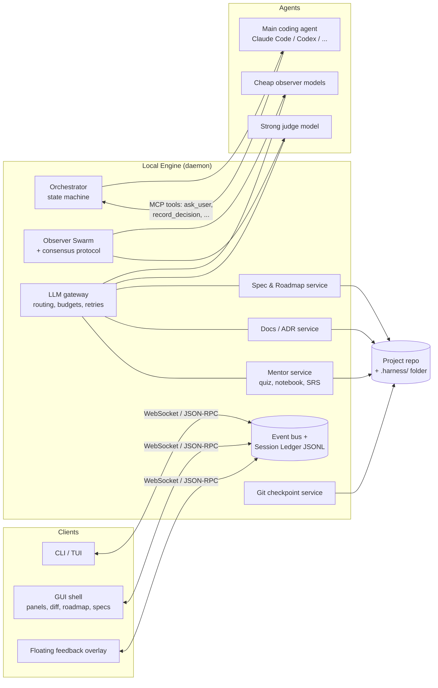
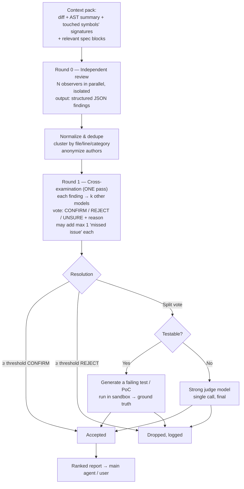

# Project Understanding & Proposal

> **Working title:** *AI-Powered IDE & Multi-Agent Development Harness*
> **Title proposals:** see §8 and Q1 in [02-OPEN-QUESTIONS.md](02-OPEN-QUESTIONS.md).
> **Status:** Draft v0.1. Nothing here is final until the open questions are answered.

---

## 1. What I Understand

You want to build a **desktop development environment** that combines three products:

1. **An IDE / harness shell.** A terminal that can host existing TUI coding agents, plus a GUI control panel, a Git-diff viewer for everything the AI changed, a Markdown viewer/editor, and a floating feedback overlay with screenshots.
2. **A spec-driven, multi-agent engine.** Specs are written and finalized *before* any code. A main coding agent implements them. A **swarm of cheap, fast LLMs** watches the work, cross-examines each other's findings, and reports problems. It sees only diffs and AST summaries, not the full chat.
3. **A mentorship platform.** The AI explains its decisions at two levels (product and engineering), keeps versioned architecture and API/DB/UI docs, quizzes you, and builds a personal study notebook. It does this without breaking your flow; by default it holds the teaching until a **debrief** at the end.

### The pillars at a glance

| # | Pillar | What it is | Core value |
|---|--------|------------|------------|
| P1 | **Shell / UI** | Control panel + center terminal + diff GUI + Markdown + feedback overlay | One place to drive and watch agents |
| P2 | **Spec & Roadmap** | Interactive spec generation, strikethrough editing, spec freeze, visual roadmap | Prevents scope creep; "why" and "what" for every step |
| P3 | **Living Docs** | ADRs, code map, API/DB/UI docs, versioned decisions, refactor proposals | Code you can understand and defend |
| P4 | **Observer Swarm** | Cheap models review → clear context → cross-review → test-backed verdicts | Catches problems the main agent misses |
| P5 | **Mentorship** | Question UI, quizzes, notebook with active recall, Active vs Debrief mode | You learn from the AI's work instead of just accepting it |

### Implicit goals I'm inferring (please confirm in the questions file)

- **You stay in control:** the AI proposes and you decide, especially on specs and refactors.
- **Transparency over magic:** every change is traceable to a spec item, a decision, and a version.
- **Low cost:** expensive models are used sparingly (spec writing, refactor validation); cheap models do the volume work.
- **Extensible:** features live as plugins in separate repos.

---

## 2. Candid Assessment

### What's strong

- **Spec-first plus debrief mode is a real differentiator.** Most AI IDEs optimize for speed. You're optimizing for *understanding and correctness*, which is a less crowded position.
- **Diffs + AST summaries instead of full chat history for observers** is the right instinct. It cuts cost and reduces bias: the reviewers don't inherit the main agent's assumptions.
- **"Clear context, then cross-review"** resembles independent peer review. Separating the finding phase from the judging phase is good design.
- **Debrief Mode as the default** protects flow and still delivers the teaching.

### Where I'd push back

1. **Scope is the #1 risk.** This is about five products. Each pillar could be a startup on its own. Without a strict build order (§7), nothing ships. My strongest recommendation is to **build the headless engine first and add GUIs later.**
2. **"The more models, the better" is usually false for reviewers.** Cheap models tend to make the *same* mistakes, and each extra reviewer adds false positives. False positives cause alert fatigue, which works against your flow-state goal. **3–5 diverse models plus test-based verification** will beat 10 similar ones. Track each model's precision and weight its votes by it.
3. **"Specs must be perfectly finalized" conflicts with reality.** Implementation always uncovers things the spec missed. I recommend **freeze + formal amendments**: a frozen spec can only change through a versioned, user-approved amendment. That keeps the anti-scope-creep discipline without blocking the work.
4. **Don't build your own coding agent first.** Wrap existing agents (Claude Code, Codex CLI, Gemini CLI, OpenCode, etc.) through their programmatic interfaces. Your value is the **orchestration, spec, docs, swarm and mentorship layers**, not another edit loop. You can add your own agent later as just another backend.
5. **Forking VS Code is a big ongoing cost.** Companies that fork it have dedicated teams to keep up with upstream. See §4.2.
6. **Model names in your notes are out of date.** "Claude 3.5 Sonnet / Opus" should become the current Claude 5 family (e.g., Opus 5.5) for spec and refactor validation. Make model choice a **config value per role** rather than hard-coding it.

---

## 3. Proposed Architecture

### 3.1 Core principle: headless engine, GUI is just a client

Everything is driven by a **local engine (daemon)** that exposes an event stream and commands. The CLI, a VS Code extension, a standalone app, and the floating overlay are all **clients** of the same engine. You get:

- A usable TUI/CLI from week one (matches your "start TUI/CLI-based" plan).
- Freedom to change the GUI technology later without rewriting logic.
- Plugins that talk to the engine, not to a specific UI.



### 3.2 The Session Ledger (the shared backbone)

Every action is appended to a session event log (JSONL): agent messages, tool calls, file edits, questions asked, answers given, decisions, observer findings, costs. **Almost every feature you described is a *view* over this ledger:**

| Feature | Derived from |
|---|---|
| Git-diff history GUI | Checkpoint commits + ledger events |
| "Why did it do this?" | Decision events linked to diffs |
| Versioned architectural decisions | ADR events, tagged with versions |
| Debrief quiz | Decisions + diffs from the session |
| Observer input | Diffs + AST summaries for the turn |
| Cost dashboard | Token/cost events |

### 3.3 Everything lives in the repo (`.harness/`)

```
.harness/
  specs/          # spec-001-auth.md (block IDs, status: draft|frozen|amended)
  amendments/     # spec change requests + approvals
  roadmap.yaml    # phases → sub-phases → tasks, linked to spec block IDs
  adr/            # Architecture Decision Records (one per decision, versioned)
  docs/           # generated: code-map, api, db, ui-ux
  findings/       # observer swarm reports per checkpoint
  notebook/       # mentorship cards (Markdown, hidden answers)
  sessions/       # ledgers (gitignored or summarized)
  config.yaml     # model roles, budgets, modes, plugins
```

The files are plain text and Git-friendly. Agents can read them, humans can review them in PRs, and nothing is locked into a database.

### 3.4 Git checkpointing

- Each agent session runs on its **own branch or `git worktree`**.
- The engine makes a **checkpoint commit after every agent turn** (or every file-write batch). The diff GUI is then just a viewer over real Git history, so you can rewind, compare, or cherry-pick.
- Squash the checkpoints when a task is accepted.

---

## 4. Answers to Your Technical Questions

### 4.1 GUI-to-TUI input stream: "How easy is it?"

**Short answer:** writing keystrokes into a terminal is easy. Doing it *reliably* is hard, because the GUI can't see what state the TUI is in (whether it's waiting for input, which prompt is focused, or what a menu shows). So **don't make the terminal the integration point.** Use it only as a fallback.

There are three layers, from best to fallback:

| Layer | How it works | Reliability | Use for |
|---|---|---|---|
| **A. Programmatic agent protocol** ⭐ | Run the agent through its SDK or protocol instead of its TUI: e.g., **Claude Agent SDK**, Claude Code headless mode (`--input-format stream-json --output-format stream-json`), or **ACP (Agent Client Protocol)**, which several agents support natively or via adapters. You send structured messages and get structured events back. | High | Main integration |
| **B. MCP "question" tools** ⭐ | The engine exposes MCP tools like `ask_user(question, options[])`, `request_spec_review(spec_id)`, `record_decision(...)`. When the agent calls one, the GUI renders your multiple-choice UI and **the tool result is your answer**. No typing into a terminal. (The Claude Agent SDK also lets you intercept its built-in question tool and render your own UI.) | High | Questions, spec Q&A, approvals |
| **C. PTY injection** (fallback) | The engine owns the pseudo-terminal (`node-pty` / Rust `portable-pty`), renders it in `xterm.js`, and writes text into it. Use **bracketed paste** (`ESC[200~ … ESC[201~`) so multi-line answers aren't sent early. Optionally parse the screen with a headless terminal emulator to detect "waiting for input". | Low–Medium | Arbitrary third-party TUIs with no API |

**Recommendation:** the center terminal *displays* a live agent session, but the GUI's buttons talk to the engine (layers A and B). For a strikethrough edit, the engine sends a **structured annotation payload** to the agent, e.g.:

```json
{ "type": "spec_annotation", "spec": "spec-003", "block": "s3.2",
  "action": "strike", "instruction": "Use passkeys instead of SMS OTP; SMS is out of scope." }
```

This is more robust than pasting prose, and it's recorded in the ledger.

### 4.2 VS Code fork vs. Tauri / Electron / Qt

| Option | Effort | Gives you for free | Downsides | Verdict |
|---|---|---|---|---|
| **VS Code extension** (+ webviews) | Low | Editor, terminal, **diff editor**, **Markdown preview**, Git, file tree, extension marketplace | Layout constraints; less control over "look & feel"; webview UIs are sandboxed | ⭐ **Best first GUI** |
| **Fork VS Code / Code-OSS** | Very high | Total control of the IDE | You must keep merging upstream forever; huge codebase; marketplace licensing limits (forks use Open VSX) | ⚠ Only if you're well funded and the extension API truly blocks you |
| **Eclipse Theia** | Medium-High | VS Code-compatible framework designed to be *built on* rather than forked | Smaller community; more assembly work | Good middle ground if you need a branded IDE |
| **Tauri** (Rust + web UI) | Medium | Small binary, low RAM, native window control (overlay, always-on-top, content protection) | You build editor/diff/terminal yourself (Monaco + xterm.js + diff libraries make this manageable) | ⭐ **Best for a standalone "cockpit"** app later |
| **Electron** | Medium | Node ecosystem (`node-pty` works directly), mature `desktopCapturer` | Heavy RAM/binary | Fine; pick it over Tauri if your team is Node-only |
| **Qt** | High | Native performance | Slow UI iteration, no web ecosystem, poor fit for Markdown/diff/webview-heavy UI | ✗ Not recommended |

**Recommendation:** you don't need to replace the editor. Your product is the **cockpit** around the agents. So:

1. **Phase 1:** engine + CLI.
2. **Phase 2:** **VS Code extension** for specs, roadmap, findings, notebook (webviews), reusing VS Code's diff, Markdown and terminal.
3. **Later:** a **Tauri cockpit app** (terminal center, control panel left, as you described) for users who don't live in VS Code, plus the floating overlay. Both connect to the same engine.

Your described layout (control panel left, terminal center/right) maps naturally to a Tauri app. In a VS Code extension it's a sidebar plus an editor-area terminal, which is close enough for v1.

### 4.3 Multi-agent consensus loop without infinite loops

**Key idea: make it a fixed pipeline (a DAG), not an open conversation.** Infinite loops happen when agents are allowed to keep replying to each other. Give every phase a fixed number of steps and a budget.



**Termination guarantees:**

1. **Fixed rounds:** Round 0 and Round 1 only. "Missed issues" added in Round 1 get exactly one verification pass and can't spawn more.
2. **Findings are immutable records with IDs and fingerprints** (hash of file, symbol, category, normalized claim). An agent can't keep re-raising the same thing in new words.
3. **Budget circuit breaker:** per-review token and cost caps plus a wall-clock timeout. If a cap is hit, report what's known so far, marked *partial*.
4. **Tests decide disputes, not debate.** When models disagree on something checkable, a sandboxed test settles it.
5. **The fix→review cycle is bounded:** after the main agent fixes a finding, only the *changed hunks* are re-reviewed. If the **same fingerprint reappears after N (2) fix attempts**, escalate to you; don't loop.
6. **Observers are advisory:** they never edit code. Only the main agent acts, and only you can override a blocking finding.
7. **Reputation weighting:** keep each model's historical precision (confirmed vs. dropped findings) and weight its votes by it. Bad models get quieter automatically.

**Structured finding schema (sketch):**

```json
{ "id": "F-0142", "fingerprint": "sha1(...)", "model": "anon-3",
  "file": "src/auth/session.ts", "lines": [41, 58], "symbol": "refreshToken",
  "category": "security|correctness|performance|style|spec-mismatch",
  "severity": "low|medium|high|critical", "confidence": 0.0,
  "claim": "...", "evidence": "...", "suggested_test": "..." }
```

**About observers creating "mock test scenarios to prove a vulnerability":** this means running AI-generated code. It **must** run in a sandbox (container or VM, no network, no secrets mounted). Plan this from day one.

**Diff + AST is necessary but not sufficient.** A diff alone hides context: a changed function may break a caller the reviewer can't see. Build a **context pack**: the diff, an AST summary (tree-sitter), signatures of the callers and callees of changed symbols, related types, and the spec blocks the task implements. It stays small but gives reviewers enough context.

### 4.4 Screenshot tool that excludes your own UI (without heavy native code)

| Approach | How | Native code | Notes |
|---|---|---|---|
| **1. Hide → capture → show** ⭐ | Overlay hides itself (or sets opacity 0), waits ~100–200 ms for the compositor, captures the screen, then reappears | None beyond a capture library | Works on all OSes. Electron: `desktopCapturer`. Tauri: e.g. the `xcap` crate. macOS CLI: `screencapture -x` |
| **2. "Capture first, crop later" snipping** ⭐ | Take a full-screen capture (via #1), then show it **frozen** in a fullscreen borderless window where the user drags a rectangle. Crop in JS (canvas) | None | This is how most snipping tools work. You get your own consistent snip UI on every OS |
| **3. Window content protection** | Electron `win.setContentProtection(true)` / Tauri `set_content_protected(true)` → OS excludes the window from captures (Windows: `WDA_EXCLUDEFROMCAPTURE`; macOS: window sharing type "none") | None (flag only) | Elegant, but **verify on current macOS**: newer capture APIs may not honor it consistently. Side effect: users can't screen-share your overlay |
| **4. Delegate to the OS** | macOS `screencapture -i` (interactive region), Windows `ms-screenclip:` then read the clipboard, Linux `grim`+`slurp` / `gnome-screenshot -a` | None | Fastest MVP, but the UX differs per OS |
| **5. App-aware capture** (bonus) | If the bug is in a **web app you're building**, capture via Playwright/CDP: screenshot + DOM snapshot + console errors + network failures | None | **Far more useful to an AI agent than pixels alone** |

**Recommendation:** use #1 + #2 for the general tool, add #3 as an enhancement where it works, and add #5 when the project under development is a web app. Attach the result to the report and drop it into `.harness/` as a backlog item linked to the roadmap.

### 4.5 Biggest technical bottlenecks (ranked)

1. **Scope.** Five products in one. *Mitigation:* the build order in §7; the engine first.
2. **TUI opacity.** You can't reliably drive TUIs by screen-scraping. *Mitigation:* SDK/ACP plus MCP tools (§4.1).
3. **Swarm signal-to-noise.** False positives destroy trust and flow. *Mitigation:* structured findings, cross-voting, tests as arbiter, reputation weighting, severity thresholds for what interrupts you.
4. **Cost and latency.** Many models on every change add up. *Mitigation:* run the swarm per checkpoint or task, not per keystroke; run it async; cap budgets; cache context packs.
5. **Doc drift and doc cost.** LLM-written docs go stale and can hallucinate. *Mitigation:* generate docs from **facts** (AST, DB schema introspection, OpenAPI extracted from code) plus **rationale** (ADRs written when the decision is made). Regenerate only the parts affected by changed files.
6. **Provider heterogeneity.** GLM, Qwen, DeepSeek, Claude, etc. differ in APIs, rate limits and reliability. *Mitigation:* one LLM gateway (OpenRouter, LiteLLM, or Vercel AI SDK) with retries, fallbacks and per-role routing.
7. **Security.** Agents run shell commands, and observers run PoC code. *Mitigation:* sandboxing, a permission model, no secrets in agent-visible env, and a network allowlist.
8. **Proving the swarm helps.** Without measurement it's a cost center. *Mitigation:* a small **seeded-bug benchmark** (repos with known injected bugs) to measure recall, precision and cost per model mix.
9. **IDE maintenance** if you fork VS Code. *Mitigation:* don't fork (§4.2).

---

## 5. Per-Pillar Proposals

### P2: Spec-Driven Development & Roadmap

**Spec lifecycle (state machine):**

```
DRAFT ──(AI generates + asks questions)──► IN_REVIEW ──(user annotates: strike / instruct / approve)──►
  REVISING ──► IN_REVIEW ... ──(user clicks "Freeze")──► FROZEN v1.0
FROZEN ──(agent hits infeasibility or user requests change)──► AMENDMENT_PROPOSED ──(user approves)──► FROZEN v1.1
```

- **Stable block IDs** in spec Markdown (e.g., `## 3.2 Session refresh {#s3.2}` or HTML comments) so annotations and roadmap links survive regeneration.
- **Strikethrough UI:** selecting text → "Strike & instruct" → stored as a structured annotation (see §4.1), rendered as ~~strikethrough~~ + an instruction callout.
- **Spec format sections (proposal):** Goal · Non-goals · Users & scenarios · Functional requirements (IDed) · Non-functional reqs · Acceptance criteria (testable, IDed) · Data model sketch · Open risks · Out-of-scope list (explicitly fights scope creep).
- **Model roles:** strongest model writes and revises the spec; cheaper models check the spec for ambiguity ("spec linting") before you see it.

**Roadmap:**

- `roadmap.yaml`: Phase → Sub-phase → Task. Each task holds `spec_refs`, `acceptance_criteria`, `why`, `what`, `deductions`, `status`, `adr_refs`, `checkpoints`.
- The GUI renders it as a collapsible timeline or tree. Clicking a node shows the why/what/deductions plus the linked diffs, findings and ADRs.
- New ideas that come up mid-implementation go to a **Parking Lot**, not into the current phase. That keeps the spec's scope intact.

### P3: Thought Process & Living Documentation

| Doc type | Source of truth | Generated by | When |
|---|---|---|---|
| **ADRs** (decisions + why) | Main agent at decision time, via a `record_decision` MCP tool | Main agent (it already has the context, so it's cheap) | Live |
| **Code map** (files, classes, methods, purpose) | AST (tree-sitter) + docstrings | Cheap doc model, incremental per changed file | Per checkpoint |
| **High-level feature docs** (inputs/outputs) | Spec + acceptance criteria + code map | Mid-tier model | Per task completion |
| **Low-level engineering docs** (patterns, responsibilities) | ADRs + code map | Mid-tier model | Per task completion |
| **API docs** (+ edge cases, examples) | OpenAPI extracted from code where possible + tests | Model adds edge cases and examples | Per task completion |
| **DB docs** (why this DB, tables, purposes) | Schema introspection / migrations + ADRs | Model writes the rationale | On schema change |
| **UI/UX docs** | ADRs tagged `ui` + screenshots | Model | Per UI task |
| **Version notes** | ADRs + roadmap phase per version tag | Model | On version bump |

**Refactoring gate:** for a refactor proposal, the agent writes a *Refactor Proposal* (motivation, plan, risk, blast radius). If the estimated blast radius exceeds a threshold, the strong model validates it before you approve. Execution happens on a separate checkpoint branch.

### P4: Multi-Agent & Observer Swarm

- **Main agent:** wrapped external agent via SDK/ACP (see Q5).
- **Sub-agents** for parallel work (docs writer, test writer) as separate engine workers, not as extra chat inside the main agent's context.
- **Observers:** 3–5 diverse cheap models via a gateway, protocol as in §4.3.
- **Plugin model:** each plugin is a separate repo exposing an **MCP server** (for agent-facing tools) and optionally a **UI contribution manifest** (panels, commands) for the GUI. Because MCP is a standard, plugins also work with other agents.

### P5: Learning & Mentorship

- **Interrupt budget:** questions have a priority. *Blocking* questions (agent can't proceed) appear immediately. *Non-blocking* ones (educational, nice-to-know) are queued for the debrief. In Active Mode the budget is higher; in Debrief Mode only blocking questions interrupt.
- **Debrief session:** generated from the session's ADRs and diffs. A guided code review, then a quiz (multiple choice + "why do you think…?"), then "similar solution for a different edge case" examples.
- **Grading open answers:** a model grades your free-text "why" answers against the ADR rationale and gives feedback, not just a score.
- **Notebook:** Markdown cards in `.harness/notebook/` with hidden answers (`<details>`), tagged by topic. Scheduled with a spaced-repetition algorithm (e.g., FSRS or SM-2) for active recall.
- **Modes:** Active (step-by-step, waits at roadmap checkpoints), Debrief (recommended default), and possibly **Silent** (no teaching at all, for experienced users or deadline days).

---

## 6. Suggested Tech Stack (v1)

| Layer | Recommendation | Why |
|---|---|---|
| Engine language | **TypeScript (Node or Bun)** | Same language as the VS Code extension, `xterm.js`, `node-pty`, MCP SDK, Claude Agent SDK and tree-sitter bindings. One language end to end |
| Agent integration | Claude Agent SDK + ACP + MCP | Structured control instead of scraping TUIs |
| LLM gateway | OpenRouter or LiteLLM (or Vercel AI SDK in-process) | One API for GLM / Qwen / DeepSeek / Claude, with retries and fallbacks |
| Code analysis | tree-sitter | Fast, multi-language AST summaries |
| Storage | Files in `.harness/` + SQLite for indexes and costs | Git-friendly; SQLite for queries |
| Sandbox | Docker/Podman container (or OS sandbox) | For observer PoCs and agent shell commands |
| GUI v1 | VS Code extension (webviews in React or Svelte) | Free diff, Markdown, terminal and editor |
| GUI v2 | Tauri + Monaco + xterm.js | Standalone cockpit + overlay |

(Rust becomes attractive later for the Tauri side and for sandboxing. The engine can stay in TypeScript.)

---

## 7. Proposed Build Order (MVP first)

| Phase | Deliverable | Proves |
|---|---|---|
| **0. Engine skeleton** | Daemon + CLI; wraps one agent via SDK; session ledger; checkpoint commits; `.harness/` layout; LLM gateway with budgets | You can drive and record an agent without scraping a TUI |
| **1. Spec workflow** | Spec generation, `ask_user` MCP tool, annotations (strike + instruct), freeze/amend, `roadmap.yaml`. Minimal VS Code webview | Pillar P2 |
| **2. Observer swarm v1** | 3 models, Round 0 + Round 1, dedupe, findings panel, sandboxed test arbitration, **seeded-bug benchmark** | P4 delivers value at acceptable cost |
| **3. Living docs** | ADR tool, code map, API/DB docs, versions | P3 |
| **4. Mentorship** | Debrief mode, quiz, notebook + SRS | P5 |
| **5. Feedback overlay** | Floating capture tool (hide-capture-crop), routing to Parking Lot/backlog | P1 overlay |
| **6. Cockpit & ecosystem** | Tauri app, plugin manifest, ACP multi-agent support, Active mode polish | Product breadth |

---

## 8. Title Proposals

| Name | Angle | Note |
|---|---|---|
| **Atelier** ⭐ | A workshop where a master builds *and* teaches apprentices; fits spec + swarm + mentorship | Check trademark and domain availability |
| **Conclave** | The swarm deliberating | Strong for the multi-agent angle, weak for mentorship |
| **Specwright** | Spec-first craftsmanship | Clear but narrower (spec only) |
| **Apprentice** | Mentorship-first | Sounds junior-oriented |
| **Harness** | Your current folder name; literal | Generic, hard to search for |

Suggested tagline: ***"A spec-driven, multi-agent IDE that teaches while it builds."***
(All names need a trademark and domain check before you commit.)

---

## 9. Next Step

Answer the questions in **[02-OPEN-QUESTIONS.md](02-OPEN-QUESTIONS.md)**. You can pick an option, write a custom answer, or ask me to clarify any question. I'll then turn this into a frozen **v1.0 spec** and a concrete Phase 0 task breakdown.
