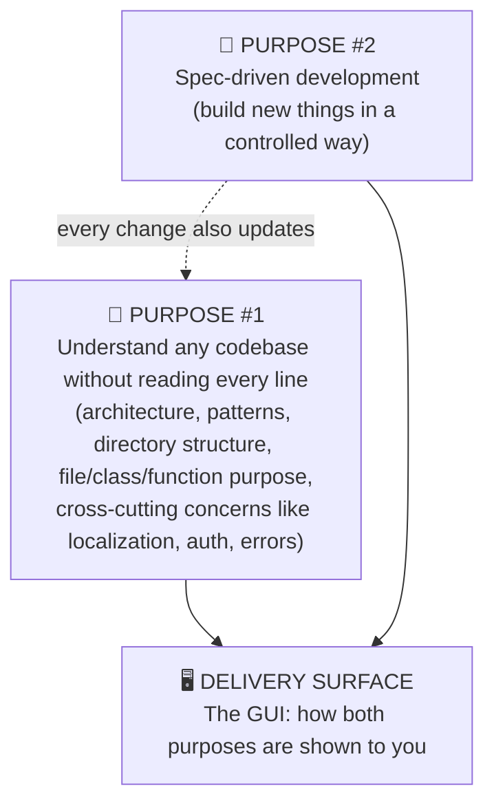
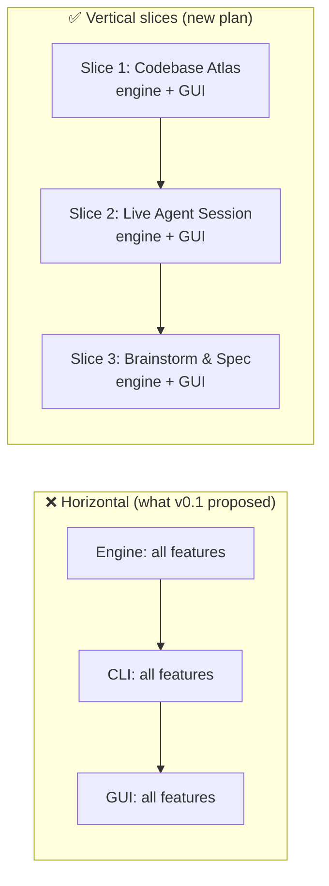
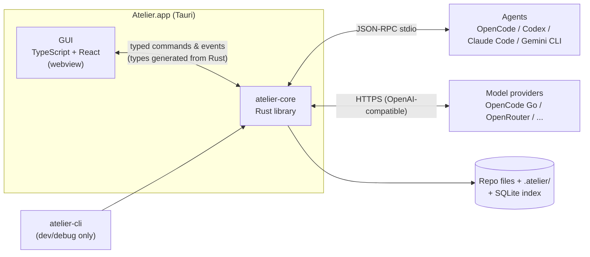
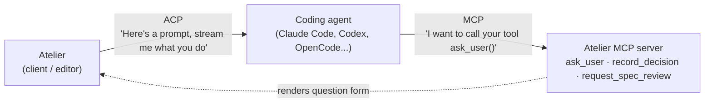
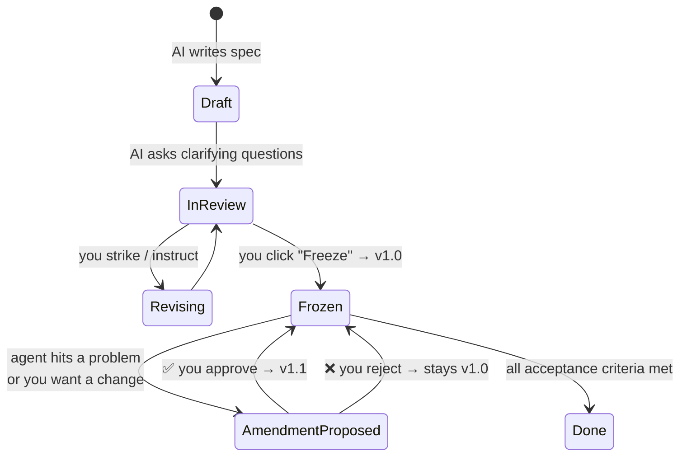
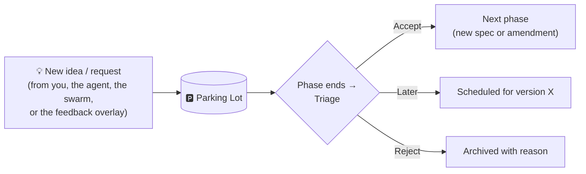
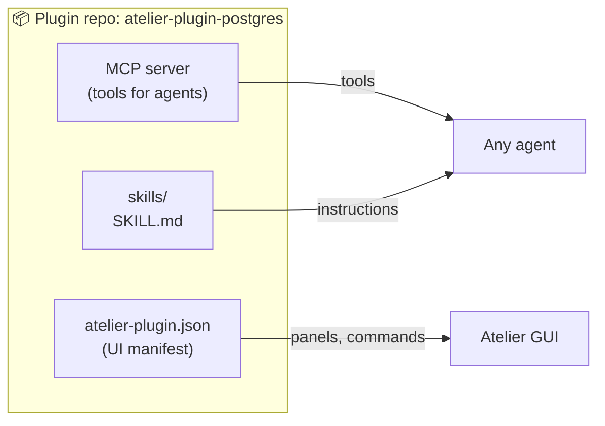

# Clarifications for Your v0.1 Answers

Each section answers a `❓ Clarify` (or a custom answer that needed a reply) from [v0.1/02-OPEN-QUESTIONS.md](../v0.1/02-OPEN-QUESTIONS.md). Each one follows the same layout:

> **Short answer** → **How it works** → **What other tools do** (with pros and cons) → **My recommendation** → **Status**

Status meanings: ✅ **Decided** (your answer stands) · 🔁 **Re-confirm** (a follow-up question is in [03-OPEN-QUESTIONS.md](03-OPEN-QUESTIONS.md)).

> ⚠️ Facts about pricing, terms of service and protocol support change often. The ones below were checked on **2026-10-07** (sources at the end). Re-check them before building on them.

---

## Contents

1. [Q1: Is "Atelier" legally safe?](#q1-is-atelier-legally-safe)
2. [Q4: Untangling your priorities](#q4-untangling-your-priorities)
3. [Q6 + Q30: GUI and engine "head to head"](#q6--q30-gui-and-engine-head-to-head)
4. [Q7: Rust vs TypeScript for the engine](#q7-rust-vs-typescript-for-the-engine)
5. [Q8: Cross-platform (macOS + Windows)](#q8-cross-platform-macos--windows)
6. [Q9: SDK vs protocol vs terminal, and what each agent offers](#q9-sdk-vs-protocol-vs-terminal-and-what-each-agent-offers)
7. [Q10: Files vs database](#q10-files-vs-database)
8. [Q12: What "freeze + amendments" means](#q12-what-freeze--amendments-means)
9. [Q14 + Q26: What a Parking Lot is](#q14--q26-what-a-parking-lot-is)
10. [Q16 + Q19: Providers, ban risk and your budget](#q16--q19-providers-ban-risk-and-your-budget)
11. [Q22: The mentorship modes explained](#q22-the-mentorship-modes-explained)
12. [Q28: How plugins work](#q28-how-plugins-work)
13. [Sources](#sources)

---

## Q1: Is "Atelier" legally safe?

**Short answer:** I can't guarantee that, and I'm not a lawyer. I did find one real conflict in your exact field.

- Product names are protected by **trademark**, not copyright. A trademark conflict depends on whether the names are similar **and** the products are in the same category.
- **InterSystems Atelier** was the official IDE for InterSystems' data platform (an Eclipse plug-in). It is now **deprecated**, but it's an IDE named Atelier, which is the riskiest kind of overlap. A deprecated product's trademark registration can still be active.
- There are almost certainly other "Atelier" software products. The word is common.

**Practical risk by usage:**

| How you use the name | Risk |
|---|---|
| Personal tool on your machine | Practically none |
| Public open-source repo, no money | Low, but a rename later would be painful |
| Commercial product / paid tier | Needs a real trademark search (ideally a lawyer) |

**What to do before you go public:** search the USPTO trademark database, EUIPO TMview and the WIPO Global Brand Database in the software class, and check the GitHub org, npm/crates.io package names and domains.

**My recommendation:** use **"Atelier" as the codename** now. Every name in the code goes in one config constant so a rename is cheap. Pick the public name before you share it widely.

**Status:** 🔁 Re-confirm (Q1 in the new questions).

---

## Q4: Untangling your priorities

You said: *"The #1 purpose is understanding the code without reading every line… secondary is spec-driven development… but I also need to view everything in a GUI, so I'm confused about my priorities."*

**Short answer:** these aren't three competing priorities. They're three layers of one product:

- The **GUI isn't a separate feature to prioritize.** It's the screen where purposes #1 and #2 appear. Every slice we build includes its GUI (see the next section).
- **Purpose #1 comes first** because it works on **any existing repo**, even code you didn't write in Atelier. It also gives you value from day one without any agent wrapping.
- **Purpose #2 then keeps #1 up to date.** When an agent builds a feature from a spec, the explanations and decisions get recorded automatically.

**What other tools do (code understanding):**

| Tool | Approach | Pros | Cons |
|---|---|---|---|
| **DeepWiki** (Cognition) | Auto-generates a wiki for a GitHub repo, with diagrams | Instant overview of any public repo | Web-only, generic, no "why" behind decisions, not tied to your workflow |
| **Google Code Wiki** | Similar auto-generated, continuously updated repo wiki | Stays fresh | Same limitations; cloud-hosted |
| **Swimm** | Docs coupled to code snippets that are kept in sync | Docs don't silently go stale | Mostly human-written; enterprise-oriented |
| **Claude Code `/init`, Codex `AGENTS.md`** | One summary file for the *agent's* benefit | Cheap, simple | Written for the AI, not for you; one flat file |
| **Sourcegraph / Cody, Cursor "ask the codebase"** | Chat over the code | Answers specific questions | You must know what to ask; nothing persistent or browsable |

**Atelier's gap to fill:** a **browsable, layered, GUI-rendered explanation** (the "Codebase Atlas": overview → modules → files → classes → functions, plus pages for cross-cutting concerns) that **also records the *why*** (ADRs) as code is written.

**Status:** ✅ Decided. **Purpose #1 = Codebase understanding, rendered in the GUI.** The build order changes accordingly (see [02-UPDATED-PROPOSAL.md](02-UPDATED-PROPOSAL.md)).

---

## Q6 + Q30: GUI and engine "head to head"

You said the GUI is a main purpose too, and you don't want "finish the CLI, then start the GUI".

**Short answer:** agreed. We'll build in **vertical slices**: each feature is built end to end (engine logic + GUI screen) before the next one starts. No CLI-only phase.

How this fits Tauri:

- The **engine is a library** (`atelier-core`) that the Tauri app loads directly. The GUI calls it through typed commands.
- A tiny **CLI** (`atelier-cli`) uses the same library, but **only as a developer/debug tool** for testing engine logic without clicking. It's not a product phase.

**Your future vision: "pure GUI, with the two-pane layout as a backup".** It becomes two **session modes** per agent:

| Mode | What you see | How it's connected | When used |
|---|---|---|---|
| **Native mode** (default when available) | Pure GUI: chat bubbles, rendered plans, diffs, question forms, no terminal | Structured protocol (ACP / vendor protocol) | Normal use |
| **Terminal mode** (fallback) | Left: Atelier panels · Right: real terminal running the vendor's own TUI | Embedded terminal (PTY) + official hooks + MCP tools | When a vendor changes something and native integration breaks, or for agents with no protocol |

**What other tools do (GUI over agents):**

| Tool | Approach | Pros | Cons |
|---|---|---|---|
| **Cursor, Windsurf, Kiro** | Fork VS Code, agent built in | Full IDE | Huge fork maintenance; locked to their own agent |
| **Zed** | Custom Rust GPU UI; agent panel connects to *external* agents via **ACP** (Zed created ACP) | Fast; any ACP agent works | Building a custom UI toolkit is a huge effort (Atelier avoids this by using a webview) |
| **Codex app / VS Code extension** | GUI over `codex app-server` (JSON-RPC) | Official, rich events | Codex only |
| **Claude desktop app (Code tab)** | GUI over Claude Code | Polished | Claude only |
| **Conductor-style apps** | macOS GUI running several Claude Code/Codex agents in parallel git worktrees | Very close to your idea | Narrow focus (parallel agents); no docs or mentorship |
| **Warp** | Terminal-first app with built-in agent | Great terminal | Terminal-centric, the opposite of "pure GUI" |

**Status:** ✅ Decided. Tauri app, vertical slices, Native + Terminal modes.

---

## Q7: Rust vs TypeScript for the engine

You said: *"I want a fast application, but it's mostly I/O and model speed is the bottleneck… Codex uses Rust… gives me vibes to pick Rust for the engine but TypeScript for the GUI."*

**Short answer:** your instinct is right, though **not because of speed**. You're correct that the model is the bottleneck: a model reply takes seconds, while TypeScript vs Rust overhead is milliseconds. The real reasons to choose Rust are:

1. **Tauri's backend is Rust anyway.** A TypeScript engine in a Tauri app has to run as a separate bundled Node/Bun process (a "sidecar"). That's two runtimes, a bigger download and an extra process to manage. With Rust, the engine lives inside the app.
2. **The heavy local work is best in Rust:** parsing code with **tree-sitter** (it's C/Rust natively), **git** (gitoxide / git2), **terminals** (`portable-pty`, which handles Windows ConPTY), **file watching** (`notify`), **screen capture** (`xcap`), **SQLite** (`rusqlite`). These are mature, cross-platform and don't need native Node module builds (`node-pty` builds are a known source of Windows pain).
3. **Type safety (your stated value):** Rust's type system is stricter than TypeScript's (no `any`, no `null` surprises, exhaustive `match`). Rust types can also be **exported to TypeScript automatically** (`specta` / `tauri-specta` / `ts-rs`), so the GUI and engine share **one source of truth for types**. Change a struct in Rust and the TypeScript build breaks where it needs updating.
4. **AI writes the code anyway:** the Rust compiler is strict, so mistakes in AI-written code get caught at compile time rather than at runtime. That's a real advantage when you aren't reading every line.
5. **Agent integrations don't care about language.** Codex app-server, ACP and MCP are all **JSON-RPC over stdin/stdout**. Rust can talk to them as easily as TypeScript.

**The honest downsides of Rust:**

| Downside | How much it matters here | Mitigation |
|---|---|---|
| Slower to iterate (compile times, borrow checker) | Medium | Keep the core modular; UI changes are TypeScript with hot reload |
| **No official Claude Agent SDK for Rust** (it's TS/Python only) | Low–Medium | Use Claude Code via ACP (the adapter is a separate process anyway) or Terminal mode + hooks |
| Fewer LLM client libraries than TS/Python | Low | Almost every provider (OpenRouter, OpenCode Go, DeepSeek, etc.) speaks the **OpenAI-compatible HTTP API**, so a thin client covers all of them |
| Harder for *you* to read the engine code | Medium | That's exactly what Atelier's Codebase Atlas is for. Atelier explaining itself is the first test |

**What other tools use:**

| Tool | Engine language | Why (as stated or evident) |
|---|---|---|
| **Codex CLI** | **Rust** (rewritten from TypeScript) | Standalone binary with no Node dependency, OS-level sandbox APIs, efficiency |
| **Zed** | Rust | Performance, custom GPU UI |
| **Goose** (Block) | Rust core + Electron desktop UI | Same split you're considering |
| **Warp** | Rust | Terminal performance |
| **Claude Code** | TypeScript (bundled with Bun into a native binary) | "On-distribution" for the model, fast iteration, npm ecosystem |
| **Gemini CLI** | TypeScript | npm distribution, fast iteration |
| **OpenCode** | TypeScript (Bun) | Fast iteration; client/server design |

The pattern: **products that ship a standalone desktop/native binary and touch the OS a lot lean to Rust. CLIs that iterate fast and live in npm lean to TypeScript.** Atelier is a desktop app that touches the OS heavily (terminals, screenshots, git, file watching, sandboxing), so it sits on the Rust side.

**My recommendation:** **Rust core + TypeScript/React GUI**, with types generated from Rust into TypeScript.

**Status:** 🔁 Re-confirm (Q2 in the new questions).

---

## Q8: Cross-platform (macOS + Windows)

**Short answer:** Tauri is cross-platform (macOS, Windows, Linux) from one codebase. Plan **macOS-first, Windows-tested from the start**.

Things that differ per OS, and how we handle them:

| Concern | macOS | Windows | Handling |
|---|---|---|---|
| Webview engine | WKWebView (Safari engine) | WebView2 (Edge/Chromium) | Test both. CSS and JS features can differ slightly |
| Terminal | Unix PTY | ConPTY | `portable-pty` abstracts both |
| Screenshot | Needs the user's *Screen Recording* permission | No prompt | `xcap` crate + permission onboarding screen on macOS |
| Sandbox for observer tests | Docker Desktop / Podman / OrbStack | Docker Desktop / Podman (WSL2) | Same container image on both |
| Global hotkey for the overlay | Supported | Supported | Tauri global-shortcut plugin |
| Paths, line endings | `/`, LF | `\`, CRLF | Normalize in the core |

**What others do:** Codex CLI supported macOS/Linux first and added Windows later (natively and via WSL). Claude Code supports macOS, Linux and Windows. Zed was macOS-only for a long time and added Linux and Windows later. **Lesson:** adding Windows late is painful. Building on both platforms in CI from day one is cheap.

**Status:** ✅ Decided. macOS primary, Windows supported from v1, Linux best-effort. (Q18 in the new questions asks *when* Windows builds start.)

---

## Q9: SDK vs protocol vs terminal, and what each agent offers

**Short answer:** an **SDK** is a library you import into your own code. A **protocol** is an agreed message format sent over a pipe, which any language can speak. Most agent SDKs are **thin wrappers around a protocol**: they start the agent as a child process and exchange JSON messages with it.

### The vocabulary

| Term | Simple explanation | Example |
|---|---|---|
| **SDK** | A library in a specific language that you call like normal functions | Claude Agent SDK (TS/Python), Codex SDK (TS/Python) |
| **Protocol** | A contract for JSON messages over stdin/stdout or a socket. Language-agnostic | **ACP**, Codex **app-server**, **MCP** |
| **Headless mode** | The agent CLI prints JSON events instead of drawing a TUI | `claude -p --output-format stream-json`, `codex exec --json` |
| **PTY** | A fake terminal. You run the real TUI and send keystrokes into it | Terminal mode fallback |
| **Hooks** | Official scripts the agent runs at certain moments (before/after tool use, on stop…) | Claude Code hooks |

### Two protocols, two directions

- **ACP (Agent Client Protocol):** *editor → agent.* Atelier drives the agent: sends prompts, receives streamed messages, tool calls, diffs and permission requests. Created by Zed. It has since been adopted by JetBrains, Neovim and Emacs plugins, and many agents.
- **MCP (Model Context Protocol):** *agent → tools.* The agent calls tools that Atelier provides. This is how your **question UI** works: the agent calls `ask_user(...)`, Atelier shows a form, and your answer is returned as the tool result.

**Atelier uses both:** ACP to *control* agents, MCP to *give agents Atelier's abilities*.

### What each popular agent exposes (checked 2026-10-07)

| Agent | ACP | Own protocol / SDK | Headless | Notes |
|---|---|---|---|---|
| **OpenCode** | ✅ Native | HTTP server (`opencode serve`) + JS SDK | ✅ | Open source; works with **OpenCode Go** (your preferred provider) |
| **Gemini CLI** | ✅ Native (first reference agent) | — | ✅ | |
| **Codex CLI** | Via adapter | ✅ **`codex app-server`** (JSON-RPC over stdio/WebSocket; powers the Codex VS Code extension and app) + Codex SDK (TS/Python, which spawns app-server) | ✅ `codex exec --json` | app-server can **generate TypeScript types / JSON Schema** for its messages |
| **Claude Code** | Via adapter (`@agentclientprotocol/claude-agent-acp`, built on the Agent SDK) | ✅ Claude Agent SDK (TS/Python) | ✅ `-p --output-format stream-json` | ⚠️ **Subscription rules apply. See Q16** |
| **Cursor** | ✅ Native (per ACP registry listings) | — | — | |
| **GitHub Copilot, Goose, Kiro CLI, Qwen Code, …** | ✅ (listed in the ACP registry, ~50 agents) | varies | varies | |

### Why use one over another

| Approach | Pros | Cons | Use in Atelier |
|---|---|---|---|
| **ACP** | One integration covers ~50 agents. Structured events. Becoming a standard | Lowest common denominator; vendor-specific features may be missing | ⭐ **Default** |
| **Vendor protocol** (Codex app-server) | Richest events; official | One vendor only; can change between versions | Add for Codex if ACP misses something |
| **Vendor SDK** (Claude Agent SDK) | Easiest if your code is TS/Python | Language-locked; **Claude subscription not allowed through it** | Only with an API key |
| **Terminal (PTY) + hooks + MCP** | Works with *any* TUI. Runs the vendor's **official** binary unchanged | You can't fully see the TUI's state; less structured | ⭐ **Fallback** (and the safest way to use a Claude subscription) |

**Status:** ✅ Decided (your answer A). Refined: **ACP by default, a vendor protocol where it adds value, Terminal mode as fallback.**

---

## Q10: Files vs database

**Short answer:** not one or the other. **Files are the source of truth, and SQLite is a fast index that can always be rebuilt from the files.** You picked A (files) and liked B (SQLite). This option (C) gives you the strengths of both.

**Why a database *alone* is a bad idea for knowledge (specs, ADRs, docs, notebook):**

1. **Agents can't easily read it.** Every coding agent is built around reading files (`cat`, `grep`). A spec inside SQLite is invisible to Claude Code or Codex unless you write extra tools.
2. **Git can't diff or merge it.** A `.db` file is binary: no reviewable history, no PRs, and merge conflicts you can't resolve.
3. **Lock-in and fragility:** if the DB is corrupted or the schema changes, your knowledge is stuck.
4. **You can't read it** without Atelier.

**Why files *alone* fall short later:**

- Queries like "all decisions about auth across all versions", "today's total spend", "which notebook cards are due today across all projects" get slow and awkward if you scan thousands of files every time.

**What other tools do:**

| Tool | Knowledge (human/agent-facing) | Operational data (sessions, history) |
|---|---|---|
| **Claude Code** | Files: `CLAUDE.md`, memory Markdown files, skills | JSONL transcript files in `~/.claude/projects/` |
| **Codex CLI** | Files: `AGENTS.md`, `config.toml` | JSONL session files in `~/.codex/sessions/` |
| **Kiro** | Files in repo: `.kiro/specs/<feature>/requirements.md, design.md, tasks.md`, `.kiro/steering/` | Internal app storage |
| **GitHub Spec Kit** | Files in repo: `specs/<feature>/spec.md, plan.md, tasks.md`, a "constitution" file | None (git only) |
| **Cline** | Files in repo: a "memory bank" folder of Markdown files | VS Code extension storage |
| **Cursor** | Rules files in repo | **SQLite** (VS Code's internal `state.vscdb`). Users frequently struggle to back up or move chat history |

**The pattern:** everyone keeps **knowledge in plain files** (often in the repo) and **operational data in user-level storage**. Cursor's SQLite chat history is the cautionary example.

**Atelier's split (recommended, option C):**

| Data | Where | Format | Source of truth? |
|---|---|---|---|
| Specs, ADRs, roadmap, docs, findings, per-project notebook | `<repo>/.atelier/` | Markdown + YAML | ✅ Yes |
| Session ledgers (high volume) | `<repo>/.atelier/sessions/` (gitignored) or user-level | JSONL | ✅ Yes |
| **Cross-project learner profile, skill progress, cost history** (new, from your Q30) | `~/.atelier/` (user-level) | Markdown/JSONL + SQLite | ✅ Files are; SQLite for the scheduling state |
| Search index, cost aggregates, "due cards" queue | `~/.atelier/index.db` | SQLite | ❌ **Derived**: delete it and it's rebuilt |

> Naming: v0.1 used `.harness/`. With the codename Atelier, the folder becomes **`.atelier/`**.

**Status:** 🔁 Re-confirm (Q8 in the new questions). I recommend upgrading from A to C.

---

## Q12: What "freeze + amendments" means

**Short answer:** think of a spec like a **signed contract**.

- **Freeze** = you sign it. From then on, the agent must build exactly what it says, and nobody (including the agent) can quietly edit it.
- **Amendment** = a formal, numbered addendum. If something must change (the agent finds the spec is impossible, or you change your mind), someone writes an *amendment request*. It shows what changes and why. **It only takes effect when you approve it.** The spec version goes up (v1.0 → v1.1) and the history keeps both versions.

**Why not "absolute freeze"?** Building always uncovers something the spec missed (a library can't do X, an edge case nobody thought of). An absolute freeze leaves two bad options: stop everything, or let the agent silently deviate. Amendments give a **third, visible path**.

**What other tools do:**

| Tool | Spec change policy | Pros | Cons |
|---|---|---|---|
| **Kiro** | Requirements → Design → Tasks, with your approval at each step. Specs stay editable and tasks can be regenerated ("living specs") | Good gates, easy flow | Edits are informal; no record of *why* scope changed |
| **GitHub Spec Kit** | `spec.md → plan.md → tasks.md` per feature branch, plus a "constitution" (project-wide rules) and a clarify step. Change = edit and regenerate | Simple, git-native | No formal change control |
| **BMAD Method** | PRD → architecture → stories; a dedicated "correct course" step for mid-sprint changes | Explicit change step | Heavy process |
| **Claude Code / Cursor plan mode** | You approve a plan before edits | Lightweight | Plan isn't persisted or versioned; no freeze |
| **Scrum (human teams)** | Sprint scope is fixed; changes go to the backlog | Proven protection against scope creep | Needs discipline |
| **Formal change control** (enterprise) | Change requests approved by a board | Very safe | Slow, bureaucratic |

**Atelier's version** = Kiro-style approval gates + Scrum-style scope protection + a lightweight version of formal change control (one click to approve, but always recorded with a reason).

**Status:** ✅ Decided.

---

## Q14 + Q26: What a Parking Lot is

You guessed: *"a backlog we don't touch without reaching a specific version."* That's very close. The precise version:

**Short answer:** the Parking Lot is an **inbox for anything that isn't part of the current phase**: new ideas, "wouldn't it be cool if…", feature requests. Nothing in it gets built while the current phase is running. **When the phase ends**, you triage each item: accept it (it becomes a new spec or an amendment for the next phase), schedule it for a later version, or reject it.

**An important distinction for your feedback overlay:**

| Report type | Example | Scope creep? | Goes to |
|---|---|---|---|
| **Defect**: the app doesn't do what the frozen spec says | "Login button does nothing" | ❌ No. It's unfinished work | **Fix queue** of the current task (fixed now) |
| **Change / idea**: something the spec never asked for | "Add dark mode" | ✅ Yes | **Parking Lot** |

So when you test the app and report a bug, it gets fixed in the current phase. When you report an idea, it waits. Atelier suggests the classification and you confirm with one click.

**What other tools do:**

| Tool / method | Equivalent | Pros | Cons |
|---|---|---|---|
| **Meeting facilitation** (origin of the term) | Whiteboard "parking lot" for off-topic items | Keeps focus | Items get forgotten without a triage step |
| **Scrum** | Product backlog; sprint scope locked | Proven | Backlogs grow forever |
| **Kanban** | "Icebox" column | Visual | Same |
| **Linear** | Triage inbox: new issues must be accepted or declined | Forced decision | Requires regular attention |
| **Shape Up** (Basecamp) | **No backlog**: ideas must be re-pitched each cycle | Prevents backlog rot | Good ideas can get lost |
| **Claude Code / Codex / Cursor** | Nothing. Session-scoped to-do lists only | — | Ideas mentioned mid-session are simply lost or silently added |

**Atelier's version:** a Linear-style triage with a **mandatory review at every phase boundary**, so the Parking Lot can't rot.

**Status:** ✅ Decided. The defect vs. idea split is 🔁 Q11 in the new questions.

---

## Q16 + Q19: Providers, ban risk and your budget

You want a gateway first, plus OpenCode Go, Claude and Codex, **without risking a ban**, and **under $3/day**.

### Ban risk: the rules as of 2026-10-07

| Provider | What's allowed | What gets you banned | Safe way for Atelier |
|---|---|---|---|
| **Anthropic (Claude Pro/Max subscription)** | Using your subscription in **Claude Code** and **claude.ai** | Using subscription OAuth tokens in *any other product, tool or service, **including the Agent SDK*** (stated on Anthropic's compliance page since Feb 2026, enforced with bans; OpenCode removed Claude subscription support after legal requests) | **Terminal mode**: launch the **official `claude` binary** in Atelier's terminal and connect via Claude Code's official hooks and MCP config. *(Running the real Claude Code in an embedded terminal isn't explicitly addressed by the policy. It's the official binary, but re-check before relying on it.)* **Or** use an **API key** (pay per token), which is allowed anywhere |
| **OpenAI (ChatGPT Plus/Pro subscription)** | Using it in the **official Codex CLI / app / IDE extension**. "Sign in with ChatGPT" for third-party apps exists but is currently for **selected partners and open-source partners** | Building your own ChatGPT OAuth flow without being a partner | Launch the **official `codex` binary** (app-server or TUI), which handles its own login |
| **OpenCode Go** ($10/mo, Go Plus $40/mo) | Officially: "use it with OpenCode or any agent" | — | ✅ Call it directly from Atelier **and** use it through OpenCode |
| **OpenRouter** (gateway) | Pay-as-you-go API keys; also free (rate-limited) models | — | ✅ Direct API |
| **Direct provider APIs** (DeepSeek, Zhipu/GLM, Qwen…) | API keys | — | ✅ Direct API |

**The golden rule for Atelier:**
> **Never extract or reuse a subscription's login tokens. To use a subscription, launch the vendor's own official binary and let it handle its own login. Use API keys or gateways for everything else.**

### Fitting under your budget

- **OpenCode Go at $10/month ≈ $0.33/day** in subscription cost. Its usage is limited per model (e.g., per-5-hour request limits). Third-party summaries describe the included usage as worth roughly **$60/month at list prices**, which matches what you heard. That makes it the **ideal default backend for the observer swarm and doc generation**: it includes several cheap "flash" models from **different vendors** (e.g., DeepSeek Flash, Qwen, GLM, Kimi), which is exactly the diversity the swarm needs.
- Atelier tracks **two kinds of budget**:
  1. **Money** (pay-per-token API/OpenRouter): hard daily cap (default suggestion **$1/day**, configurable) and a hard monthly cap.
  2. **Subscription quotas** (OpenCode Go windows, Codex/Claude limits): shown as a percentage-used meter, so you see you're at 70% of the 5-hour window *before* you hit it.
- Design choices that keep costs low:
  - The swarm runs **per completed task**, not per edit (your choice).
  - Codebase Atlas explanations are generated **lazily and cached by file content hash**, so an unchanged file is never re-explained.
  - Session summaries keep prompts short (this is also why the Brainstorm Studio exists).

**Status:** ✅ Decided: gateway + OpenCode Go + official binaries for subscriptions. Default caps are 🔁 Q16 in the new questions.

---

## Q22: The mentorship modes explained

| Mode | During work | After work | Best for | Cost |
|---|---|---|---|---|
| **Debrief** ⭐ (your default) | Agent works uninterrupted. Only *blocking* questions appear | **Debrief session**: guided tour of the changes → "why do you think…?" quiz → similar solutions for other edge cases → cards added to the notebook | Flow state plus learning | Medium (one debrief per task) |
| **Active** | Agent pauses at each roadmap step, explains, asks you a question, waits for your OK | Short recap | Learning a brand-new topic deeply; careful step-by-step work | High (slow, many calls) |
| **Silent** | No teaching | Docs and ADRs are still written; no quiz | Deadline days; boilerplate tasks | Lowest |
| **Per-project setting** | Any of the above, chosen per project (e.g., Active for a Rust learning project, Silent for a quick script) | — | Mixed use | — |

**What other tools do:**

| Tool | Learning feature | Pros | Cons |
|---|---|---|---|
| **Claude Code output styles** | **Explanatory** (adds "Insight" notes while working) and **Learning** (pauses and asks *you* to write small pieces, marked `TODO(human)`) | Built into the harness | Teaching happens *during* work (breaks flow); nothing is saved for later recall |
| **ChatGPT Study Mode / Claude learning mode** | Socratic questions instead of answers | Good pedagogy | Chat-only; not tied to your code |
| **Exercism / Codecademy** | Exercises + mentoring | Structured curriculum | Not your real code |

**Atelier's difference:** teaching is based on **your actual code and decisions**, happens **after** the work (Debrief), and is **remembered across projects** (learner profile + spaced repetition).

**Status:** ✅ Decided: Debrief is the default. A per-project override is cheap to add later.

---

## Q28: How plugins work

**Short answer:** a plugin is a separate small package (its own GitHub repo) that adds abilities to Atelier without changing Atelier's code. It can contain:

| Part | What it is | Example |
|---|---|---|
| **MCP server** | A small program exposing **tools** that *agents* can call. Because MCP is a standard, these tools work with *any* MCP-capable agent, not just Atelier | A "Postgres inspector" plugin that lets the agent run read-only queries |
| **Skills** | Folders with a `SKILL.md` of instructions (+ scripts) that agents load on demand. Supported by several harnesses now | "How we write DB migrations in this project" |
| **UI manifest** | A JSON file telling *Atelier's GUI* what to add: a panel, a button, a command, a document block renderer | Adds a "DB schema" panel that renders tables as a diagram |

**What other tools do:**

| Tool | Plugin model | Pros | Cons |
|---|---|---|---|
| **Claude Code** | Plugins bundle slash commands, subagents, skills, hooks and MCP servers. Marketplaces are just git repos | Very close to what Atelier needs | Claude-specific packaging |
| **VS Code** | Extensions in JS/TS with a `package.json` "contributes" manifest | Huge ecosystem; the manifest idea is proven | Extensions run with broad access |
| **Zed** | Extensions compiled to WebAssembly (sandboxed) | Safe | Harder to write |
| **OpenCode** | JS/TS plugins that hook into events | Simple | OpenCode-specific |
| **MCP alone** (most agents) | Tools only, no UI | Universal | Can't add GUI elements |

**Security note:** plugins run code on your machine. Atelier shows what a plugin requests (tools, file access, network) and asks before installing, like a phone app permission prompt.

**Status:** ✅ Decided (your answer A). For scope reasons, **the plugin system comes after the core slices.** Until then, internal features are built *as if* they were plugins, so they can be extracted later.

---

## Sources

- InterSystems Atelier (deprecated IDE): [docs.intersystems.com/atelier](https://docs.intersystems.com/atelier/latest/index.jsp), [community.intersystems.com](https://community.intersystems.com/taxonomy/term/176)
- roadmap.sh license / terms (used in [02-UPDATED-PROPOSAL.md](02-UPDATED-PROPOSAL.md)): [roadmap.sh/terms](https://roadmap.sh/terms), [LICENSE mirror](https://toscode.mulanos.cn/cyd1310997/developer-roadmap/blob/master/LICENSE)
- OpenCode Go: [opencode.ai/go](https://opencode.ai/go), [LLM Gateway explainer](https://llmgateway.io/blog/opencode-go-pricing)
- Anthropic subscription policy: [The Register (2026-02-20)](https://www.theregister.com/software/2026/02/20/anthropic-clarifies-ban-on-third-party-tool-access-to-claude/5014546), [AlternativeTo](https://alternativeto.net/news/2026/2/anthropic-officially-bans-using-subscription-authentication-for-third-party-claude-use)
- OpenAI "Sign in with ChatGPT": [OpenAI Help Center](https://help.openai.com/en/articles/20001410), [IT Brief](https://itbrief.com.au/story/openai-launches-chatgpt-sign-in-for-16-partner-tools), [The New Stack](https://thenewstack.io/sign-in-with-chatgpt/)
- ACP: [agentclientprotocol.com clients](https://agentclientprotocol.com/get-started/clients), [AgentRQ: which agents support ACP](https://agentrq.com/blog/which-coding-agents-support-acp-agent-client-protocol), [AI SDK ACP provider](https://ai-sdk.dev/providers/community-providers/acp)
- Codex app-server: [developers.openai.com/codex/app-server](https://developers.openai.com/codex/app-server)
