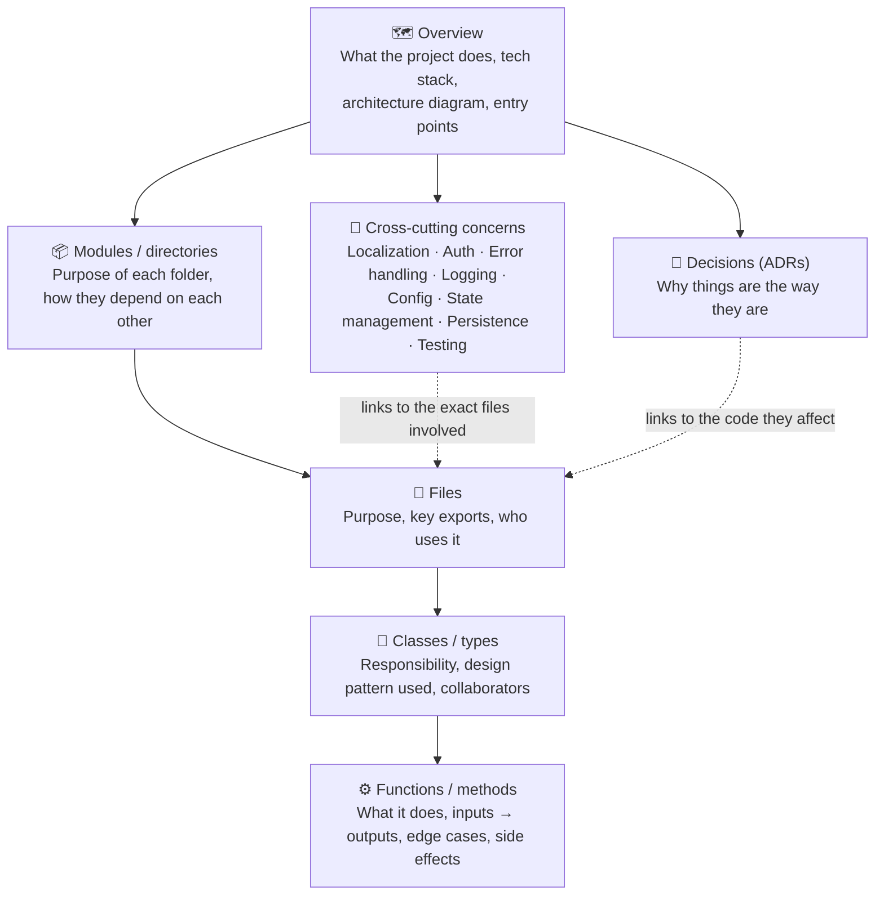
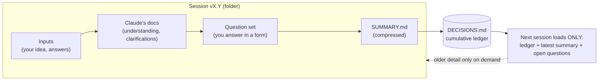
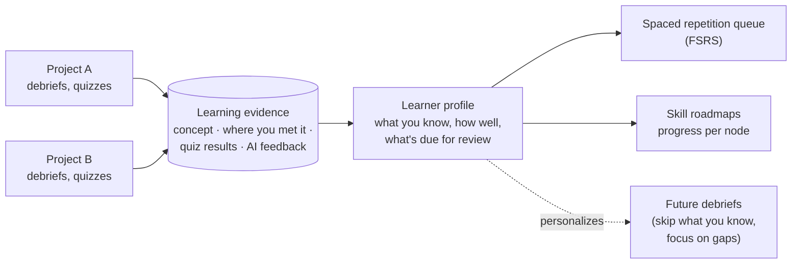
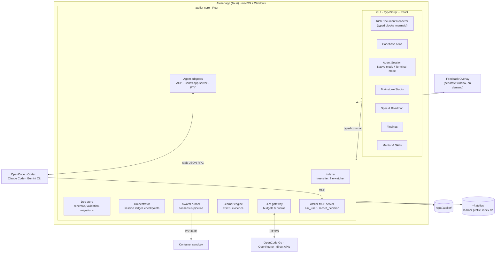

# Updated Proposal (v0.2)

> This document covers **only what changed or is new** since [v0.1](../v0.1/01-PROJECT-UNDERSTANDING.md). Anything not mentioned here (e.g., the consensus-loop design, the screenshot approach) still stands as written in v0.1.
> The authoritative list of decisions is [../DECISIONS.md](../DECISIONS.md).

---

## 1. Revised Product Definition

> **Atelier** *(codename)*: a desktop app that **explains any codebase at every level, from architecture down to single functions, in a rich visual GUI**, and that **builds new features through spec-driven, multi-agent development**, teaching you what it did along the way.

| Priority | Purpose |
|---|---|
| **#1** | **Understand code without reading every line**: architecture, design patterns, directory structure, purpose of every file/class/function, and cross-cutting concerns (localization, auth, errors, config…) |
| **#2** | **Spec-driven development** that keeps #1 up to date automatically |
| **Always** | **Everything is rendered in a rich GUI.** No raw Markdown, no ASCII diagrams |
| **Supporting** | Observer swarm (quality), mentorship and learner profile (growth), brainstorm studio (thinking), feedback overlay (testing) |

## 2. Revised Pillars

| # | Pillar | Change vs v0.1 |
|---|---|---|
| **A** | **Codebase Atlas** (understanding) | ⬆️ **Promoted to #1.** Was "P3 Living Docs" |
| **B** | **Live Agent Session** (agent wrapping, diff viewer, ADR capture) | Split out of P1/P4 |
| **C** | **Brainstorm Studio** | 🆕 **New** (your Q30 request) |
| **D** | **Spec & Roadmap** | Unchanged design, now fed by Brainstorm Studio |
| **E** | **Observer Swarm** | Observers made strictly read-only; about 3 models |
| **F** | **Mentor + Learner Profile + Skill Roadmaps** | 🆕 Expanded to work **across projects** |
| **G** | **Feedback Overlay** | Now **on demand** only; defect vs. idea routing |
| **—** | **Rich Document Renderer** | 🆕 Shared foundation for every pillar |

---

## 3. Pillar A: Codebase Atlas

### 3.1 What you'll see



- **Cross-cutting concern pages** answer questions like *"how do we handle localization?"*. A page lists the library used, where translation files live, how a string flows from code to screen, and links to every file involved. This is the part most tools miss.
- Every page has **two depths** (from v0.1): **Overview** (what and why) and **Engineer** (patterns, responsibilities, trade-offs). A toggle switches between them.
- Every page **links to the code**. Clicking a function name opens it in a read-only code viewer next to its explanation.

### 3.2 How it's generated: facts first, AI second

| Layer | Source | Cost | When |
|---|---|---|---|
| **Facts**: files, symbols, imports, call references, dependencies, framework detection | tree-sitter + manifest files (package.json, Cargo.toml, …) | **Free** (local) | Eagerly, on open; incrementally on file change |
| **Overview + module summaries** | LLM over the facts + key files | Small, bounded | Eagerly, once (then on significant change) |
| **File / class / function explanations** | LLM over that symbol + its neighbours | Per item | **Lazily**: when you open the page. **Cached by content hash** |
| **Cross-cutting concern pages** | Heuristics (e.g., i18n libraries, `locales/` folders) + LLM confirmation | Small | Eagerly detected, lazily written |
| **ADRs** | Recorded live by the agent (Pillar B) or inferred for existing repos (marked *"inferred"*) | Small | Live / on request |

This **hybrid (eager facts, lazy explanations)** design keeps a large repo within your **<$3/day** budget. An unchanged function is never explained twice.

### 3.3 What other tools do

See the comparison in [01-CLARIFICATIONS.md → Q4](01-CLARIFICATIONS.md#q4-untangling-your-priorities) (DeepWiki, Google Code Wiki, Swimm, Cody, `/init`).

---

## 4. Foundation: Rich Document Renderer & the Atelier Document Format

You said: *"I hate to look at simple text like markdown without formatting, or mermaid diagrams with ASCII… we should create a structure for this… those structures probably have versions because a version mismatch would be ugly."*

### 4.1 Proposal: Markdown + frontmatter + typed blocks

Every Atelier document stays a **readable Markdown file** (so it works in Git, GitHub and any editor). It also carries:

1. **Frontmatter** declaring *what kind of document* it is and *which schema version* it follows.
2. **Typed fenced blocks** that the GUI renders as rich components.

````markdown
---
atelier: doc@1          # format version
kind: question-set      # spec | adr | atlas-page | question-set | summary | notebook-card | skill-tree ...
kind_version: 1         # schema version of this kind
id: brainstorm-v0.2-questions
---

# Open Questions

```atelier:question
id: Q2
title: Engine language
multi: false
options:
  - id: A
    label: Rust core + TypeScript UI
    badge: strongly-recommended
  - id: B
    label: TypeScript engine as Bun sidecar
    badge: viable
answer: null
custom: ""
clarify: ""
```
````

| Block type | Renders as |
|---|---|
| `mermaid` | Interactive diagram (zoom, pan, click a node to jump to code/docs) |
| `atelier:question` | Form with radio buttons/checkboxes, recommendation badges, custom-answer box, "ask to clarify" button |
| `atelier:decision` | Decision card (status, date, rationale, superseded-by link) |
| `atelier:filetree` | Collapsible file tree with purpose badges |
| `atelier:symbol` | Class/function card with signature, responsibility, links |
| `atelier:quiz` | Flashcard / quiz with hidden answer |
| `atelier:finding` | Observer finding card (severity, votes, evidence) |
| `atelier:roadmap` | Interactive phase/task timeline |

If a block type is unknown (e.g., an older Atelier opens a newer file), it's shown as a **readable formatted code block with a "newer format" notice**, never as a broken screen.

### 4.2 Versioning rules (to prevent "ugly mismatches")

1. Every file declares `atelier: doc@N` and `kind_version`.
2. The **schemas are generated from Rust types** (`schemars`), and the **TypeScript types come from the same Rust types**. GUI, engine and validator can't disagree.
3. Atelier can read the **current and previous** major versions. Older files are **migrated automatically** on open, and the change shows up as a normal Git diff you can review.
4. Every file is **validated on save**. Invalid content (e.g., an agent wrote a malformed block) is flagged in the GUI with a "fix" button, not silently rendered wrong.

### 4.3 What other tools do

| Format | Used by | Pros | Cons |
|---|---|---|---|
| **Plain Markdown templates** | Kiro, Spec Kit, Cline memory bank | Universal, simple | No structure to render richly; no validation |
| **Markdown + typed blocks + frontmatter** ⭐ | Docusaurus admonitions, GitHub (mermaid), Obsidian callouts | Readable everywhere *and* richly renderable | Requires our own renderer (planned anyway) |
| **Markdoc** (Stripe) | Stripe docs | Custom tags **with schema validation** (great idea to borrow) | Non-standard syntax looks odd outside the renderer |
| **MDX** | Many doc sites | Full React components in docs | **Executes code** (security risk with AI-written files); poor portability |
| **JSON blocks** | Notion (internally), Jupyter `.ipynb` | Perfectly structured | Unreadable without the app; ugly Git diffs |

> 🧪 **Dogfooding:** the files in this `brainstorm/` folder are the first real documents for this format. The question files will move to `atelier:question` blocks once the format is confirmed (Q7 in the new questions).

---

## 5. Pillar C: Brainstorm Studio (new)

You said: *"Brainstorming costs too many tokens… we should create a structure to reliably brainstorm: storing, summarizing to remove context decay, and reducing cost."*

### 5.1 Design: this repo's `brainstorm/` folder is the manual prototype



| Mechanism | Fixes |
|---|---|
| **One folder per session** (`v0.1`, `v0.2`, …), frozen when closed | History is never overwritten; you can always see how an idea evolved |
| **SUMMARY.md per session** (compact, structured) | **Cost:** a new session reads around 2 pages instead of the whole history |
| **DECISIONS.md ledger** (each decision has an ID, status, source and superseded-by) | **Context decay:** decisions don't get lost or contradicted three sessions later |
| **Structured question sets** (options, ⭐ badges, custom answer, clarify) | Fast answers with no copy-pasting; answers are machine-readable |
| **Summary consistency check** (in the app: a cheap model checks that every decision in the summary matches the ledger) | Summaries can't silently drop or distort decisions |
| **Promote to spec** | When a topic's decisions are stable, one click drafts a **spec** from them (→ Pillar D) |

### 5.2 What other tools do

| Tool | Approach | Pros | Cons |
|---|---|---|---|
| **ChatGPT / Claude Projects + memory** | Shared files + automatic memory | Zero effort | Memory is opaque; you don't control what's kept |
| **Claude Code** (`CLAUDE.md` + auto-compaction) | Instructions file + automatic summarizing when context fills | Automatic | Compaction can lose decisions; no versioned history |
| **NotebookLM** | Answers grounded in your uploaded sources | Low hallucination | Not built for evolving decisions |
| **Cline memory bank** | Fixed set of Markdown files the agent updates | Transparent, in repo | Overwritten in place; no session history |
| **Atelier Brainstorm Studio** | Versioned sessions + ledger + summaries + typed question forms | Transparent, cheap, no lost decisions | You need to close sessions properly (the app automates this) |

---

## 6. Pillar F: Mentor + Learner Profile + Skill Roadmaps (expanded)

You asked for: *memory of what I've learned across **all** projects, plus skill roadmaps (like roadmap.sh), plus my progress on them.*

### 6.1 Learner profile (global, `~/.atelier/learner/`)



- **Evidence-based:** when a debrief teaches "Strategy pattern" using a file in Project A, that's recorded as evidence with a link to the code. Quiz answers and the **AI feedback on them (your Q24 request)** are stored too.
- **Personalization:** debriefs skip what you've mastered and focus on gaps. This is where cross-project memory pays off.
- **Notebook cards** use spaced repetition (FSRS) **built into Atelier** (your Q23: no Anki export).

### 6.2 Skill roadmaps: the roadmap.sh question

**What roadmap.sh's license says (checked 2026-10-07):** all content is copyrighted. **Personal use is allowed**, but republishing the content (including in derived digital form) is not allowed without consent. The author also says permission is often granted if you ask and explain the use. **Links to roadmap.sh are always fine.**

That means:

| Option | Legal status | Notes |
|---|---|---|
| Bundle roadmap.sh trees in Atelier | ❌ Not allowed (Atelier may be shared/open-sourced) | |
| Import them on your machine for personal use only | ⚠️ Grey area. Allowed for personal use, but it breaks the moment you share Atelier with that feature | Not recommended as a feature |
| **Ask roadmap.sh's author for permission** | ✅ If granted | Worth a short email if you want their exact trees |
| **AI-generated skill trees** (our own content, `kind: skill-tree`) **+ link out to roadmap.sh for each topic** ⭐ | ✅ | A strong model drafts a tree once, you review it, and it's yours. Links send you to roadmap.sh for their guides |

**Progress is computed, not just ticked:** a node (e.g., "Backend → Caching → Redis") lights up based on **evidence**: you met it in your code, you passed its quiz cards, you answered "why" questions about it.

### 6.3 What other tools do

| Tool | Approach | Pros | Cons |
|---|---|---|---|
| **roadmap.sh** | Static expert-curated trees; you tick progress manually | High-quality curation | Self-reported progress; not tied to your work |
| **Duolingo-style skill trees** | Progress unlocked by exercises | Motivating | Exercises aren't your real code |
| **Anki** | Pure spaced repetition | Proven memory science | No structure or context |
| **Exercism tracks** | Exercises + mentors per language | Real feedback | Separate from your real projects |
| **Atelier** | Trees + evidence from **your real code** + spaced repetition + AI feedback history | Learning tied to real work | Tree quality depends on generation + your review |

---

## 7. Pillar E: Observers are read-only (your Q30 request)

Agreed, and we'll enforce it **structurally** rather than by asking the models nicely:

| Rule | How it's enforced |
|---|---|
| Observers **cannot write files** | They're given **no write tools at all**. They only receive the context pack and can call a read-only `read_file` restricted to the repo |
| Observers **don't write to `.atelier/` themselves either** | They return **structured JSON**. The **engine** validates it and writes `.atelier/findings/`. A malformed or malicious observer output can't corrupt anything |
| Observer **PoC tests** don't touch your repo | The engine runs them in a **container** with a **read-only copy** of the repo |
| No shell, no network for observers | Tools simply don't exist for them |

---

## 8. Pillar G: Feedback Overlay (updated)

- **On demand only:** opened with a **global hotkey** or from Atelier's menu-bar/tray icon. It doesn't start with the app.
- Purpose: **testing the app you're building** (web, desktop, mobile simulator, game).
- **Message + optional capture** (full screen or rectangle), overlay hidden during capture (hide → capture → show → crop, as decided in v0.1).
- On submit, Atelier **suggests a classification** you confirm with one click:
  - **Defect** (doesn't match the frozen spec) → **fix queue** of the current task
  - **Idea / change** → **Parking Lot**
- See [01-CLARIFICATIONS.md → Parking Lot](01-CLARIFICATIONS.md#q14--q26-what-a-parking-lot-is).

---

## 9. Updated Architecture



### Storage layout (updated: `.harness/` → `.atelier/`)

| Path | Contents |
|---|---|
| `repo/.atelier/brainstorm/` | Brainstorm sessions (same structure as this repo's `brainstorm/`) |
| `repo/.atelier/specs/`, `amendments/` | Specs (one per feature) and approved amendments |
| `repo/.atelier/roadmap.md` | Roadmap as an `atelier:roadmap` block |
| `repo/.atelier/parking-lot/` | Ideas waiting for triage |
| `repo/.atelier/adr/` | Architecture Decision Records |
| `repo/.atelier/atlas/` | Generated Codebase Atlas pages + content-hash cache manifest |
| `repo/.atelier/findings/` | Observer findings (written by the engine only) |
| `repo/.atelier/notebook/` | Project notebook cards |
| `repo/.atelier/sessions/` | Session ledgers (JSONL, gitignored) |
| `~/.atelier/learner/` | Cross-project learner profile, evidence, skill trees, FSRS state |
| `~/.atelier/index.db` | SQLite: search index, cost history, due-card queue (**derived, rebuildable**) |
| `~/.atelier/config.toml` | Providers, budgets, model roles, default modes |

---

## 10. Revised Build Order: Vertical Slices

Each slice delivers **engine + GUI together** and is usable on its own.

| Slice | Delivers | You can… |
|---|---|---|
| **S0: Foundations** | Tauri shell, `atelier-core`, Rust→TS types, **Rich Document Renderer** (Markdown + mermaid + typed blocks), provider settings, budget meter | …open **this repo's `brainstorm/` folder** and read it beautifully rendered (the first dogfood test) |
| **S1: Codebase Atlas** ⭐ *Purpose #1* | Indexer, overview/modules (eager), files/classes/functions (lazy + cached), cross-cutting concern pages | …open any repo and understand it without reading the code |
| **S2: Live Agent Session** | OpenCode via ACP (first agent), Terminal mode fallback, checkpoint commits, **diff viewer**, `record_decision` → ADRs, Atlas updates incrementally | …watch an agent build, review its diffs, and see *why* |
| **S3: Brainstorm Studio + Spec & Roadmap** | Question forms (answerable in the GUI), sessions/ledger/summaries, spec drafting, strike & instruct, freeze/amend, Parking Lot, roadmap view | …do this exact brainstorming inside Atelier |
| **S4: Observer Swarm** | 3 vendor-diverse models via OpenCode Go, consensus pipeline, findings panel, container PoCs, seeded-bug benchmark | …get independent reviews per task |
| **S5: Mentor** | Debrief, quiz + AI feedback history, notebook + FSRS, learner profile, skill trees | …learn from every task, across projects |
| **S6: Feedback Overlay** | Hotkey overlay, hide-capture-crop, defect/idea routing | …report bugs while testing your app |
| **S7: Ecosystem** | Codex app-server adapter, Claude Code terminal integration (hooks + MCP), Gemini CLI, plugin system, more doc types (API, DB, UI/UX, refactor proposals) | …use any agent and extend Atelier |

> **Why S0 renders the brainstorm folder first:** it's the smallest useful thing, it proves the rendering foundation every other slice depends on, and it fixes your "I hate reading plain Markdown" problem for *these very documents*.
