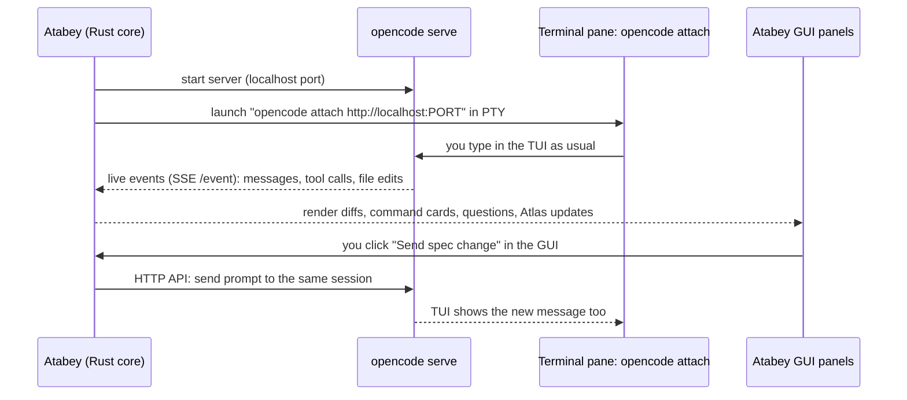
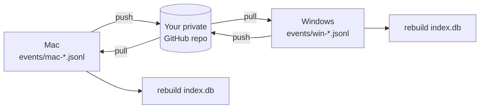
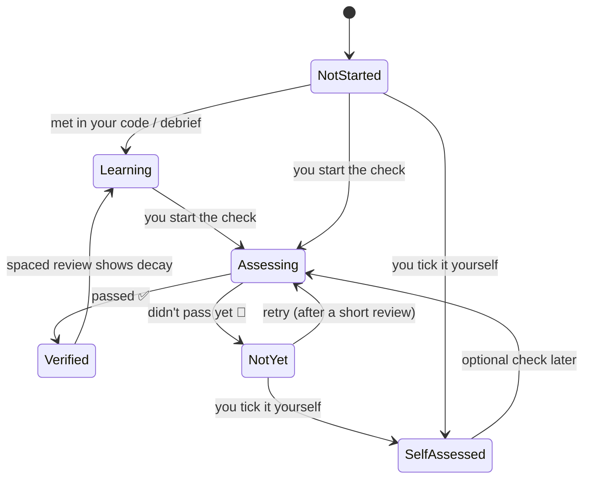

# Clarifications for Your v0.2 Answers

> Same layout as before: **Short answer → How it works → What others do → Recommendation → Status**.
> Your big list of new ideas (v0.2-Q21) is handled in the separate proposal files: [02-PROPOSAL-PLATFORM.md](02-PROPOSAL-PLATFORM.md), [03-PROPOSAL-QUALITY.md](03-PROPOSAL-QUALITY.md), [04-PROPOSAL-LEARNING.md](04-PROPOSAL-LEARNING.md), [05-HOW-WE-BUILD-IT.md](05-HOW-WE-BUILD-IT.md).

---

## Contents

1. [Q1: A new name from Ottoman, Seljuk and Göktürk history](#q1-a-new-name-from-ottoman-seljuk-and-göktürk-history)
2. [Q10 + Q21: Session modes in v1 vs v2](#q10--q21-session-modes-in-v1-vs-v2)
3. [Q13: Adjustable caps](#q13-adjustable-caps)
4. [Q14: Session folders vs topic threads](#q14-session-folders-vs-topic-threads)
5. [Q15: Is git sync for the learner profile cheap enough for v1?](#q15-is-git-sync-for-the-learner-profile-cheap-enough-for-v1)
6. [Q16: The roadmap.sh permission email](#q16-the-roadmapsh-permission-email)
7. [Q17: Skill assessments that don't crush anyone's ego](#q17-skill-assessments-that-dont-crush-anyones-ego)
8. [Sources](#sources)

---

## Q1: A new name from Ottoman, Seljuk and Göktürk history

You dropped "Atelier" and asked for something from Ottoman, Seljuk or Göktürk history, ideally around **lala**, the mentors of Ottoman princes.

**Short answer:** the strongest fit is **Atabey**. It's the **Seljuk** title for the guardian-tutor of a young prince ("father-lord"). The Ottoman **lala** institution is essentially the continuation of the Seljuk atabey. So Atabey keeps your "lala" meaning, adds the Seljuk era you mentioned, and avoids a collision that "Lala" has.

### Candidates (quick web check on 2026-10-07; **not** a legal trademark search)

| Name | Era | Meaning | Fits | Collision found? | Verdict |
|---|---|---|---|---|---|
| **Atabey** | Seljuk | Guardian and tutor of a prince ("father-lord"); predecessor of the Ottoman *lala* | Mentor + guardian, which matches mentorship and observers that protect your code | **None found** in software | ⭐⭐ |
| **Enderun** | Ottoman | Palace school that trained the empire's elite administrators | Education / academy | None found in software | ⭐ (or use it as the name of the learning module) |
| **Lala** | Ottoman | Mentor of a prince | Exactly your idea | ⚠️ **Yes**: *lala.ai*, a local "project-scoped reasoning layer" dev tool, plus a "Lala AI" education app | ⚠️ |
| **Tonyukuk** | Göktürk | The wise counsellor of Bilge Kağan; author of the Orkhon-era inscriptions | Advisor + documentation | None found | ⚪ (distinctive, but hard for non-Turkish speakers to spell) |
| **Orhun** | Göktürk | The Orkhon inscriptions, the oldest Turkic written texts | Documentation (Purpose #1) | None found | ⚪ (better as the Codebase Atlas module name) |

### Optional: themed module names

If you like the theme, each pillar can carry a historical name with a plain-English subtitle so the meaning stays obvious:

| Module (plain name) | Themed name | Why it fits |
|---|---|---|
| Codebase Atlas | **Orhun** | Inscriptions that explain the code "carved in stone" |
| Observer Swarm | **Kurultay** | The Turkic assembly where leaders deliberated and decided together |
| Brainstorm Studio | **Divan** | The Ottoman imperial council where matters were debated before a decision |
| Frozen spec seal | **Tuğra** (`tugra` in code) | The sultan's seal on official decrees. Freezing a spec = "stamping the tuğra" |
| Decision ledger & logs | **Defter** | Ottoman registers that recorded everything |
| Mentor / learning | **Enderun** | The palace school |
| Practice scenarios | **Talimhane** | The training/drill ground |
| Extension library | **Bedesten** | The covered bazaar where valuable goods were traded |
| Tech stack packs | **Kervan** | A caravan carrying a complete set of goods |

**What others do:** most dev tools pick one short, unusual brand name (Zed, Warp, Kiro, Cursor) and give features **plain** names. Themed feature names (like Rust's crates/cargo or Kubernetes' Greek nautical theme: pods, helm) work when each has an obvious subtitle. **Pros:** memorable, distinctive, a story to tell. **Cons:** newcomers must learn the vocabulary, so the GUI must always show the plain subtitle.

> In this session's documents I use **Atabey** as the **working name** (folder `.atabey/`) until you confirm. Renaming later is a find-and-replace.

**Status:** 🔁 v0.3-Q1 and v0.3-Q2. The same advice applies: run a proper trademark and domain check before going public.

---

## Q10 + Q21: Session modes in v1 vs v2

You chose *"native when supported, terminal fallback"* (v0.2-Q10), and later said *"v1 = terminal + our GUI; v2 = completely GUI, with a simple button to switch back to the v1 layout"* (v0.2-Q21). I read the later, more specific answer as the plan:

| Version | Default | Fallback |
|---|---|---|
| **v1** | **Terminal + GUI**: the agent's real TUI runs in the terminal pane, and the GUI shows everything around it live (diffs, commands, questions, docs) | — |
| **v2** | **Native mode** (pure GUI) | One-click **"Switch to Terminal layout"** button that goes back to the v1 layout for the same session |

### How v1 "terminal + GUI" works technically (it's very doable with OpenCode)

OpenCode has a **client/server design**: `opencode serve` runs a headless server, `opencode attach <url>` connects a TUI to it, and the server publishes a live **event stream** (Server-Sent Events at `/event`) and an HTTP API with an OpenAPI spec.

- This **solves the "GUI → TUI input" problem from v0.1 without keystroke injection**: the GUI sends input through the server's API, and the TUI sees it because both are clients of the same session.
- For **Claude Code** in Terminal mode we use its official **hooks** (events out) and an **MCP server** (`ask_user` in). For **Codex**, its TUI is itself a client of `app-server`, so a similar pattern is likely possible. We'll verify when we get there.
- **ACP** remains the plan for **v2 Native mode** across many agents.

**What others do:** Conductor-style apps and Warp are terminal-first; Zed and the Codex app are native-first; very few do **both on one session**. That's a real differentiator.

**Status:** ✅ Decided (D-018 updated).

---

## Q13: Adjustable caps

Yes. The defaults are **$1/day and $15/month**, and everything is adjustable in Settings:

| Setting | Default | Adjustable |
|---|---|---|
| Daily money cap | $1.00 | ✅ |
| Monthly money cap | $15.00 | ✅ |
| Per-feature caps (Atlas, Swarm, Mentor, Decision models…) | Share of the daily cap | ✅ |
| What happens at the cap | **Pause and ask** (never silently continue) | ✅ (pause / switch to cheaper model / stop) |
| Subscription quota warnings | Warn at 70% and 90% of a window | ✅ |

**Status:** ✅ Decided.

---

## Q14: Session folders vs topic threads

You picked A (session folders) and asked for the pros and cons of B (topic threads).

| | **A. Session folders** (current) | **B. Topic threads** | **C. A + topic tags** ⭐⭐ |
|---|---|---|---|
| How it works | One folder per conversation | One file per topic (storage, swarm, …) updated every session | Session folders, plus every decision tagged with a topic. The app *computes* topic views |
| Answers "what happened in session 3?" | ✅ Easy | ❌ Scattered across topic files | ✅ Easy |
| Answers "everything about storage?" | ⚠️ Hunt across sessions | ✅ Easy | ✅ Easy (filter by tag) |
| Maintenance per session | Low | **High**: every touched topic file must be rewritten | Low: just add tags |
| Token cost per session | Low | **Higher**: rewriting topic files | Low |
| Risk of contradictions | Low | **Medium**: the same fact lives in sessions *and* topics | Low: one source, many views |

**What others do:** chat tools (ChatGPT, Claude Projects) are purely chronological; wikis (Notion, Confluence) are purely topical and go stale; **issue trackers like Linear/GitHub** do C: chronological items + labels + filtered views. That's the proven pattern.

> Note: [DECISIONS.md](../DECISIONS.md) is **already grouped by topic** (Identity, Platform, Swarm…), so you effectively have C today. The app version would just let you click a tag.

**Status:** 🔁 v0.3-Q21 (A + tags recommended).

---

## Q15: Is git sync for the learner profile cheap enough for v1?

**Short answer:** yes, **if we design the storage for it now**. That design costs almost nothing, so I recommend including sync in v1 (as part of the Mentor slice).

What makes sync cheap:

1. **Files are the source of truth; SQLite is derived** (already decided), so we never have to merge databases.
2. **Append-only, per-device event files** (e.g., `events/mac-2026-10.jsonl`, `events/win-2026-10.jsonl`). Two machines never edit the same file, so **git merges never conflict**.
3. "Sync" is just: `git pull --rebase` → `git push` on `~/.atabey/learner/`, against a **private** repo you create once. Then the index is rebuilt.

**Effort estimate:** about 1–2 small tasks: a "Connect sync repo" settings screen + a "Sync now" button + auto-sync on app close.

**What others do:** Obsidian Git (community plugin) syncs vaults through git (popular, conflicts happen when files are edited on two devices); Anki uses its own sync server; VS Code Settings Sync uses a Microsoft/GitHub account backend. Per-device append-only files avoid Obsidian's conflict problem.

**Status:** ✅ Decided: local first, **git sync included in v1** because the design makes it cheap (v0.3-Q23 asks you to confirm).

---

## Q16: The roadmap.sh permission email

As you asked, **I won't send anything**. I wrote you a guide with a ready-to-edit draft: **[07-ACTION-ROADMAPSH-EMAIL.md](07-ACTION-ROADMAPSH-EMAIL.md)**. It covers who to contact (roadmap.sh's founder, contact details from roadmap.sh's own About page), what to ask for, a draft email, and what to do with the reply.

Meanwhile, skill trees will be **AI-generated** (decided).

**Status:** ✅ Decided. 📌 Action item for you (listed in [README.md](../README.md)).

---

## Q17: Skill assessments that don't crush anyone's ego

Your requirements: *enough questions to test the skill → pass if eligible → if not, the user can still tick it themselves → show failures as a "you tried" indicator, not an ego-crusher.*

### Node states

### How it looks on the tree

| State | Visual | Wording |
|---|---|---|
| Not started | Empty node | — |
| Learning | Half-filled | "Learning: met in 3 places in your code" |
| **Verified** | Filled node with a small seal (the *tuğra*, if you like the theme) | "Verified on 2026-11-02" |
| **Self-assessed** | Outlined node with a ✋ badge | "Self-assessed": fully valid, just labelled differently |
| **Not yet** 🌱 | Small amber dot (never a red ✗) | "**Not yet**: tried 2026-11-02 · 3/5 · focus next: cache invalidation" |

- **"Not yet"** comes from *growth-mindset* grading (Carol Dweck's "the power of yet"). It's used in some schools in place of "fail" to frame the result as a waypoint, not a verdict.
- The attempt history stays visible on hover, so it's honest without shouting.

### How the check works (adaptive, so "enough questions" without a long exam)

| Step | What happens |
|---|---|
| 1 | Start with **5 mixed items**: multiple choice, one "why" question, one mini production scenario |
| 2 | If it's clearly a pass or clearly not yet → **stop early** |
| 3 | If borderline → up to **5 more** targeted items |
| 4 | Result + **AI feedback stored** (your v0.1 Q24 decision) + cards added to spaced repetition for weak spots |

**What others do:** Duolingo uses "legendary" and placement tests (adaptive); roadmap.sh uses manual ticks only; Khan Academy uses mastery levels (Attempted → Familiar → Proficient → Mastered) and **never shows "failed"**. That's the closest model to your request.

**Status:** ✅ Decided.

---

## Sources

- Name checks (quick, not legal): [lala.ai on Hunted](https://www.hunted.space/product/lala-ai), [Lala AI app](https://apps.apple.com/mx/app/lala-ai/id6736908401)
- OpenCode server & attach: [opencode.ai/docs/server](https://opencode.ai/docs/server/), [attach command](https://www.mintlify.com/anomalyco/opencode/cli/attach)
- roadmap.sh contact: [roadmap.sh/about](https://roadmap.sh/about)
