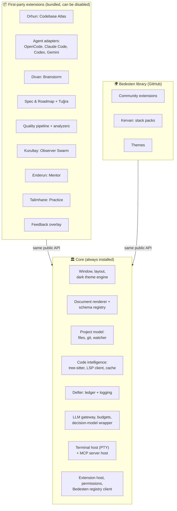
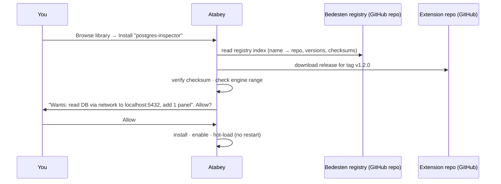
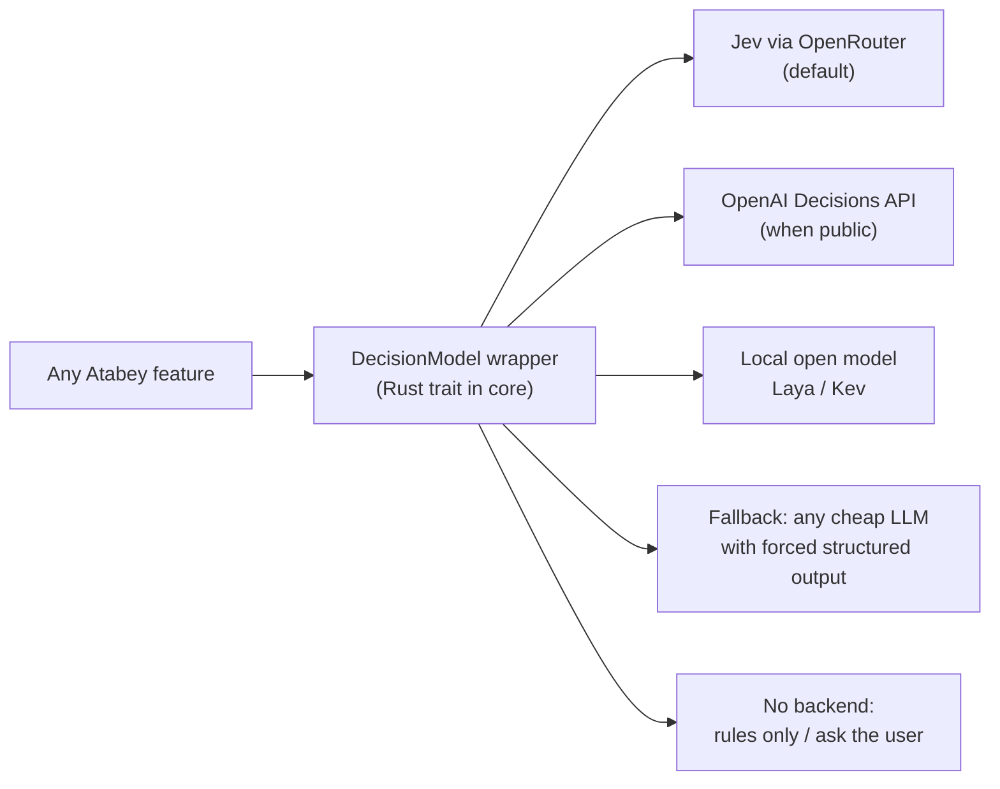
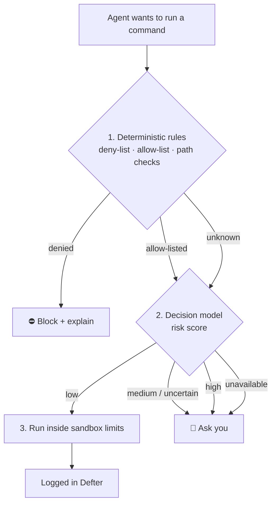
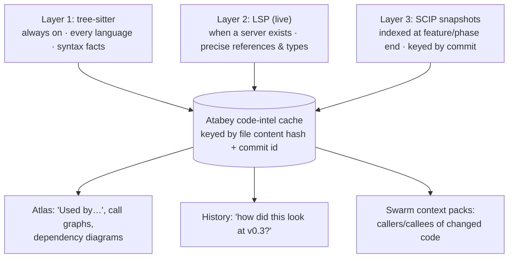

# Proposal: Platform

> Covers your v0.2-Q21 ideas on **extensibility ("like Neovim")**, **tech stack library**, **decision models (Jev)**, **LSP and caching**, **logging**, and **themes**.
> Working name: **Atabey** (pending v0.3-Q1).

## Contents

1. [Core + extensions ("like Neovim")](#1-core--extensions-like-neovim)
2. [Tech stack packs (Kervan)](#2-tech-stack-packs-kervan)
3. [Decision models (Jev and future ones)](#3-decision-models-jev-and-future-ones)
4. [Code intelligence: tree-sitter, LSP and caching](#4-code-intelligence-tree-sitter-lsp-and-caching)
5. [Logging everything (Defter)](#5-logging-everything-defter)
6. [Themes](#6-themes)
7. [Sources](#sources)

---

## 1. Core + extensions ("like Neovim")

You said: *"I can change my mind about features later, so it's crucial to be scalable: install the IDE with only core features, then a plugin/extension library on GitHub that auto-installs… agent SKILLs for writing extensions… like Neovim. Does this pay off or limit us?"*

### 1.1 Plugin vs extension: is there a difference?

**In practice, no.** It's naming tradition, not a technical difference:

| Calls them "extensions" | Calls them "plugins" |
|---|---|
| VS Code, Zed, Chrome, Firefox | Neovim, JetBrains, Obsidian, Claude Code, Eclipse |

**Recommendation:** use **"extension"** in the product (the more common word in modern editors), and call the library **Bedesten** if you like the theme.

### 1.2 What others do

| Tool | Model | What's in core | Pros | Cons |
|---|---|---|---|---|
| **Neovim** | Tiny core + Lua plugins from git repos (lazy.nvim etc.) | Editor, **LSP client, tree-sitter, terminal** (moved *into* core because everyone needed them) | Extreme flexibility, huge community | Setup burden; distributions (LazyVim) exist because raw Neovim is too bare |
| **VS Code** | Core + extensions; **many built-in features are actually bundled extensions** (Git, Markdown, TypeScript) | Editor, workbench, extension host | Proven at scale; built-ins prove the API works | Extensions run with broad trust |
| **Obsidian** | "Core plugins" (first-party, toggleable) + community plugins | Vault, editor, renderer | Users switch off what they don't need | Community plugins have full access |
| **Zed** | Core + WASM extensions from a **central GitHub registry repo** | Almost everything (performance focus) | Safe sandbox, curated registry | Limited extension API |
| **Eclipse** | **Everything** is a plugin (OSGi) | Almost nothing | Infinitely extensible | ⚠️ Famous for complexity, slowness and "plugin hell" |
| **Claude Code** | Plugins = commands + agents + skills + hooks + MCP; marketplaces are git repos | The agent harness | Simple distribution | No GUI extension points |

### 1.3 Does it pay off or limit us?

| ✅ Pays off | ❌ Costs / limits | Mitigation |
|---|---|---|
| You can **change your mind**: disable or replace a feature without touching the core | Designing a **stable API** takes effort upfront | Keep the API **unstable (0.x)** until 3+ extensions use it ("rule of three") |
| **AI-friendly:** an agent works on one extension with a small, clear context | **Cross-feature work** (e.g., Swarm reading Atlas data) is harder | Shared data lives in **core services** (doc store, event bus) that all extensions use |
| Community can add features; you can try others' ideas | **Version compatibility** (core updates break extensions) | Manifest declares `engine: ">=0.4 <0.6"`; core refuses incompatible versions with a clear message |
| Smaller, faster core | **Process boundaries** add latency and debugging effort | Only heavy/untrusted parts run out-of-process |
| Clear security boundary | **Security**: extensions run code | Permission manifest + approval screen (like phone apps) |

**My take:** it pays off **if** we follow the VS Code / Obsidian pattern, **not** the Eclipse one:

> **Lesson from Neovim:** keep shared *infrastructure* in core (Neovim had to pull LSP and tree-sitter *into* core). Make *features* extensions.

### 1.4 Proposed split

**Key rule:** first-party features use **exactly the same API** as community extensions. That's how VS Code keeps its API honest.

### 1.5 Extension anatomy

| Part | Runs where | Talks via | Example |
|---|---|---|---|
| `atabey-extension.toml` manifest | — | — | name, version, engine range, **permissions**, contributions |
| **UI contributions** (panels, doc block renderers, commands) | Sandboxed iframe / web component in the GUI | Message API (like VS Code webviews) | Atlas panel, `atabey:finding` renderer |
| **Backend contributions** | **Separate process** (any language) | JSON-RPC over stdio (like LSP/MCP) | Swarm runner, SARIF importer |
| **MCP servers** | Separate process | MCP | Tools for agents |
| **Skills** | Files | Loaded by agents | "How to write an Atabey extension" |
| **Data-only contributions** | — | Files | Themes, pipeline recipes, skill trees, scenarios |

**Install flow** (auto-install from GitHub, as you asked):

**Extension development kit:** a template repo + `atabey ext new` scaffolder + **agent skills** (`SKILL.md`: "how to build an Atabey extension", "how to add a doc block renderer", "how to publish to Bedesten"). Then *any* agent (Claude Code, OpenCode…) can build extensions reliably. That's your idea, and it's a good one.

---

## 2. Tech stack packs (Kervan)

You said: *"A tech stack section: for a specific stack it installs the necessary tools and SKILLs; it can have its own library."*

**Proposal:** a **stack pack** is just a special kind of extension (data-only, so it's safe) that bundles everything one tech stack needs:

| Contents | Example: `kervan-rust-tauri-react` |
|---|---|
| **Toolchain** (installed via `mise`) | rust, node, pnpm |
| **Language servers** | rust-analyzer, typescript-language-server |
| **tree-sitter grammars** | rust, typescript, tsx |
| **Linters / analyzers** (→ SARIF) | clippy, eslint/biome, gitleaks, osv-scanner |
| **Pipeline recipes** | `rust.check`, `rust.test`, `ts.typecheck`, `tauri.build` |
| **Agent skills** | "Rust error handling conventions", "Tauri command patterns", "React component conventions" |
| **Conventions doc** | Folder layout, naming, testing standards (rendered in the Atlas) |
| **Project template** (optional) | Starter repo |

**What others do:**

| Tool | Equivalent | Pros | Cons |
|---|---|---|---|
| **VS Code** | Extension packs + Profiles + **Dev Containers** "features" | Very complete | Dev Containers need Docker; scattered concepts |
| **JetBrains** | One IDE per stack (PyCharm, WebStorm…) | Deep integration | Heavy; paid |
| **mise / asdf** | Tool version managers (`.mise.toml`) | Simple, cross-platform | Tools only, no skills/conventions |
| **Nix / devbox** | Reproducible environments | Perfectly reproducible | Steep learning curve; weak on Windows |
| **Claude Code plugin marketplaces / cursor.directory** | Rules and skills per stack | Agent-aware | No toolchain install |
| **Yeoman / cookiecutter** | Project templates | Quick start | One-shot; no ongoing support |

**Kervan = mise-level tool install + agent skills + pipeline recipes + conventions, in one pack.** Nobody combines all of these today.

**First pack:** `kervan-rust-tauri-react`, the stack of Atabey itself, so we dogfood it while building the app.

---

## 3. Decision models (Jev and future ones)

You asked about Jev: *a decision model, not a language model: give it a prompt and options, it picks one. Use a wrapper, not hard-coded Jev, because OpenAI/Anthropic may ship similar models. Research use cases (e.g., is a command malicious?). Optional when there's no API key, but on by default.*

### 3.1 What Jev is (checked 2026-10-07)

| | |
|---|---|
| **Maker** | TypeSafe (AI lab). Released **2026-09-15** |
| **What it does** | Takes text (**state**) + typed **questions** and returns **typed answers only**. It never writes prose |
| **Question types** | **choice** (pick 1 of up to 255 options, with a probability for each), **score** (ordered levels, up to 10), **noul** (yes/no probability) |
| **Output** | Selected option + **calibrated probabilities** + confidence |
| **Access** | Via **OpenRouter's Decisions API** (alpha) or TypeSafe's SDKs pointed at OpenRouter. **The OpenRouter key we already plan to use covers it** |
| **Price** | **$0.042 per million input tokens; output free.** A typical call costs about two thousandths of a cent, so it's effectively free within your budget |
| **Limits** | Text only; 32k-token state; no reasoning or explanations; results vary a little between calls (use threshold bands, not exact values) |
| **Competitors** | **OpenAI Decisions API** (announced at DevDay 2026; **limited preview**, schema not yet public) · open models you can run yourself: **Laya** (Apache-2.0, ModernBERT-based, ≤20 options), **Kev** (Apache-2.0, Qwen-based) |
| **⚠️ Known weakness** | The **"JevOut"** paper (arXiv, Sept 2026) shows that **natural-sounding context can flip a decision model's answer**. Never use one as the *only* safety gate |

### 3.2 The wrapper (our own interface; backends are swappable)

Our interface uses **our own types**: `Choice`, `Score`, `YesNo`. Each backend adapter translates them. OpenAI's API differs today and isn't documented yet, so it gets its own adapter when it's public. This is exactly why the wrapper is necessary.

### 3.3 Use cases in Atabey

| # | Use case | Question type | Saves / improves | Can the model act alone? |
|---|---|---|---|---|
| 1 | **Command safety gate**: before an agent's terminal command runs | score: risk 0–3 | Safety | ❌ **Escalate only** (see 3.4) |
| 2 | Feedback report: **defect or idea?** (v0.2-Q11) | choice | Your clicks | Suggests; you confirm |
| 3 | **Interrupt now or wait for the debrief?** (protects flow) | yes/no | Focus | ✅ |
| 4 | **Model routing**: is this task simple or hard? → cheap vs strong model | score | **Money** | ✅ |
| 5 | **Atlas refresh**: does this diff change the module's meaning? → regenerate or not | yes/no | **Money** | ✅ |
| 6 | Swarm: **are findings A and B duplicates?** | yes/no | Noise | ✅ |
| 7 | Swarm: finding **severity** | score | Triage | Suggests |
| 8 | Spec lint: **is requirement R testable?** | yes/no | Spec quality | Suggests |
| 9 | Brainstorm: **does this summary contradict decision D-xxx?** | yes/no | Prevents context decay | Flags for review |
| 10 | Mentor: **is this example production-grade, or a toy?** (see learning proposal) | score | Lesson quality | ✅ (regenerate if low) |
| 11 | Parking Lot triage suggestion | choice | Time | Suggests |
| 12 | Pipeline: **which recipe fits this repo?** | choice | Reliability | Suggests |

### 3.4 Safety design for the command gate (because of JevOut)

**The rule:** the decision model may only **add friction** (ask or block). It can **never relax** a deterministic rule or the sandbox. If it's unavailable, Atabey **asks you** (fail-closed).

**What others do:** Claude Code and Codex rely on **permission rules + approval prompts + OS sandboxes**; some harnesses add a model-based reviewer for auto-approval. A dedicated, cheap, calibrated decision model with an escalate-only policy is a clean upgrade on that.

### 3.5 Default on, but optional

- **On by default** whenever a supported key exists (OpenRouter → Jev).
- **No key:** features fall back (rules, the cheap-LLM fallback, or asking you), and a small status badge says *"Decision models: off. Add an OpenRouter key to enable."*

---

## 4. Code intelligence: tree-sitter, LSP and caching

You asked: *"Maybe use LSP to show how code interacts (where a method/class is used). Do LSP and tree-sitter have caches? If not, we can make our own per feature phase / git commit."*

### 4.1 What each tool does

| Tool | What it knows | Speed | Cache? |
|---|---|---|---|
| **tree-sitter** | **Syntax only**: functions, classes, calls *by name*. No types, no cross-file resolution | Very fast; all languages | Incremental re-parse **within a running session**. **No persistent cache** on disk; that's up to us |
| **LSP servers** (rust-analyzer, tsserver, pyright, gopls, clangd…) | **Semantics**: real "find references", go-to-definition, call hierarchy, types | Slow startup on big repos, then fast | **Varies by server**: some keep everything in memory and re-index on every start; some persist an on-disk index (clangd's background index, gopls' file cache). **No standard, cross-language persistent cache** |
| **SCIP** (Sourcegraph's index format) | **Precomputed** semantic index (definitions, references) for a **specific commit** | Built once per commit, then queried instantly, **without running the LSP** | ✅ That's the whole point: a snapshot you store |

### 4.2 Proposal: three layers + our own commit-keyed cache

- **Your idea is exactly right:** we build **our own cache**, keyed by **file content hash** (so unchanged files are never re-parsed) and **commit id** (so every phase or version has a snapshot).
- **SCIP snapshots at phase/feature end** give the Atlas a *time machine*: "who called this function at v0.3?". You get it without re-running anything.
- In the GUI, every class or function card shows **"Used by (12)"** and a **call graph**.

**What others do:**

| Tool | Approach |
|---|---|
| **Sourcegraph** | SCIP indexes per commit (that's why we borrow it) |
| **GitHub code navigation** | Search-based (tree-sitter) everywhere + precise indexes for some languages |
| **VS Code / Zed / Neovim** | Live LSP only; nothing kept across commits |
| **Aider** | tree-sitter "repo map" ranked by importance, fitted into the prompt |
| **Cursor** | Embedding index of the codebase, synced incrementally using a **Merkle tree of file hashes** (the same content-hash idea we're using) |

---

## 5. Logging everything (Defter)

You said: *"All actions taken by the tool are logged, session-wise, for troubleshooting, and maybe to train my own model."*

### 5.1 Three streams, one correlation id

| Stream | Contents | Format | Purpose |
|---|---|---|---|
| **Session ledger** | Every prompt, agent message, tool call, **command (+ intent, exit code, output excerpt)**, diff reference, decision, finding, cost, your clicks/approvals | JSONL per session | What happened and why |
| **App log** | Errors, warnings, debug info from Atabey itself | Rotating log files (Rust `tracing`) | Troubleshooting Atabey |
| **Traces** (optional) | Timing spans per agent turn / tool call / LLM request | OpenTelemetry | Performance; export to tools like Jaeger |

Every record carries `session_id`, `turn_id` and `trace_id`, so one click in the GUI jumps from an error to the exact agent turn that caused it.

### 5.2 Privacy and safety

- **Secrets are redacted before writing** (API key patterns, `.env` values, tokens).
- **Retention setting** (e.g., keep raw ledgers 90 days, summaries forever).
- Logs stay **local** unless you export them.

### 5.3 "Train my own model": what's realistic

| Data you'd export | Good for | Caveat |
|---|---|---|
| **Your approve / deny / override decisions** on commands, findings, routing | Fine-tuning a **small local decision model** (e.g., Laya/Kev-style) that learns *your* preferences | ✅ The labels are yours. The cleanest use case |
| Full agent trajectories (prompts + model outputs) | Training a coding model | ⚠️ **Check each provider's terms.** Several prohibit using their outputs to develop competing models |

**What others do:** Claude Code stores JSONL transcripts per project and can export OpenTelemetry metrics; Codex stores JSONL "rollout" files per session; OpenCode keeps logs under its data directory; VS Code has per-component log channels. **None of them offer a "dataset export"** of your own decisions. That would be new.

---

## 6. Themes

- **v1: one dark theme, Monokai-based.** VS Code ships a built-in **Monokai** theme under the MIT license, so we can base ours on it. (**Monokai Pro** is a separate commercial product; we don't copy it.)
- Everything is built on **semantic design tokens** (`surface`, `accent`, `severity-high`, `diff-added`…), so later themes just swap token values.
- **Syntax highlighting with Shiki**, which uses **VS Code's own theme and grammar formats**. That makes **importing VS Code themes later** (your idea) mostly free.

**What others do:** Zed has its own JSON themes plus a VS Code theme importer; Cursor and Windsurf inherit VS Code themes directly; Warp uses YAML themes.

---

## Sources

- Jev: [OpenRouter: What is Jev](https://openrouter.ai/blog/insights/what-is-jev/), [Hugging Face guide](https://huggingface.co/blog/paidaxccc/what-is-jev-model-a-practical-guide-to-typed-ai-de), [Decision models overview (Laya, Kev…)](https://www.layer3labs.io/guides/system-one-decision-models), [OpenAI Decisions API vs Jev](https://huggingface.co/blog/a2aprotocol/openai-decisions-api-vs-jev-a-practical-guide), [JevOut paper](https://arxiv.org/pdf/2609.30243), [Decision models for pentest harnesses](https://arxiv.org/pdf/2609.28940)
- OpenCode server: [opencode.ai/docs/server](https://opencode.ai/docs/server/)
