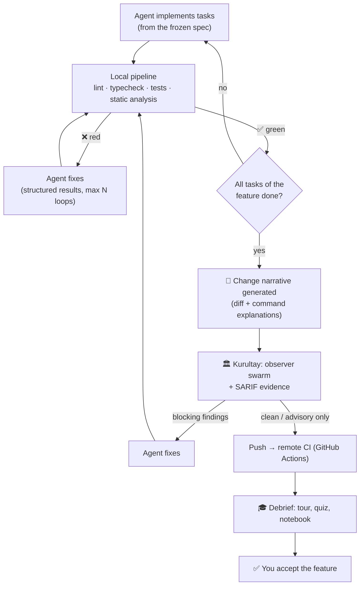
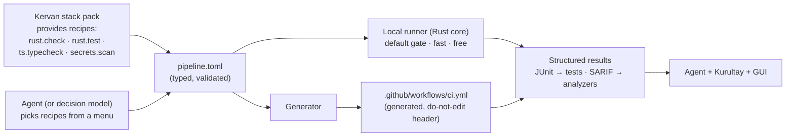
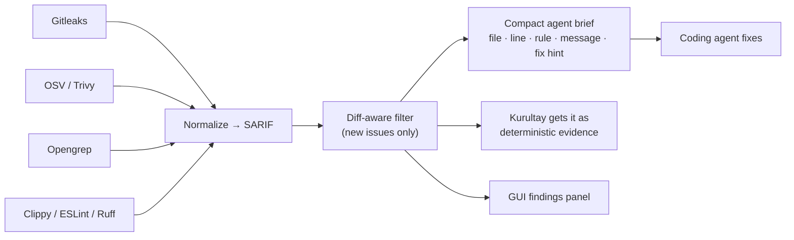

# Proposal: Quality Pipeline

> Covers your v0.2-Q21 ideas on **explaining git diffs and commands**, **running observers after CI succeeds**, **medium models sharing findings + a strong judge**, **easy CI/CD**, and **free static-analysis guardrails**.

## Contents

1. [The feature-completion flow](#1-the-feature-completion-flow)
2. [Change narratives: explaining diffs and commands](#2-change-narratives-explaining-diffs-and-commands)
3. [CI/CD without relying on the AI's imagination](#3-cicd-without-relying-on-the-ais-imagination)
4. [Static analysis guardrails](#4-static-analysis-guardrails)
5. [Kurultay: the swarm, refined](#5-kurultay-the-swarm-refined)
6. [Sources](#sources)

---

## 1. The feature-completion flow

You said: *"After CI/CD finishes without problems and the whole feature is complete, that's when we start the observer agents and other custom agents."*

Agreed. This **moves the swarm from "per task" to "per completed feature, after CI is green"** (updating D-042). That's cheaper, and the swarm reviews code that already compiles and passes tests and static analysis, so it spends its effort on *real* problems instead of things a linter would catch.



| Trade-off | Per task (old) | **Per feature after CI (new)** |
|---|---|---|
| Cost | Higher (many small reviews) | **Lower** |
| Noise | Reviews code that may not even compile | **Only reviews green code** |
| Fix size | Small, early fixes | Possibly bigger fixes, later |
| Mitigation for late fixes | — | CI and static analysis already catch most issues per task; the swarm focuses on design, security and logic |

**Status:** ✅ Decided (D-042 superseded by D-046).

---

## 2. Change narratives: explaining diffs and commands

You asked: *"What if AI explains the git diffs: what each diff achieves? And the intention of executed scripts and terminal commands, with a ❓ at the top-right of each command box. At the end of feature implementation."*

**Short answer:** not too much. It's **central to Purpose #1** (understanding without reading every line) and cheap to do well.

### 2.1 What you'll see

| Element | Shows | ❓ reveals |
|---|---|---|
| **Feature story** (top) | 5–10 sentences: what changed and why, linked to spec requirements | — |
| **Change groups** | Hunks grouped by *intent*, not by file: "These 4 hunks add retry with exponential backoff to the payment client" | Why this approach, the alternative considered, the linked ADR |
| **Per-file summary** | One line per file: role in the change | Full explanation |
| **Command cards** | `cargo test -p core`, `python scripts/migrate.py`, … with exit code, duration, output excerpt | **❓ top-right:** what the command does (each flag), **why** the agent ran it, risk level, what happened |
| **Script cards** | Scripts the agent wrote or ran | Purpose, inputs and outputs, side effects |

### 2.2 How it's generated: facts first, AI second (again)

| Fact (free, deterministic) | AI layer (cheap model, once per feature) |
|---|---|
| Diff hunks, file roles from the Atlas | Grouping hunks by intent, writing the story |
| Command parsed into program + flags (explainshell-style lookup from `--help`/man pages) | The **intent**, from the agent's own stated reason in the session ledger + context |
| Exit code, duration, output (from the ledger) | Plain-language outcome |

- **Cost:** one feature's diff is typically tens of thousands of tokens. With a flash-tier model through OpenCode Go that's well within your daily budget. Results are cached, so a narrative is never generated twice.
- **When:** automatically at the end of a feature (your choice). Pressing ❓ on a single item before then generates just that item, on demand.

**What others do:**

| Tool | Approach | Pros | Cons |
|---|---|---|---|
| **CodeRabbit** | PR "walkthrough": per-file summary table + sequence diagrams | Rich | PR-level only; SaaS |
| **GitHub Copilot PR summaries** | Generated PR description | Built in | Shallow; no command intent |
| **Claude Code** | The model writes a short description for each shell command it runs | Intent visible live | Not kept as a browsable narrative |
| **Warp** | "Explain this command" with AI | Handy | Manual; one command at a time |
| **explainshell.com** | Deterministic flag explanations from man pages | Accurate | No intent; shell only |

**Atabey combines** CodeRabbit-style walkthroughs + Claude Code-style intent + explainshell-style accuracy, **kept forever** in the feature's history.

---

## 3. CI/CD without relying on the AI's imagination

You said: *"Make it easy to create CI/CD pipelines… maybe a small tool, a CI/CD SDK or CLI, so AI doesn't rely on its own ability to write pipelines… Jenkins comes to mind… local or remote?"*

### 3.1 The problem

AI-written CI YAML is a classic failure point: wrong action versions, YAML indentation errors, steps that work locally but not in CI, secrets misconfigured. The agent burns tokens debugging pipelines instead of building features.

### 3.2 Options

| Option | What it is | Pros | Cons | Fit for you |
|---|---|---|---|---|
| **Jenkins** | Self-hosted CI server (Java), huge plugin ecosystem | Powerful, free, open source | **You run and maintain a server**; plugin upgrade pain; heavy for a solo dev | ⚠️ |
| **GitHub Actions only** | YAML workflows on GitHub's runners | Free for public repos (free-minute allowance for private); ubiquitous | YAML is where AI makes mistakes; slow feedback; remote only | ⚪ |
| **`act`** | Runs GitHub Actions locally | Local feedback | Imperfect fidelity with real runners | ⚪ helper |
| **Dagger** | **"CI as code" SDK**: pipelines in Go/Python/TypeScript, executed in containers; runs **identically locally and in any CI** | Exactly your "CI/CD SDK" idea; no YAML logic | Requires a container engine; another tool to learn; no official Rust SDK | ⚪ optional later backend |
| **Task runners** (just, Taskfile, make) | Named shell commands | Simple, local, fast | Not a full CI (no matrix, no artifacts) | Building block |
| **Atabey Pipeline Recipes** ⭐⭐ (proposal) | A small **typed pipeline file** + **recipes from stack packs** + Atabey's **own runner** + **generated** GitHub Actions | AI only *chooses* recipes; the YAML is generated, never hand-written; local and remote run the same steps | We build and maintain it (small) | ⭐⭐ |

### 3.3 The proposal: Pipeline Recipes



Example `pipeline.toml` (what the agent writes: choices only, nothing creative):

```toml
[pipeline]
schema = "atabey.pipeline@1"

[[stage]]
name = "check"
recipes = ["rust.fmt-check", "rust.clippy", "ts.typecheck", "ts.lint"]

[[stage]]
name = "test"
recipes = ["rust.test", "ts.test"]

[[stage]]
name = "analyze"
recipes = ["secrets.gitleaks", "deps.osv-scanner", "sast.opengrep"]
mode = "diff-aware"   # only fail on issues introduced since the feature started
```

| Question | Answer |
|---|---|
| **Local or remote?** | **Both, same definition.** **Local** is the default gate inside the agent loop (instant, free, works offline). **Remote** (generated GitHub Actions) runs on push as the official record |
| **What about Jenkins later?** | The generator design allows more targets (GitLab CI, Jenkins) as extensions if you ever need them |
| **CD (deployment)?** | Recommend **CI only in v1**. Deploy recipes (Docker image push, Vercel, Fly.io, app-store builds…) come later via stack packs. See v0.3-Q9 |

---

## 4. Static analysis guardrails

You said: *"Use free, open-source, permissively licensed static analysis tools like SonarQube for stricter guardrails… especially at the end of the CI cycle, pass or fail, supply results to the coding agent. What's the industry standard?"*

### 4.1 The industry conventions

| Convention | What it means | Atabey's use |
|---|---|---|
| **SARIF** (OASIS standard) | A common JSON format for static-analysis results; GitHub code scanning ingests it | **Every analyzer's output is normalized to SARIF** → one format for the agent, the swarm and the GUI |
| **Quality gate** (popularized by SonarQube) | CI fails if conditions are broken (e.g., "no new critical issues") | Pipeline `analyze` stage = the gate |
| **"Clean as you code"** / diff-aware | Judge **new** code, not the whole legacy codebase | `mode = "diff-aware"`: crucial for existing repos, so the agent isn't drowned in 3,000 old warnings |
| **Shift left** | Run checks as early as possible | Local runner on every task, not just remote CI |

### 4.2 About SonarQube specifically (checked 2026-10-07)

- **SonarQube Community Build** is still free, but **since Nov 2024 its bundled analyzers are under the *Sonar Source-Available License* (SSALv1)**. That isn't an open-source license. Only the platform code without the analyzers remains LGPL-3.0.
- It also needs a **Java server + database**. That's heavy for a solo developer's laptop.
- **Recommendation:** ⚠️ skip SonarQube. Use lighter, permissive tools that do the same jobs.

### 4.3 Recommended toolset (installed via stack packs, not bundled)

| Job | Tool | License | Notes |
|---|---|---|---|
| **Secrets** in code/history | **Gitleaks** | MIT | Fast, SARIF output |
| **Vulnerable dependencies** | **OSV-Scanner** | Apache-2.0 | Google's OSV database |
| **Vulns + IaC + containers + secrets** | **Trivy** | Apache-2.0 | All-rounder |
| **Multi-language SAST** (pattern rules, taint analysis) | **Opengrep** | LGPL-2.1 (engine) | Community fork of Semgrep CE (2025) that restored the features Semgrep removed. ⚠️ Semgrep's *maintained rules* now use a restrictive "Semgrep Rules License", so we use community or our own rules |
| Rust | **Clippy** | MIT/Apache-2.0 | |
| TypeScript/JS | **ESLint** or **Biome** | MIT (Biome: MIT/Apache-2.0) | |
| Python | **Ruff** | MIT | |
| Go | **golangci-lint** | GPL-3.0 | Fine to *run*; just don't bundle it |

> **License note:** running a tool as a separate program doesn't put its license on Atabey. **Bundling and redistributing** its binary can. Stack packs therefore **install tools on your machine** (via `mise` or the language's package manager) instead of shipping them inside Atabey.

### 4.4 Feeding results to the agent ("pass or fail, supply it")



Deterministic findings are **facts**. Giving them to the swarm as evidence reduces LLM guesswork and false positives.

**What others do:** GitHub (CodeQL + SARIF upload + code scanning alerts; CodeQL is free only for open source); GitLab (built-in SAST templates); SonarQube/SonarCloud (quality gates); CodeRabbit (runs dozens of linters and feeds them to its LLM review, the same idea as ours).

---

## 5. Kurultay: the swarm, refined

You asked: *"Medium-tier AIs share their findings somewhere, then look at each other's findings and contemplate, or a capable model like Opus 5.5 does it."*

**Short answer:** that's the v0.1 design. Here it is refined with **model tiers** so it fits your budget:

| Round | Who | Where findings go | Cost control |
|---|---|---|---|
| **0: Independent review** | **3 medium models from different vendors** (from OpenCode Go) | Shared **findings board**: `.atabey/findings/<feature>/round-0/<model>.json` (written by the engine) | One call each |
| **1: Cross-examination** | The same 3 models, each reviewing the others' **anonymized** findings (CONFIRM / REJECT / UNSURE) | `round-1/votes.json` | One call each |
| **2: Judge (only for split votes)** | **One strong model** | `round-2/verdicts.json` | Only disputed findings; skipped if none |
| **Evidence** | SARIF results + sandboxed PoC tests | Attached to findings | Free / local |

**Who should be the judge?**

| Option | Cost | Quality | Ban-safe? |
|---|---|---|---|
| **The strongest model in your OpenCode Go plan** ⭐⭐ | Included in the subscription | Good | ✅ |
| **Claude Opus 5.5 via API key** | Pay per token; a few calls per feature could eat a large part of a $1 day | Best | ✅ (API key) |
| Claude via your Claude subscription | — | — | ❌ **Not allowed**: automating a subscription outside Claude Code (see v0.2 clarifications) |
| No judge: majority vote only | Free | Weakest on ties | ✅ |

**What others do:** research on multi-agent debate shows cross-examination improves factual accuracy, while LLM-as-judge setups show **position and self-preference biases**. That's why we **anonymize authors** and **randomize order** before cross-examination and judging. Commercial reviewers (CodeRabbit, Greptile) typically use one strong model + static analysis rather than a vendor-diverse swarm. Kurultay's diversity is a real differentiator, *if* the seeded-bug benchmark shows it helps.

**Status:** 🔁 v0.3-Q11 (judge choice).

---

## Sources

- Dagger: [Dagger vs GitHub Actions](https://computingforgeeks.com/dagger-vs-github-actions-comparison/), [Dagger in Docker (2026)](https://oneuptime.com/blog/post/2026-02-08-how-to-run-dagger-ci-pipelines-in-docker/markdown)
- SonarQube licensing: [sonarsource.com/license](https://www.sonarsource.com/license/)
- Opengrep / Semgrep: [Semgrep: compare to Opengrep](https://semgrep.dev/docs/faq/comparisons/opengrep), [InfoQ: Semgrep forked as Opengrep](https://www.infoq.com/news/2025/02/semgrep-forked-opengrep), [Semgrep vs SonarQube 2026](https://www.pixee.ai/blog/semgrep-vs-sonarqube)
