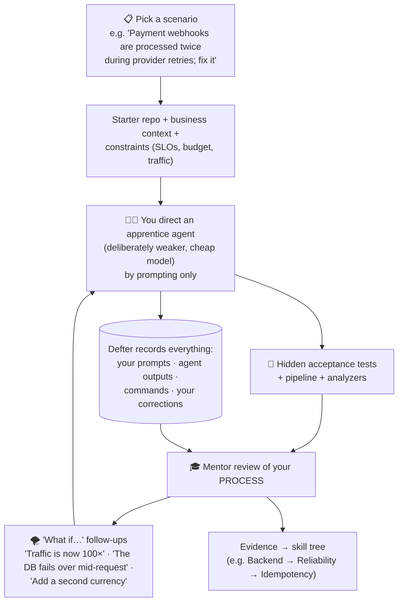
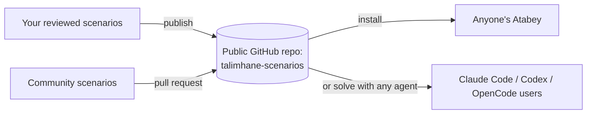
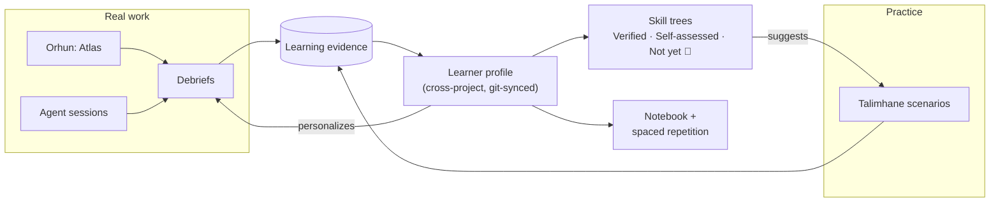

# Proposal: Learning (Enderun + Talimhane)

> Covers your v0.2-Q21 ideas: **production-grade examples instead of Animal/Cat/Dog**, and an **interactive practice tool that trains system thinking through agentic coding**, with shareable scenarios, deliberately weaker models and "what if" follow-ups.
> Skill-tree assessment design ("Not yet" indicators) is in [01-CLARIFICATIONS.md → Q17](01-CLARIFICATIONS.md#q17-skill-assessments-that-dont-crush-anyones-ego).

## Contents

1. [Production-grade teaching standard](#1-production-grade-teaching-standard)
2. [Talimhane: practice ground for system thinking](#2-talimhane-practice-ground-for-system-thinking)
3. [Sharing scenarios publicly](#3-sharing-scenarios-publicly)
4. [How it all connects](#4-how-it-all-connects)

---

## 1. Production-grade teaching standard

You said: *"Explain with real-world, production-grade examples, not animal/cat/dog classes. Real complicated systems, and the common conventions."*

### 1.1 Where examples come from (in priority order)

| Priority | Source | Example |
|---|---|---|
| 1 | **Your own code** (from the Atlas) | "Your `PaymentClient` uses the Strategy pattern to switch providers. Here's why that matters when Stripe has an outage" |
| 2 | **Well-known open-source systems** (linked, short excerpts, with license attribution) | How PostgreSQL's MVCC avoids read locks; how Kubernetes controllers reconcile state; how Redis handles eviction |
| 3 | **Realistic synthetic scenarios** | Idempotent payment webhooks, rate limiting at an API gateway, outbox pattern for reliable events, zero-downtime schema migrations, multi-tenant RBAC, i18n with ICU plural rules, cache invalidation, backpressure in queues |

### 1.2 Every lesson has the same shape

| Section | Content |
|---|---|
| **The concept** | One plain paragraph |
| **In production** | A real-system example (from the list above) |
| **Common conventions** | How the industry usually does it (naming, structure, libraries) |
| **What goes wrong** | Real failure modes: race conditions, partial failures, N+1 queries, thundering herds… |
| **Trade-offs** | When *not* to use it |
| **Check yourself** | 2–3 quiz cards → notebook (spaced repetition) |

### 1.3 Enforcing it (so toy examples can't sneak in)

1. **Mentor style guide** in every mentor prompt: banned examples (Animal/Dog/Cat, Foo/Bar, Shape/Circle, Car/Engine) plus required sections.
2. **Decision-model check** (cheap, from the platform proposal): *"Score 0–3: how production-realistic is this example?"* If it scores low, the example is regenerated automatically.

**What others do:** most tutorials (and LLMs by default) use toy examples because they're short. **CodeCrafters** ("build your own Redis/Git/Docker") and **"Designing Data-Intensive Applications"** are loved precisely because they use real systems. That's the bar.

**Status:** ✅ Decided (a product requirement).

---

## 2. Talimhane: practice ground for system thinking

You described: *"Small agentic coding sessions on predefined, real-life, production-grade problems. The user solves it by prompting. The mentor AI looks at how we thought (our prompts, what they generated, what we did when the AI gave a bad solution, how we set guardrail prompts). So people improve software engineering and CS skills, not syntax memorization. Use dumber models so the user has to navigate the problem themselves. The AI generates follow-ups: what if X happens instead?"*

**Short answer:** this is a genuinely new idea. Nobody grades **how you direct an AI agent** on real-system problems. It also reuses almost everything we're already building (agent sessions, ledger, pipeline, swarm, mentor), so it's cheaper to build than it sounds.

### 2.1 The flow

### 2.2 What gets graded: the process, not the syntax

| Dimension | What the mentor looks for in your session |
|---|---|
| **Problem framing** | Did you clarify requirements and constraints before asking for code? |
| **Decomposition** | Did you split the problem into verifiable steps? |
| **Guardrails** | Did you set constraints the agent must respect ("don't change the public API", "every DB write must be idempotent")? |
| **Verification** | Did you ask for tests, check edge cases, read the diff? |
| **Recovery** | When the apprentice produced a bad solution, did you notice? How did you correct it? |
| **System reasoning** | Did you consider failure modes, scale, consistency, cost? |
| **Outcome** | Hidden tests pass; analyzers clean; no regressions |

Feedback uses the same **"Not yet" 🌱** tone as the skill trees: specific, honest, never humiliating.

### 2.3 Why a weaker model is a feature (your idea)

| Apprentice model | Effect on learning | Cost |
|---|---|---|
| **Weak, cheap model** ⭐⭐ | It makes realistic mistakes → **you** must catch them, decompose and verify. That's exactly the skill being trained | Lowest (fits your budget) |
| Strong model | It solves the problem for you → you learn little about directing agents | Higher |
| Adaptive (gets weaker as you improve) | Keeps it challenging | Medium |

### 2.4 Scenario format (just files, like everything else)

| File | Contents |
|---|---|
| `scenario.md` (`kind: scenario`) | Business context, constraints, SLOs, difficulty, skill-tree nodes it trains |
| `starter/` | The starter repository |
| `hidden-tests/` | Acceptance tests (not shown to you or the apprentice) |
| `follow-ups.md` | "What if" variations, each with its own hidden tests |
| `rubric.toml` | The grading dimensions and weights |

AI generates new scenarios on request ("give me a medium-difficulty caching scenario in Rust"), and **you review them before they enter your library**. Scenario quality matters more than quantity.

### 2.5 What others do

| Tool | What it trains | Pros | Cons |
|---|---|---|---|
| **LeetCode / HackerRank** | Algorithms, syntax | Huge library | Not real systems; not about AI collaboration |
| **CodeCrafters** | Building real systems (Redis, Git, Docker) | Real-system depth (closest in spirit) | You write all the code yourself; no agent-directing skills |
| **Exercism** | Language fluency, mentored | Human feedback | Small exercises |
| **ByteByteGo / Hello Interview** | System design (diagrams, talking) | System thinking | No implementation, no verification |
| **SWE-bench-style tasks** | Benchmarks for *agents* | Realistic issues | Built for evaluating models, not teaching humans |
| **Talimhane** | **System thinking + directing AI agents + verification**, graded on your *process* | New combination | Scenario quality is critical |

---

## 3. Sharing scenarios publicly

You said: *"Maybe we can share these real-life problems on the internet so everyone can solve them on their own."*

Scenarios are plain files, so sharing reuses the **Bedesten** mechanism (a GitHub registry):

- Anyone can solve a scenario **even without Atabey** (starter repo + instructions), which spreads the project.
- Hidden tests can't really stay hidden in a public repo, so public scenarios use a **"no peeking" honor system**; Atabey simply doesn't show them during a session. A private grading service could come much later, if ever.
- License for shared scenarios: a content license such as **CC BY 4.0** (separate from the code's Apache-2.0). Decided later.

**Recommendation:** build Talimhane for **personal use first**; open the public library once you have ~10 scenarios you're proud of.

---

## 4. How it all connects

The loop: **real work and practice both create evidence → the profile updates the skill trees → weak spots suggest the next Talimhane scenario → debriefs skip what you've already mastered.**
