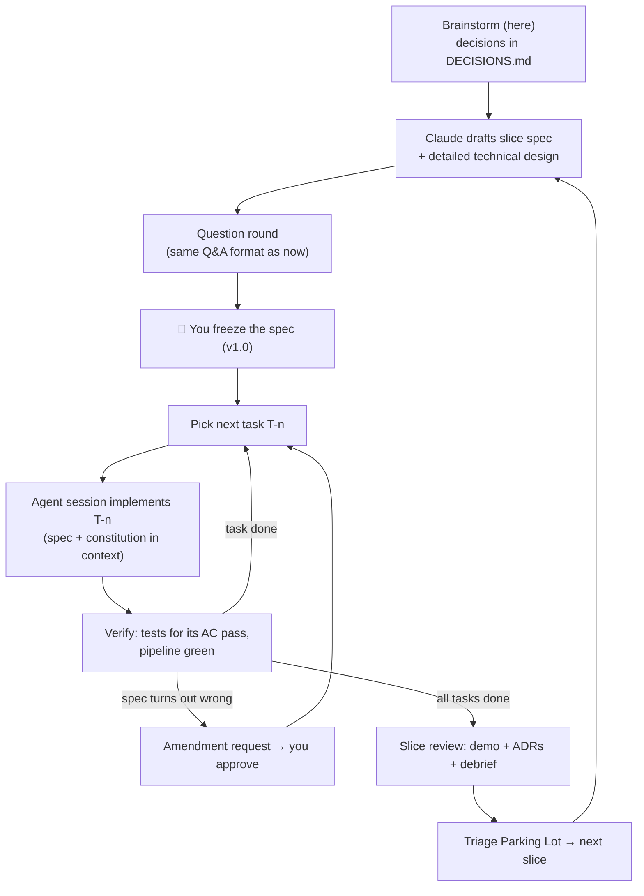

# How We Build It: Process & Revised Roadmap

> Covers your v0.2-Q21 request: *"We will use a simple spec-driven approach to build this IDE. Make your suggestion for a solo developer like me. I don't like external spec-driven toolkits, but if you insist I'd consider it. You will explain all the technical details and the roadmap in a very detailed way."*
> 📌 **Noted for the future:** when we move from brainstorming to building, the first deliverable is a **very detailed technical roadmap**. This is recorded in `CLAUDE.md`. For now we keep brainstorming.

## Contents

1. [Spec-Lite: a homegrown process for one developer](#1-spec-lite-a-homegrown-process-for-one-developer)
2. [What others do](#2-what-others-do)
3. [Revised build order (v1 and v2)](#3-revised-build-order-v1-and-v2)
4. [When does brainstorming end?](#4-when-does-brainstorming-end)

---

## 1. Spec-Lite: a homegrown process for one developer

**Short answer:** I don't insist on an external toolkit. A small homegrown process fits you better, because **it's the same process Atabey will implement as a product**. Building Atabey this way is the first real test of Atabey's own design (and once the Spec slice exists, Atabey can manage its own development).

### 1.1 The documents

| Document | One per | Purpose | Changes how? |
|---|---|---|---|
| `CONSTITUTION.md` | Project | Non-negotiable engineering rules: Rust core / TS UI, type safety, tests required, no secrets in code, logging rules, licenses allowed | Rarely; via an amendment |
| `PRODUCT-SPEC.md` | Project | Vision, pillars, non-goals, v1/v2 scope (generated from `DECISIONS.md` when brainstorming ends) | Amendments |
| `specs/S<n>-<name>.md` | **Slice** (e.g., S0 Foundations) | What this slice must do, testably | Frozen → amendments |
| `adr/ADR-<nnnn>-<title>.md` | Decision | Why something is built a certain way | Superseded by new ADRs |
| `ROADMAP.md` | Project | Slices, status, versions | Updated at slice boundaries |
| `PARKING-LOT.md` | Project | Ideas that came up mid-slice | Triaged at slice boundaries |

### 1.2 Slice spec template

| Section | Contents |
|---|---|
| **Frontmatter** | `id`, `status` (draft / frozen / done), `version`, `depends_on` |
| **Goal** | 2–3 sentences |
| **Non-goals** | Explicitly out of scope (anti-scope-creep) |
| **Requirements** | `R-1`, `R-2`… each one testable |
| **Acceptance criteria** | `AC-1`… concrete checks (ideally automated tests) mapped to requirements |
| **Technical design** | Modules, Rust types, TS types, data flow (Mermaid), extension points |
| **Tasks** | `T-1`… each small enough for **one agent session**, each linked to requirements |
| **Risks & unknowns** | With a mitigation per risk |
| **Amendments** | `A-1 (date): what changed, why, approved` |

### 1.3 The loop per slice

### 1.4 Agent instructions file

A short `AGENTS.md` (read by OpenCode, Codex and others) plus `CLAUDE.md` (Claude Code), both saying: *read CONSTITUTION.md and the active slice spec first; only do the current task; put new ideas in PARKING-LOT.md; never edit a frozen spec, propose an amendment instead.* This turns the process into guardrails the agent actually follows.

---

## 2. What others do

| Toolkit | Approach | Pros | Cons for you |
|---|---|---|---|
| **GitHub Spec Kit** | Slash commands: `/specify → /clarify → /plan → /tasks → /implement`; a "constitution"; a branch per feature | Well thought out; the **constitution idea is worth borrowing** | Many templates and steps; tuned for its own CLI flow |
| **Kiro** | Requirements → design → tasks with approval gates, inside its IDE | Smooth UX | Tied to Kiro's IDE |
| **BMAD Method** | Many agent personas (analyst, PM, architect, scrum master…) and documents | Thorough | **Heavy for a solo developer** |
| **OpenSpec** | Lightweight: specs + "change proposals" with deltas against the current spec | Great for changing existing systems; the **delta idea is worth borrowing** for amendments | Another tool and folder convention to adopt |
| **Spec-Lite (proposal)** | A handful of Markdown files + agent instruction files | **Zero dependencies; identical to Atabey's own future format; you control it** | No ready-made slash commands (we write a few skills for that) |

**Recommendation:** ⭐⭐ **Spec-Lite**, borrowing Spec Kit's *constitution* and OpenSpec's *delta-style amendments*.

---

## 3. Revised build order (v1 and v2)

Updated with everything decided so far: the extension architecture, v1 Terminal + GUI, the quality pipeline after tasks and the swarm after CI, Talimhane, decision models and logging.

| Slice | Delivers | Kind |
|---|---|---|
| **S0: Foundations** | Tauri shell · `atabey-core` · Rust→TS types · **document renderer** (Markdown + Mermaid + typed blocks) · **Monokai-based dark theme** · **Defter logging** · settings, providers, budget meter · **extension host v0** (first-party only) · macOS + Windows CI | Core |
| **S1: Orhun (Codebase Atlas)** | tree-sitter facts · overview & modules (eager) · files/classes/functions (lazy, cached) · cross-cutting concern pages · **LSP "Used by"** · code-intel cache | Core (code intel) + first-party extension (Atlas) |
| **S2: Agent Session v1** | **OpenCode**: `opencode serve` + TUI attached in the terminal pane + GUI live via event stream · checkpoint commits · **diff viewer** · command cards · `record_decision` → ADRs · **decision-model command gate** | Core (PTY, MCP host, decision wrapper) + extension |
| **S3: Divan + Spec & Roadmap** | Brainstorm Studio (this workflow in the GUI) · spec drafting, strike & instruct, **Tuğra freeze**, amendments · Parking Lot · roadmap view | Extensions |
| **S4: Quality pipeline** | **Pipeline Recipes** + local runner + generated GitHub Actions · analyzers → **SARIF** (diff-aware) · **change narratives** (diff + command ❓ explanations) | Extensions + first Kervan pack |
| **S5: Kurultay (Swarm)** | 3-vendor review after green CI · cross-examination · judge for splits · PoC sandbox · seeded-bug benchmark | Extension |
| **S6: Enderun (Mentor)** | Debriefs (production-grade lessons) · quiz + stored AI feedback · notebook + FSRS · **cross-project learner profile + git sync** · skill trees with "Not yet" 🌱 | Extension |
| **S7: Talimhane** | Scenarios · apprentice sessions · process grading · "what if" follow-ups | Extension |
| **S8: Feedback overlay** | Global hotkey + tray · hide-capture-crop · defect/idea routing | Extension |
| **S9: Bedesten & Kervan** | Public extension registry · install/permissions UI · extension dev kit + **skills** · stack-pack library · VS Code theme import | Core + ecosystem |
| **🏁 v1.0** | = S0–S9: **Terminal + GUI** layout | |
| **v2.0** | **Native mode** (pure GUI via ACP) by default + **"Switch to Terminal layout"** button · more agents (Codex app-server, Claude Code via hooks, Gemini CLI) · more doc types (API, DB, UI/UX, refactor proposals) · CD/deploy recipes · public Talimhane library | |

> **Why S9 comes last even though extensions matter:** the API needs 3+ real extensions using it before it's frozen ("rule of three"). By S9 there will be ~9 first-party extensions proving it.

---

## 4. When does brainstorming end?

We've now covered every pillar at least once. I propose:

| Session | Content |
|---|---|
| **v0.4** | Your answers to v0.3 + any last ideas → **consolidation**: `PRODUCT-SPEC.md` v1.0 draft + `CONSTITUTION.md` draft + the final decision ledger |
| **v0.5** | **S0 Foundations**: a very detailed technical spec & roadmap (crates, modules, types, IPC, renderer architecture, CI setup, tasks) → you freeze it |
| then | Implementation starts, slice by slice |

You can of course keep adding ideas. They'll go to the Parking Lot or into later slices without blocking S0. This is v0.3-Q24.
