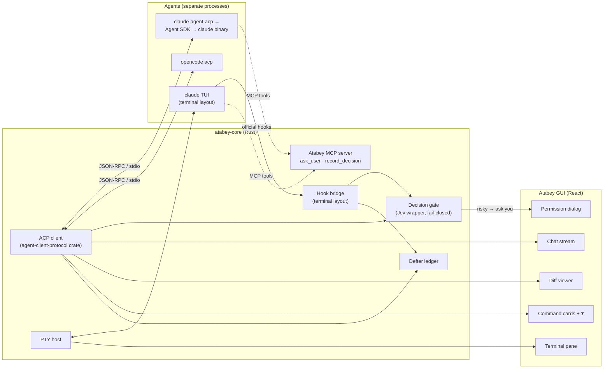
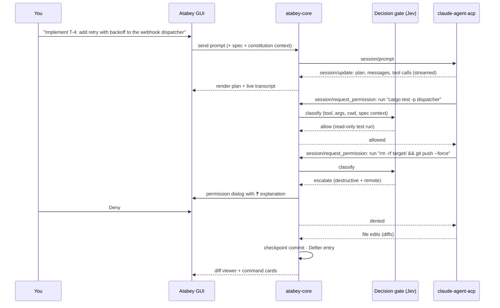
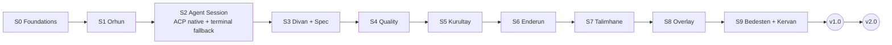

# Proposal: Agents, Sessions & the Native-First Roadmap

> Covers your v0.3-Q27 ideas: Claude Code as the priority agent, Claude Code via ACP, the observer runtime, and *"should we start directly with the full-GUI version?"*

## Contents

1. [The plain-language summary](#1-the-plain-language-summary)
2. [How Atabey connects to Claude Code](#2-how-atabey-connects-to-claude-code)
3. [My opinion: skip "v1 Terminal + GUI", go native-first](#3-my-opinion-skip-v1-terminal--gui-go-native-first)
4. [Session architecture (ACP client in the Rust core)](#4-session-architecture-acp-client-in-the-rust-core)
5. [Observer runtime: OpenCode headless, not a new harness](#5-observer-runtime-opencode-headless-not-a-new-harness)
6. [Revised build order](#6-revised-build-order)
7. [Sources](#7-sources)

---

## 1. The plain-language summary

| Question | Answer |
|---|---|
| Which agent do I code with? | **Claude Code**, with your own subscription |
| How does Atabey talk to it? | Through **ACP** (Agent Client Protocol): Atabey is the "editor", Claude Code is the "agent". It's the same mechanism Zed and JetBrains use |
| Is there a plan B? | Yes: a **Terminal layout** that runs the normal `claude` TUI in a terminal pane, with the GUI following along through Claude Code's official hooks. **One click to switch** |
| Do we still build "v1 Terminal + GUI" first? | **No** (recommended). v1.0 is **native GUI by default + terminal fallback**, built together in S2 |
| Who are the observers? | **OpenCode, run headless** with read-only "observer" agents on OpenCode Go models. No new harness |

**ACP in one sentence:** it is to coding agents what **LSP** is to language servers. One protocol (JSON-RPC over stdio) lets any editor drive any agent: send prompts, stream replies, show tool calls and diffs, and answer permission requests.

---

## 2. How Atabey connects to Claude Code

### 2.1 The four possible ways

| # | Way | How it works | Uses your subscription? | GUI richness | Risk / cost |
|---|---|---|---|---|---|
| **A** | **ACP adapter** (`claude-agent-acp`) ⭐⭐ | Atabey ↔ ACP ↔ adapter ↔ **Agent SDK** ↔ **official Claude Code binary** | ✅ Allowed today for individual use (see [Clarifications Q27.4](01-CLARIFICATIONS.md#q274-can-i-use-claude-code-through-acp-without-licensing-problems)) | **High**: structured messages, tool calls, diffs, permissions, plans, subagents | 🟡 Policy has changed several times in 2026; a separate billing pool was planned, then paused |
| **B** | **Terminal + hooks** ⭐ (fallback) | The real `claude` TUI in a terminal pane; official **hooks** push events to Atabey; Atabey's **MCP server** offers `ask_user` / `record_decision` | ✅ Clearly allowed: unmodified binary, your own login | **Medium**: the GUI observes; you type in the TUI | 🟢 Lowest. Even the paused billing change kept the terminal CLI on full subscription limits |
| C | Drive `claude -p --input-format stream-json` ourselves | Our own Rust driver for Claude Code's headless JSON stream (what the Agent SDK does internally) | Same as A | High | 🟠 We maintain a private protocol mapping; adapter A already does this (Apache-2.0, maintained by the ACP org) |
| D | Agent SDK with an **API key** | Pay per token | ❌ (API billing) | High | 🔴 **Budget breaker**: one long coding session can exceed your whole $3/day |

**Recommendation:** **A as the default + B as the always-available fallback.** Never C or D for daily work.

### 2.2 What Atabey must never do (ban-safe rule, refined)

| ✅ Do | ❌ Never |
|---|---|
| Launch the **unmodified** official binary (directly or through the vendor's official SDK) | Bundle, patch or repackage Claude Code |
| Let **you** install Claude Code and sign in through **Anthropic's own flow** | Show an Atabey "Sign in with Claude" button |
| Treat Claude Code's credential store as invisible | Read, copy, store or forward OAuth/session tokens |
| Label it "Claude Agent" / "runs Claude Code" | Name any Atabey feature "Claude Code …" |
| Re-check Anthropic's legal page **before any public release** | Assume today's rules still hold next quarter |

> This refines **D-041** (ban-safe rule). Rows 1–4 also apply to every other subscription-based agent (Codex with ChatGPT login, Gemini CLI with Google login).

### 2.3 What others do

| Tool | How it runs Claude Code | Subscription login? | Pros | Cons |
|---|---|---|---|---|
| **Zed** | ACP adapter, native agent panel | ✅ Yes (terminal login) | Rich native UI, many agents in one panel | Some TUI features missing |
| **JetBrains AI** | ACP adapter, bundled | ❌ Bundled version is API-key-only (a separate plugin enables subscription) | Conservative legally | Paying per token |
| **Neovim** (CodeCompanion, Avante) | ACP adapter | ✅ | Lightweight | Text-only UI |
| **VS Code** | Anthropic's own official extension | ✅ | First-party | Not available to other apps |
| **Warp, Conductor-style apps** | Real TUI in a terminal | ✅ | Every feature works | GUI can't see much |
| **Atabey (proposal)** | **ACP native + terminal fallback, one click apart** | ✅ (personal use) | Rich GUI *and* an escape hatch | Two modes to maintain |

---

## 3. My opinion: skip "v1 Terminal + GUI", go native-first

### 3.1 Short answer

**Yes, start with the full GUI**, but **don't skip the terminal entirely**. Ship it as a fallback inside the same slice (S2). The old "v2 Native mode" moves into v1.0.

### 3.2 Why

| # | Reason | Detail |
|---|---|---|
| 1 | **The trick that made "v1 Terminal + GUI" attractive was OpenCode-specific** | OpenCode's `serve` + `attach` let TUI and GUI share one session. Claude Code, now the priority, has no equivalent, so in terminal mode the GUI is mostly a spectator |
| 2 | **ACP gives structure for free** | Tool calls, diffs, plans, permission requests and subagent transcripts arrive as typed messages, ready for the diff viewer, command cards with ❓, and change narratives |
| 3 | **The decision-model gate fits perfectly** | ACP's permission request goes to the **client**. Atabey asks Jev first: auto-allow safe commands, escalate risky ones to you. In terminal mode, the same gate needs a `PreToolUse` hook (possible, but it's a second implementation) |
| 4 | **One integration, many agents** | The ACP registry lists Claude Code, Codex CLI, OpenCode, Gemini CLI, GitHub Copilot CLI and more. Agent adapters become registry entries, not custom code |
| 5 | **Rust-native** | The official `agent-client-protocol` crate covers the client side, transports and full schema types. It drops straight into `atabey-core` |
| 6 | **It's what you actually want** | You described pure GUI as the goal (v0.2-Q21). Building a terminal-first v1 and then rebuilding the session UI later is double work |

### 3.3 Risks and mitigations

| Risk | Likelihood | Mitigation |
|---|---|---|
| Anthropic moves ACP/SDK usage to a **separate, smaller credit** (planned June 15, 2026, then paused) | Medium | **Terminal fallback in S2**; the meter shows which mode is burning which allowance; one-click switch |
| Anthropic restricts subscription use through the Agent SDK for third-party apps | Low–medium for personal use | Same fallback; Atabey never touched credentials, so nothing in Atabey breaks the rules |
| **Feature lag**: some TUI-only commands are missing in ACP (e.g., OpenCode `/undo` / `/redo`) | Certain | Terminal layout for those moments; checkpoint commits (S2) cover undo anyway |
| The adapter breaks or is abandoned | Low (ACP org, 2.6k★, active) | Apache-2.0: we can pin a version or fork |
| **More UI work** in S2 (chat stream, permission dialogs, diff review) | Certain | Reuse the S0 document renderer; ACP defines the data shapes; S2 is split into small tasks |
| Same session in both modes | Unknown | Agent SDK sessions are Claude Code sessions, so `claude --resume <id>` *may* continue them in the TUI. **Verify in the S2 spec**; if it doesn't work, the switch starts a new session with a handoff summary |

### 3.4 Options compared

| Option | Time to a usable app | Long-term rework | Budget safety | Verdict |
|---|---|---|---|---|
| **Native-first v1 + terminal fallback in S2** | Medium (S2 grows ~30–40%) | **None**: this *is* the end state | ✅ (fallback) | ⭐⭐ |
| Keep v0.3 plan (Terminal + GUI v1, Native v2) | Faster S2 | **High**: session UI rebuilt in v2 | ✅ | ⚪ |
| Native only, no terminal | Fastest native | None | ⚠️ No escape if billing/policy changes | ⚠️ |

### 3.5 What changes in the plan

| Before (v0.3) | After (proposal) |
|---|---|
| D-017: v1 = OpenCode `serve`/`attach`; ACP for v2 | **ACP-first for all agents from S2**; hooks + MCP for the terminal layout; OpenCode server API only for headless batch jobs (Kurultay) |
| D-018: v1 Terminal + GUI; v2 Native + switch back | **v1.0 = Native (ACP) default + one-click Terminal layout** |
| D-026: first agent OpenCode | **First agent: Claude Code** (ACP adapter); **second: OpenCode** (`opencode acp`) to prove the abstraction |
| v2.0 = Native mode + more agents | **v2.0 = more doc types, CD/deploy recipes, public Talimhane library, more agents tested** |

---

## 4. Session architecture (ACP client in the Rust core)

### 4.1 One prompt, start to finish (native mode)

### 4.2 Mode switch

| | Native (default) | Terminal layout |
|---|---|---|
| You type in | Atabey's chat box | The real `claude` TUI |
| Atabey sees | Everything (ACP messages) | Hook events: tool use, prompts, stops, notifications |
| Permission gate | ACP permission request → Jev | `PreToolUse` hook → Jev |
| Diffs / checkpoints | ✅ | ✅ (from hooks + git) |
| Billing | Agent SDK path (subscription today) | Plain CLI (subscription) |
| When to use | Always | Missing TUI feature, billing change, debugging |

---

## 5. Observer runtime: OpenCode headless, not a new harness

### 5.1 Options

| Option | How | Pros | Cons | Verdict |
|---|---|---|---|---|
| **A. OpenCode headless + read-only agents** | `.atabey/opencode/agents/kurultay-observer.md` with `edit: deny`, `bash: deny`, `webfetch: deny`, model per observer; driven via `opencode serve` HTTP API | Official Go client (no abuse-detection risk); tools + LSP built in; per-agent models; JSON events; keeps D-010 | One more process per review; OpenCode version upgrades | ⭐⭐ |
| B. Own minimal harness in Rust calling Go endpoints | HTTP to `opencode.ai/zen/go/v1` | Full control, tiny | Must mimic "typical coding-agent traffic" + session headers; reimplement tools; breaks D-010 | ⚠️ |
| C. Claude Code subagents as observers | `.claude/agents/reviewer.md` | Zero setup | **Same vendor as the coder** (defeats D-040 diversity); burns your Claude limits | ⚠️ |
| D. OpenCode via ACP (`opencode acp`) | Same as A over ACP | One protocol for everything | Less control over per-prompt model/agent selection than the server API | ⚪ (decide in S5 spec) |

### 5.2 How "structurally read-only" is enforced (D-045)

| Layer | Mechanism |
|---|---|
| 1. Agent permissions | OpenCode agent config: `edit`, `bash`, `webfetch` = `deny` |
| 2. Filesystem | Observers run in a **separate git worktree checked out at the feature commit**, not your working copy |
| 3. Output | Observers return **JSON findings as their final message**; **the engine** validates and writes `.atabey/findings/…` |
| 4. Audit | Every observer session is linked to the Defter ledger (correlation id) |

### 5.3 Cost check (OpenCode Go, checked 2026-10-09)

Go is $10/month with **per-model dollar allowances** (5-hour = 20%, weekly = 50%, monthly = 100%). A Kurultay run is roughly **3 observers × 2 rounds + 0–1 judge call** per completed feature. At a few features a week, this fits comfortably. If an allowance runs out, the free models remain available. The meter shows each model's remaining allowance.

**What others do:** OpenCode's own **Plan/Explore** agents and Claude Code's **Explore** subagent are read-only by tool restriction. CodeRabbit and Greptile run their own hosted pipelines (not an option on your budget). Codex has `/review` with a single model.

---

## 6. Revised build order

Only S2 changes in substance. S5 and S7 now name their runtime.

| Slice | Delivers | Change vs v0.3 |
|---|---|---|
| **S0: Foundations** | Tauri shell · `atabey-core` · Rust→TS types · document renderer · **theme system** (registry + semantic tokens; Monokai ships) · Defter · settings, providers, budget meter · extension host v0 · **Ulak v0 (commands + events)** · macOS + Windows CI | + theme registry, + Ulak v0 |
| **S1: Orhun** | tree-sitter facts · overview & modules · lazy explanations · LSP "Used by" · code-intel cache | — |
| **S2: Agent Session** | **ACP client** · **Claude Code via `claude-agent-acp`** · **OpenCode via `opencode acp`** · native chat + plan + tool-call stream · **permission dialog + Jev gate** · diff viewer · command cards · checkpoint commits · `record_decision` → ADRs · **terminal layout fallback** (PTY + Claude hooks bridge + MCP) · one-click mode switch | **Native-first + terminal fallback** (was: OpenCode serve/attach) |
| **S3: Divan + Spec & Roadmap** | Brainstorm Studio · specs · Tuğra freeze · amendments · Parking Lot · roadmap | — |
| **S4: Quality pipeline** | Pipeline Recipes · analyzers → SARIF · change narratives | — |
| **S5: Kurultay** | **OpenCode headless read-only observers** · cross-exam · judge (Go) + **escalate-to-Opus button** · PoC sandbox · benchmark | Runtime named; escalate button |
| **S6: Enderun** | Debriefs · quiz · FSRS · learner profile + git sync · **AI-generated skill trees (no roadmap.sh)** | roadmap.sh removed |
| **S7: Talimhane** | Scenarios · **apprentice = OpenCode + cheap Go model over ACP** · process grading | Runtime named |
| **S8: Feedback overlay** | Hotkey + tray · capture · defect/idea routing | — |
| **S9: Bedesten & Kervan** | Public registry · install/permissions UI · extension dev kit + skills · stack packs · **more themes + VS Code theme import** · **Ulak services frozen at 1.0** | + Ulak freeze |
| **🏁 v1.0** | **Native GUI (ACP) by default + Terminal layout fallback** | was Terminal + GUI |
| **v2.0** | More doc types (API, DB, UI/UX, refactor proposals) · CD/deploy recipes · public Talimhane library · more agents certified (Codex, Gemini CLI, Copilot CLI) | Native mode moved to v1 |

---

## 7. Sources

All checked **2026-10-09**.

- Anthropic: [Claude Code legal and compliance](https://code.claude.com/docs/en/legal-and-compliance), [Agent SDK overview](https://code.claude.com/docs/en/agent-sdk/overview)
- Zed: [Anthropic billing changes for Zed users](https://zed.dev/blog/anthropic-subscription-changes) (with June 16, 2026 pause update), [ACP Registry is live](https://zed.dev/blog/acp-registry)
- ACP: [claude-agent-acp](https://github.com/agentclientprotocol/claude-agent-acp), [Rust library](https://agentclientprotocol.com/libraries/rust), [registry announcement](https://agentclientprotocol.com/announcements/acp-agent-registry-stabilized.md)
- JetBrains: [Subscription ACP Agent plugin](https://plugins.jetbrains.com/plugin/33150-subscription-acp-agent)
- OpenCode: [Go](https://opencode.ai/docs/go/), [Agents & permissions](https://opencode.ai/docs/agents/), [ACP support](https://opencode.ai/docs/acp/)
