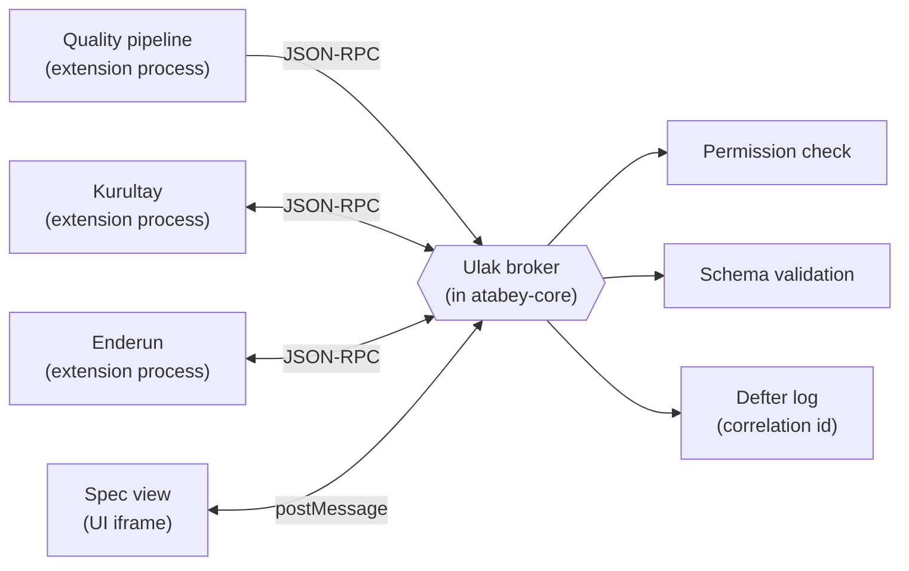
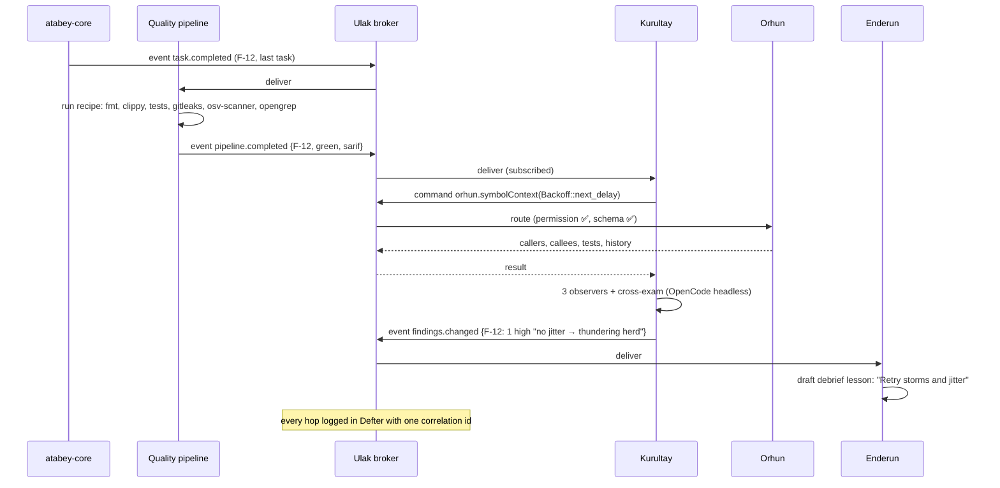

# Proposal: Ulak · Extension Messaging

> Your idea (v0.3-Q27): *"We can create an extension communication protocol, like one extension can send a message to another in a predefined way."*
> *Ulak* = the courier of the Seljuk and Ottoman state post. Subtitle: **"Ulak · Extension Messaging"**.

## Contents

1. [Short answer](#1-short-answer)
2. [What others do](#2-what-others-do)
3. [The three message styles](#3-the-three-message-styles)
4. [Contracts: how "predefined" is enforced](#4-contracts-how-predefined-is-enforced)
5. [A real flow through Ulak](#5-a-real-flow-through-ulak)
6. [Rules](#6-rules)
7. [When it gets built](#7-when-it-gets-built)

---

## 1. Short answer

**Yes, it makes sense, and Atabey actually needs it.** Most first-party features hand work to each other: the pipeline finishes → Kurultay reviews → Enderun teaches from the findings. Without a shared protocol, each pair would invent its own glue.

The design in one line: **extensions never talk directly; every message goes through the core broker, as a typed, versioned contract.**



Why through the core instead of direct connections:

| Concern | Through the core | Direct connections |
|---|---|---|
| **Permissions** | Core checks the extension declared it may call this | Anyone can call anything |
| **Logging (Defter)** | Every message is logged with a correlation id | Invisible |
| **Crashes** | Core restarts the crashed extension and returns a clean error | Caller hangs |
| **Versions** | Core negotiates contract versions | Breaks silently |

---

## 2. What others do

| Tool | Mechanism | Pros | Cons |
|---|---|---|---|
| **VS Code** | `commands.executeCommand(id, …)` + an extension's `exports` API + `extensionDependencies` | Simple, very popular | Commands are untyped (`any`); `exports` only works in the same JS process |
| **JetBrains** | **Extension points** + a **message bus** (topics with typed listener interfaces) | Strongly typed, scalable | Heavy; JVM-only |
| **Eclipse** | Extension points + OSGi services | Extremely powerful | Famous for complexity |
| **Neovim** | `User` autocmd events + `require('other-plugin')` | Trivial to use | No isolation, no versioning |
| **Obsidian** | Workspace events; reaching other plugins via `app.plugins` (unofficial) | Easy | Cross-plugin access is a hack |
| **Zed** | WASM extensions can't call each other | Very safe | No composition |
| **MCP** | Agent ↔ tool servers | Standard | Built for agents, not for extension ↔ extension |
| **Ulak (proposal)** | **Commands + events + typed services, all through a broker, over the same JSON-RPC as the extension host** | Typed *and* isolated *and* logged | We design and maintain it |

**Takeaway:** Ulak takes JetBrains' typed topics and services, VS Code's simple command ids, and Neovim's lightweight events, and puts them behind process isolation (Q4 decision).

---

## 3. The three message styles

| Style | Shape | Delivery | Example |
|---|---|---|---|
| **Command** | Request → response (or error) | Exactly one handler; timeout (default 30 s); cancellable | `orhun.symbolContext { path: "src/dispatch/retry.rs", symbol: "Backoff::next_delay" }` → callers, callees, docs, recent changes |
| **Event** | Fire-and-forget broadcast | All subscribers; ordered per topic; **not persisted** (durable facts live in files/Defter) | `pipeline.completed { feature: "F-12 webhook retries", status: "green", sarif: [...] }` |
| **Service** | A named, versioned interface with several methods + events | Provided by one extension, consumed by many | `atabey.findings@1`: `list`, `get`, `updateStatus`, event `findings.changed` |

The **core itself publishes events through Ulak** too (`project.fileChanged`, `session.started`, `task.completed`, `spec.frozen`). First-party extensions use the bus exactly like community ones: same rule as D-027.

---

## 4. Contracts: how "predefined" is enforced

### 4.1 A contract is a file

```toml
# contracts/atabey.findings/1.2.0/contract.toml
name    = "atabey.findings"
version = "1.2.0"           # semver: minor = additive, major = breaking

[methods.list]
params  = "schemas/ListParams.json"     # JSON Schema, generated from Rust types
result  = "schemas/FindingPage.json"

[methods.updateStatus]
params  = "schemas/UpdateStatusParams.json"
result  = "schemas/Finding.json"

[events."findings.changed"]
payload = "schemas/FindingsChanged.json"
```

Schemas are **generated from Rust types** (same pipeline as Rust→TS types in S0), so contracts can't drift from code. TypeScript clients get generated types too.

### 4.2 Extensions declare what they provide and use

```toml
# atabey-extension.toml (Kurultay)
[ulak.provides]
services = ["atabey.findings@1.2"]

[ulak.requires]
services = ["atabey.codeintel@^1"]      # from Orhun
commands = ["pipeline.sarifFor"]

[ulak.subscribes]
events = ["pipeline.completed", "spec.frozen"]

[ulak.emits]
events = ["findings.changed", "kurultay.reviewFinished"]
```

At install, you see this in plain English: *"Kurultay will read code intelligence from Orhun, react when the pipeline finishes, and publish findings."*

### 4.3 What the broker checks on every message

| Check | On failure |
|---|---|
| Sender declared this command/event/service | Rejected + Defter warning |
| Payload matches the schema | Rejected with a precise error (dev mode: always on; release: on for third-party extensions) |
| Contract version compatible (`^1` accepts 1.2) | Rejected with "needs atabey.codeintel ≥ 1.0 < 2.0" |
| Handler alive | Restart once, then error to the caller |
| Rate limit (per extension) | Back-pressure; protects the UI |

---

## 5. A real flow through Ulak

Feature **F-12 "Webhook delivery retries with exponential backoff"** finishes in a payments service:



---

## 6. Rules

| # | Rule | Why |
|---|---|---|
| 1 | No direct extension-to-extension connections | Permissions, logs, isolation |
| 2 | Every message has a **contract**; no free-form string messages | "Predefined", as you asked |
| 3 | Contracts follow **semver**; breaking change = new major, old major kept for one minor Atabey release | Extensions don't break overnight |
| 4 | Events are **not** a database; durable facts go to files / Defter | Files are the source of truth (D-020) |
| 5 | Commands must be **idempotent or say so** in the contract | Safe retries after a crash |
| 6 | Contract ids are namespaced: `atabey.*` = first-party; `<publisher>.*` = community | No collisions in Bedesten |

---

## 7. When it gets built

| Slice | Ulak scope |
|---|---|
| **S0** | Broker + **commands + events**; core events; Defter logging; schema generation |
| **S1–S2** | First real contracts: `atabey.codeintel@0` (Orhun), `atabey.session@0` (agent sessions) |
| **S4–S6** | `atabey.pipeline`, `atabey.findings`, `atabey.learning`: the "rule of three" is reached |
| **S9** | Contracts reach **1.0**, are documented in the extension dev kit, and get agent **skills** ("how to consume an Atabey service") |

💰 **Cost:** none (local, no AI calls).
