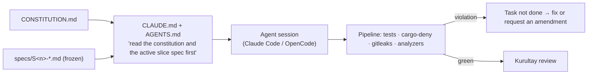

# Atabey Constitution (Draft)

> **What this is:** the short list of non-negotiable engineering rules for building Atabey, borrowed from Spec Kit's "constitution" idea *(D-034)*. Every agent session gets it in context (via `CLAUDE.md` / `AGENTS.md`). Changing it requires a **formal amendment you approve** (Article 12).
> **What others do:** Spec Kit's constitution is similar but longer and more generic. Kiro uses "steering files". Cursor and Claude Code use rules files (`.cursor/rules`, `CLAUDE.md`). Ours is short on purpose: agents follow short rules more reliably.

## Articles

| # | Article | The rule | Why |
|---|---|---|---|
| 1 | **Type safety** | Rust core; TypeScript in `strict` mode. **TS types, JSON Schemas and Ulak contracts are generated from Rust types**, never hand-duplicated. No `any` without a written justification comment | D-005, D-014. Drift between core and GUI is the #1 bug source in Tauri apps |
| 2 | **Files are the truth** | Anything a user or agent authors lives in files (`.atabey/`, `~/.atabey/`). SQLite is a rebuildable index only | D-020. Git history, diffs, recoverability |
| 3 | **Specs before code** | No code without a frozen slice spec. Only implement the current task. New ideas go to `PARKING-LOT.md`. A frozen spec changes only through an amendment | D-030–032 |
| 4 | **Tests prove acceptance** | Every acceptance criterion maps to at least one automated test. A task is done only when its tests pass and the pipeline is green on **macOS and Windows** | D-016, D-043 |
| 5 | **Log every action, leak no secret** | Every agent/tool/extension action goes to Defter with a correlation id. Secrets are redacted before writing. No secret in code, logs, fixtures or docs | D-029 |
| 6 | **Vendor terms are hard limits** | Subscriptions only via the vendor's **unmodified** binary and the **vendor's own login**. Never read, store or forward subscription credentials. Never bundle or patch vendor agents. No vendor trademark in feature names | D-041 |
| 7 | **Budget is a hard limit** | Every pay-per-token call goes through the LLM gateway and its caps ($1/day, $15/month by default; pause and ask at the cap). No direct provider calls that bypass the meter | D-044, D-047 |
| 8 | **Least privilege** | Observers are structurally read-only. Extensions get only the permissions they declare and you approve. The decision gate **fails closed** (asks you) when unavailable. PoC tests run in containers | D-021, D-045, D-028 |
| 9 | **One public API** | First-party features use the same extension API and Ulak contracts as community extensions. No private back doors into the core | D-027 |
| 10 | **Licenses** | Linked/bundled dependencies: **MIT, Apache-2.0, BSD-2/3, ISC, Zlib, Unicode, MPL-2.0**. **LGPL** only as a separate executable (e.g., Opengrep). **GPL, AGPL, SSPL, BUSL, source-available**: never linked or bundled; at most an external tool you install yourself. Enforced in CI (`cargo-deny` + an npm license checker) | D-007 (Apache-2.0) |
| 11 | **Rich and real** | User-facing content is rendered richly (no raw Markdown, **no ASCII diagrams**). Examples, fixtures and lessons are **production-grade**, never toy (`Foo`/`Bar`, `Animal`/`Dog`) | D-022, D-068 |
| 12 | **Amendments** | Any change to this constitution or a frozen spec: a written **delta** (what, why, impact) → you approve → version bump → logged in the ledger | D-030, D-034 (OpenSpec-style deltas) |

## How agents see it

**Enforced by machines where possible:** Articles 1 (type generation check), 4 (tests + 2-OS CI), 5 (gitleaks), 7 (gateway is the only HTTP client to LLMs), 10 (`cargo-deny`). The rest is enforced by spec review and Kurultay.
