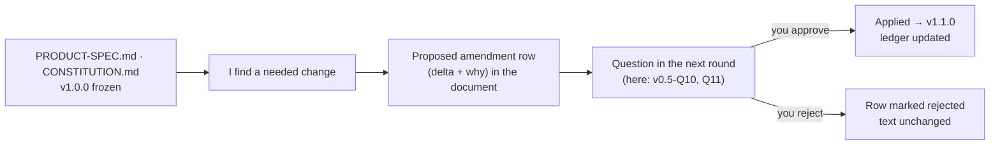

# Clarifications for Your v0.4 Answers

> You accepted the ⭐⭐ option on **all 10 questions** and left Q11 (corrections) and Q12 (new ideas) empty. **Brainstorming is over**, and this session starts implementation planning. Below: what was applied, the one missing answer, and three things I found while writing the S0 spec that need your OK.

## Contents

1. [What was applied](#1-what-was-applied)
2. [Missing answer: your Claude plan (v0.4-Q5)](#2-missing-answer-your-claude-plan-v04-q5)
3. [Found while writing the spec](#3-found-while-writing-the-spec)
4. [What "frozen" means from now on](#4-what-frozen-means-from-now-on)

---

## 1. What was applied

| Answer | Result |
|---|---|
| Q1 Native-first v1 | D-111 ✅ (D-018 ⛔) |
| Q2 `claude-agent-acp` + hooks bridge | D-110 ✅ (D-017 ⛔) |
| Q3 OpenCode as second agent in S2 | D-113 note ✅ |
| Q4 OpenCode headless observers | D-106 ✅ |
| Q5 Subscription shown separately | D-107 ✅ (plan still unknown, see below) |
| Q6 No Atabey "Sign in with Claude"; re-check before public release | D-108 ✅ |
| Q7 Ulak (commands + events + services) | D-105 ✅ |
| Q8 Product Spec | **[PRODUCT-SPEC.md](../../../PRODUCT-SPEC.md) v1.0.0 frozen** at the repo root |
| Q9 Constitution | **[CONSTITUTION.md](../../../CONSTITUTION.md) v1.0.0 frozen** at the repo root |
| Q10 Move at the start of v0.5 | ✅ Done: `brainstorm/` → `docs/brainstorm/` (with `git mv`, so file history is kept) |

New at the repo root: [ROADMAP.md](../../../ROADMAP.md), [PARKING-LOT.md](../../../PARKING-LOT.md), and the **[S0 Foundations spec](../../../specs/S0-foundations.md)** (draft).

---

## 2. Missing answer: your Claude plan (v0.4-Q5)

Q5's custom answer asked which Claude plan you use. It was left blank. It doesn't block S0 (the status bar only *records* the plan; usage tracking starts in S2), so it's repeated as **v0.5-Q7**.

---

## 3. Found while writing the spec

### 3.1 Extension iframes and a past Tauri security issue (affects D-100)

**Short answer:** D-100 still works, but it must be **proven by a test** before we build on it.

In 2024, a Tauri advisory (CVE-2024-35222) showed that iframes could call the app's internal API. It's fixed: iframes can no longer invoke commands, **except on Windows when the iframe has the same origin as the app**. Our design gives every extension iframe an **opaque origin** (`sandbox="allow-scripts"` without `allow-same-origin`), so the exception doesn't apply. The S0 spec therefore starts with a small **spike task (T-04)** that proves it on macOS and Windows in CI before the extension host is built. If it fails, we switch to dedicated webviews (an amendment). Details: [02 §4](02-S0-TECH-CHOICES.md#4-extension-ui-isolation) · decision **v0.5-Q4**.

### 3.2 OpenCode Go should only be used *through* OpenCode (proposed Product Spec amendment A-1)

The draft Product Spec said the core gateway would use "cheap Go / OpenRouter models" for explanations and lessons. But a direct gateway call to OpenCode Go's endpoint isn't coding-agent traffic. That's exactly the "homemade client" risk you rejected in v0.4-Q4. So I propose: **the gateway uses OpenRouter; OpenCode Go is only used through the OpenCode runtime** (`opencode run` / `serve` / `acp`). Cost impact: explanations and lessons become pay-per-token on cheap OpenRouter models (fractions of a cent each, inside the $1/day cap). Heavier jobs can still go through `opencode run` on your Go plan. Decision **v0.5-Q10**.

### 3.3 Two licenses missing from Constitution Article 10 (proposed amendment A-1)

The standard Rust file watcher (`notify`, needed in S0) is **CC0-1.0** (public domain dedication), and several core Rust crates are dual-licensed with **BSL-1.0** (Boost). Both are *more* permissive than MIT, but neither is on Article 10's list. I propose adding **CC0-1.0, 0BSD and BSL-1.0**, with an explicit note that **BSL-1.0 (Boost) ≠ BUSL (Business Source License)**, which stays banned. Decision **v0.5-Q11**.

### 3.4 The `outputs/` folder

It's still untracked in git. It isn't a brainstorm source (your rule) and isn't part of Atabey. **v0.5-Q8** asks: ignore or commit.

---

## 4. What "frozen" means from now on

This is the first time Spec-Lite's freeze/amend loop is used for real:

The S0 spec is still a **draft**. When you answer v0.5, I apply your answers and mark it **frozen (Tuğra)**, and implementation starts with **T-01**.
