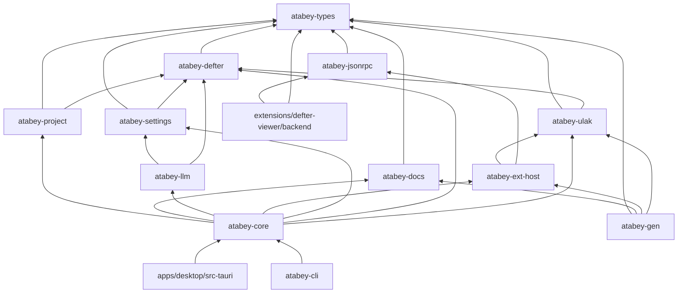
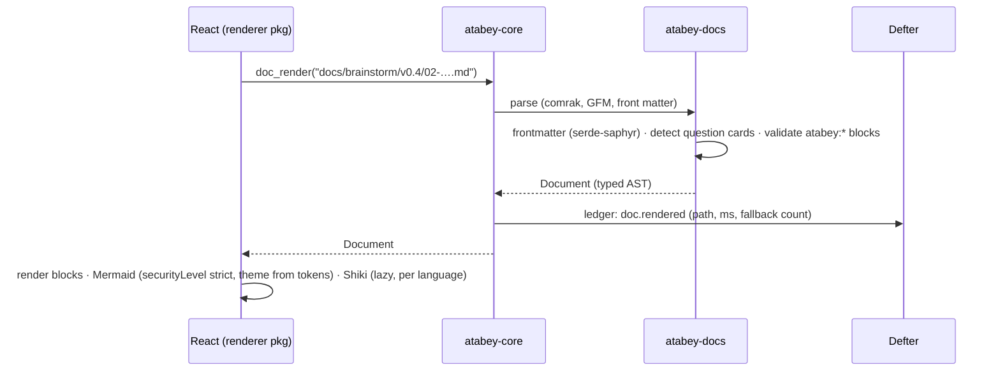
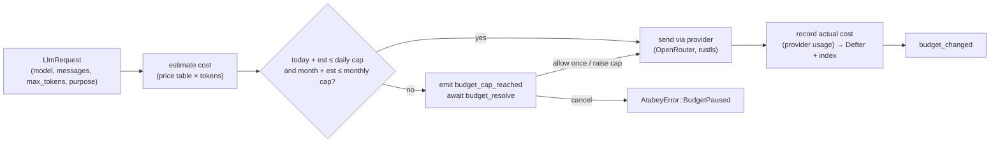
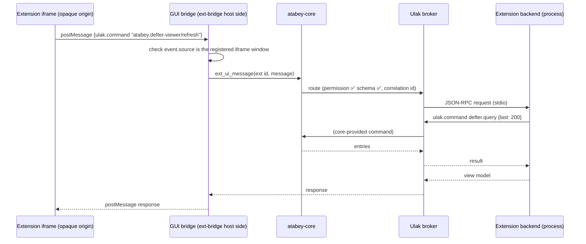
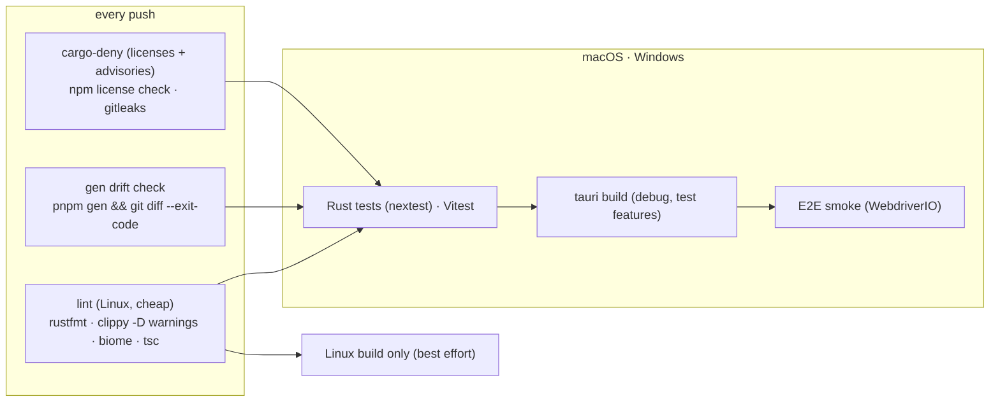
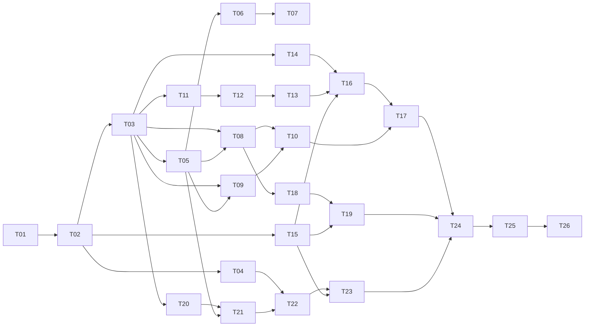

# S0: Foundations

> **Plain-language summary:** S0 builds the empty-but-solid house every later slice moves into. That means a Tauri window with a dark, themeable layout, a Rust core with typed communication to the GUI, a renderer that shows Markdown + Mermaid + Atabey blocks beautifully, logging of everything (Defter), settings and API keys stored safely, a budget meter that blocks overspending, a working extension host with Ulak messaging, and CI on macOS + Windows.
> **Dogfooding test:** at the end of S0, Atabey opens **its own repo** and renders the entire brainstorm history (`docs/brainstorm/`) and this spec correctly.

## Contents

1. [Goal](#1-goal)
2. [Non-goals](#2-non-goals)
3. [Requirements](#3-requirements)
4. [Acceptance criteria](#4-acceptance-criteria)
5. [Technical design](#5-technical-design)
6. [Tasks](#6-tasks)
7. [Risks & unknowns](#7-risks--unknowns)
8. [Amendments](#8-amendments)
9. [Sources](#9-sources)

---

## 1. Goal

Deliver a cross-platform desktop shell and core platform that every later slice builds on: **typed IPC, document rendering, themes, logging, settings and secrets, budget enforcement, extension host + Ulak v0**, all tested in CI on macOS and Windows. S0 has **no AI features** beyond one budget-metered "test connection" call.

## 2. Non-goals

| Not in S0 | Comes in |
|---|---|
| Code intelligence (tree-sitter, LSP, SCIP) | S1 |
| Agents, ACP, PTY/terminal, MCP server, decision gate (Jev) | S2 |
| Interactive question forms, spec editing, Tuğra freeze UI | S3 (S0 renders them read-only) |
| Pipeline recipes, analyzers, change narratives | S4 |
| Third-party extensions, Bedesten registry, install UI | S9 (S0 = bundled first-party only) |
| Ulak typed *services* | S1–S2 (S0 = commands + events) |
| More themes, VS Code theme import | S9 (S0 builds the registry) |
| Auto-update, code signing, installers for distribution | Later slice (S0 produces unsigned dev builds) |
| Linux support | Best effort: it must compile in CI, but isn't tested *(D-016)* |

## 3. Requirements

Each requirement is testable. `→` lists the decisions it implements.

### 3.1 Shell & layout

| ID | Requirement |
|---|---|
| R-1 | The app starts on macOS (arm64 + x64) and Windows (x64) as a single main window with: **activity bar** (left icons), **sidebar**, **main area** (tabs), **bottom panel**, **status bar**. Panels are resizable; sizes persist per project → D-011, D-016 |
| R-2 | **Open Folder** (menu + `Cmd/Ctrl+O`) opens a project. The last 10 projects appear in a **Recent** list. Re-opening the app restores the last project and open tabs |
| R-3 | A **command palette** (`Cmd/Ctrl+Shift+P`) lists every registered command (core + extensions) with fuzzy search |

### 3.2 Typed IPC

| ID | Requirement |
|---|---|
| R-4 | Every Tauri command and event payload is a Rust type; **TypeScript bindings are generated** and committed; CI fails if regenerated bindings differ (drift check) → Constitution Art. 1, D-014 |
| R-5 | Every IPC error is a typed `AtabeyError` (code + message + optional details), never a bare string |

### 3.3 Project model

| ID | Requirement |
|---|---|
| R-6 | Opening a folder creates (if missing) `.atabey/project.toml` with a stable **project id** (UUIDv7) and name → D-019, D-020 |
| R-7 | The core detects whether the folder is a git repo and exposes branch, HEAD commit and dirty file count (read-only) |
| R-8 | A **file watcher** publishes debounced (200 ms) `project.filesChanged` events, ignoring `.git/`, `node_modules/`, `target/` and `.gitignore`d paths |
| R-9 | A **file tree** in the sidebar shows the project; clicking a `.md` file opens it in the renderer; other text files open in a read-only code view (Shiki) |

### 3.4 Document renderer

| ID | Requirement |
|---|---|
| R-10 | Markdown (CommonMark + GFM: tables, task lists, strikethrough, footnotes, autolinks) + **YAML frontmatter** is parsed **in Rust** into a typed document AST, sent to the GUI and rendered by React components → D-022, D-023 |
| R-11 | **Mermaid** fenced blocks render as diagrams (theme-aware). Invalid diagrams show an inline error card with the source, never a blank space |
| R-12 | Code blocks are highlighted with **Shiki** using the active theme |
| R-13 | **Typed blocks** (` ```atabey:<kind> `) are validated against JSON Schemas generated from Rust types. S0 kinds: `atabey:callout`, `atabey:decision`, `atabey:question`. An invalid or unknown block renders as a **fallback card** showing the raw content + the validation error |
| R-14 | The brainstorm **question format** (checkbox options with ⭐⭐/⭐/⚪/⚠️, `✍️ Custom answer:`, `❓ Clarify:`) is recognized from plain Markdown and rendered as a **read-only question card** (interactive editing comes in S3) → D-081 |
| R-15 | Frontmatter is shown as a compact header (status pill, date, version) instead of raw YAML |
| R-16 | Relative links between documents open in a new tab; heading anchors (`#…`) scroll to the heading; external links open in the system browser after a confirmation |
| R-17 | Rendering never executes HTML from documents: raw HTML in Markdown is **escaped** in S0 |

### 3.5 Themes

| ID | Requirement |
|---|---|
| R-18 | A **theme registry** loads themes from `themes/` (bundled) and `~/.atabey/themes/` (user). A theme is a JSON file validated against a schema generated from the Rust `Theme` type → D-091 |
| R-19 | Components use only **semantic tokens** (CSS custom properties), never literal colors. A lint rule (Biome/grep check in CI) rejects hex/rgb literals outside `themes/` |
| R-20 | **Atabey Monokai** (dark) ships, derived from VS Code's MIT-licensed Monokai with attribution. The theme switcher in Settings lists all registered themes; switching applies live without restart |

### 3.6 Defter (logging)

| ID | Requirement |
|---|---|
| R-21 | Every user action, IPC command, extension message and LLM call produces a **ledger entry** (JSON Lines) with timestamp, **correlation id**, actor, kind, payload summary and outcome → D-029, Constitution Art. 5 |
| R-22 | App logs (`tracing`) are written to daily rolling files |
| R-23 | **Redaction:** before any write, values matching secret patterns, plus **every secret currently stored in the keychain**, are replaced with `«redacted:<kind>»` |
| R-24 | **Retention:** session ledgers 90 days raw, then compacted into per-day summaries kept forever; app logs 14 days. A cleanup job runs at startup and daily |
| R-25 | The core exposes `defter.query` (filter by time, kind, correlation id) and publishes `defter.appended` events |

### 3.7 Settings, secrets, providers, budget

| ID | Requirement |
|---|---|
| R-26 | Settings are **TOML files**: user `~/.atabey/settings.toml`, project `.atabey/settings.toml` (project overrides user). Unknown keys are preserved; invalid values produce a typed error shown in the Settings UI |
| R-27 | **Secrets** (API keys) are stored only in the OS keychain (macOS Keychain, Windows Credential Manager), never in files, logs or IPC payloads back to the GUI (the GUI only sees "set / not set") |
| R-28 | **Providers:** S0 supports **OpenRouter** (OpenAI-compatible) as the gateway provider. "Test connection" makes one minimal, metered call. The provider list is a Rust enum, ready for more |
| R-29 | **Budget meter:** every pay-per-token call is estimated before it's sent and recorded after. Defaults **$1/day, $15/month**, adjustable. If a call would exceed a cap, it is **paused** and a dialog asks: *allow once / raise cap / cancel* → D-044, D-047, Constitution Art. 7 |
| R-30 | The status bar shows today's spend / daily cap and month / monthly cap. A **Subscriptions** section in Settings records plans (yours: "Claude: Pro", "OpenCode Go"); usage tracking comes in S2 → D-107 |
| R-31 | The LLM gateway is the **only** code that may make HTTP calls to model providers. A CI check rejects provider hostnames anywhere else |

### 3.8 Extension host & Ulak v0

| ID | Requirement |
|---|---|
| R-32 | Extensions are discovered from `extensions/` (bundled). Each has an `atabey-extension.toml` manifest validated against a generated schema: id, version, engine range, permissions, contributions, `[ulak]` declarations → D-027, D-100 |
| R-33 | **Backend contributions** run as **separate processes** speaking **JSON-RPC 2.0 over stdio (newline-delimited JSON)**. The host supervises them: start on activation, health-check, restart once on crash, then mark as failed with a visible error |
| R-34 | **UI contributions** (sidebar panels, main-area views) load in a **sandboxed iframe** (`sandbox="allow-scripts"`, opaque origin) served from the `atabey-ext://` scheme with a strict CSP. They communicate only through a `postMessage` bridge that the core checks against the extension's permissions |
| R-35 | **Ulak broker v0:** commands (request → response, 30 s default timeout, cancellable) and events (pub/sub, ordered per topic). The broker checks **declared permissions** and **schema validity** of every message and logs every hop in Defter with the caller's correlation id → D-105 |
| R-36 | Core events published via Ulak: `project.opened`, `project.filesChanged`, `settings.changed`, `theme.changed`, `budget.changed`, `budget.capReached`, `defter.appended` |
| R-37 | **First-party extension: "Defter Viewer"** (Defter · Ledger Viewer): a bottom-panel UI + a Rust backend process. It uses Ulak `defter.query` and subscribes to `defter.appended` to show a live, filterable ledger. It proves the full extension path |

### 3.9 Quality & CI

| ID | Requirement |
|---|---|
| R-38 | CI (GitHub Actions) on **macOS and Windows** runs: format, lint, Rust tests, TS tests, binding/schema drift check, license + advisory check (`cargo-deny`, npm license check), secret scan (Gitleaks), app build, **E2E smoke test**. Linux: build only → D-016 |
| R-39 | All tool versions are pinned in `mise.toml` (Rust, Node, pnpm) and lockfiles → D-103 |
| R-40 | A debug CLI `atabey-cli` exposes core functions without the GUI (`render`, `defter query`, `settings get/set`, `ext list`) → D-013 |

---

## 4. Acceptance criteria

| AC | Verifies | Check | Automated? |
|---|---|---|---|
| AC-1 | R-1, R-2 | E2E: app launches, opens the repo fixture, layout regions visible, reopen restores project + tabs | ✅ WebdriverIO (macOS + Windows) |
| AC-2 | R-3 | E2E: palette lists core commands and "Defter Viewer: Focus" | ✅ |
| AC-3 | R-4, R-5 | CI drift check: `pnpm gen` produces no diff; unit test: every command's error type is `AtabeyError` | ✅ |
| AC-4 | R-6, R-7 | Rust tests on temp repos (git + non-git): project id stable across reopen; branch/HEAD/dirty count correct | ✅ |
| AC-5 | R-8 | Rust test: 50 rapid writes → ≤ 3 batched events; ignored paths produce none | ✅ |
| AC-6 | R-10–R-17 | **Golden corpus:** every file in `docs/brainstorm/**` + `specs/*.md` + `PRODUCT-SPEC.md` + `CONSTITUTION.md` parses with **zero fallback cards** and zero Mermaid errors; AST snapshots (`insta`) committed | ✅ |
| AC-7 | R-13 | Invalid `atabey:decision` fixture → fallback card with the exact schema error path | ✅ |
| AC-8 | R-17 | `<script>` / `onerror=` fixture is rendered as text; no script runs (E2E checks `window.__xss` stays undefined) | ✅ |
| AC-9 | R-18–R-20 | Theme schema test; CI color-literal check; E2E: switching theme changes `--surface-panel` without reload | ✅ |
| AC-10 | R-21, R-25 | Opening a project + one command produce ledger entries sharing one correlation id; `defter.query` returns them | ✅ |
| AC-11 | R-23 | Property test (`proptest`): a random secret stored in the keychain mock never appears in ledger/log output, in any position or encoding tested (plain, JSON-escaped, URL-encoded) | ✅ |
| AC-12 | R-24 | Clock-injected test: 91-day-old ledger → compacted summary; 15-day-old app log → deleted | ✅ |
| AC-13 | R-26, R-27 | Settings precedence test; keychain round-trip test (real keychain on macOS/Windows CI, mock elsewhere); IPC snapshot proves the secret value is never serialized | ✅ |
| AC-14 | R-29 | Gateway test with a fake provider: call over the cap → paused; "cancel" → no HTTP request sent | ✅ |
| AC-15 | R-31 | CI grep check for `openrouter.ai` / `api.anthropic.com` / `opencode.ai` outside `crates/atabey-llm` | ✅ |
| AC-16 | R-33 | Test extension that crashes → restarted once → second crash → "failed" state + Defter entry | ✅ |
| AC-17 | R-34 | **Security E2E (macOS + Windows):** inside an extension iframe, `window.__TAURI__`, `__TAURI_INTERNALS__` and IPC `postMessage` are unavailable or rejected; a forged bridge message for an undeclared permission is rejected and logged | ✅ |
| AC-18 | R-35, R-36 | Broker tests: undeclared command → rejected; schema-invalid payload → rejected; timeout → typed error; event order preserved per topic | ✅ |
| AC-19 | R-37 | E2E: open Defter Viewer, run a command, the new entry appears within 1 s | ✅ |
| AC-20 | R-38, R-39 | CI green on macOS + Windows; Linux build green | ✅ |
| AC-21 | R-40 | `atabey-cli render PRODUCT-SPEC.md --json` outputs the same AST as the snapshot | ✅ |
| AC-22 | all | **Manual demo** (you): open the Atabey repo, read v0.1–v0.5 and this spec in the app, switch theme, check spend in the status bar, open Defter Viewer | 👤 |

---

## 5. Technical design

### 5.1 Stack (versions checked 2026-10-10)

| Layer | Choice | Version | License | Why (alternatives in [v0.5/02](../docs/brainstorm/v0.5/02-S0-TECH-CHOICES.md)) |
|---|---|---|---|---|
| Shell | **Tauri** | 2.12.x (not 3.0 alpha) | MIT/Apache-2.0 | D-011; v3 is alpha |
| Async | tokio | 1.53 | MIT | Standard |
| IPC types | **tauri-specta** + specta | `=2.0.0-rc.25` (pinned) | MIT | Typed commands **and** events (v0.5-Q1) |
| JSON Schema | schemars | 1.2 | MIT | Contracts, block & theme schemas |
| Schema validation | jsonschema | 0.58 | MIT | Ulak + typed blocks |
| Markdown | **comrak** | 0.56 | BSD-2-Clause | GFM + frontmatter in Rust (v0.5-Q2) |
| YAML (frontmatter) | serde-saphyr | 1.3 | MIT/Apache-2.0 | `serde_yaml` is deprecated |
| TOML | toml | 1.1 | MIT/Apache-2.0 | Settings, manifests |
| Git (read-only) | **gix** | 0.89 | MIT/Apache-2.0 | Pure Rust; `git2` wraps libgit2 (GPL-2.0 + linking exception, not on the allowed list) |
| File watching | notify (+ debouncer) | 8.2 | CC0-1.0 | Allowed by Constitution A-1 |
| SQLite (derived index) | rusqlite (`bundled`) | 0.40 | MIT | Index rebuilt from files on schema-version change; no migrations needed |
| Secrets | keyring | 4.2 | MIT/Apache-2.0 | macOS Keychain, Windows Credential Manager |
| Logging | tracing + tracing-subscriber + tracing-appender | 0.1 / 0.3 / 0.2 | MIT | Standard |
| IDs | uuid (v7) | 1.28 | MIT/Apache-2.0 | Sortable ids, correlation ids |
| Errors | thiserror (libs), anyhow (CLI only) | 2.0 / 1.0 | MIT/Apache-2.0 | |
| HTTP (gateway) | reqwest (rustls) | latest 0.x | MIT/Apache-2.0 | |
| Rust tests | cargo-nextest, insta, proptest | — | MIT/Apache-2.0 | Snapshots, property tests |
| GUI | **React** + TypeScript (strict) | 19.3 / 7.0 | MIT / Apache-2.0 | D-015; TS 7 = native compiler |
| Build | Vite | 8.3 | MIT | Tauri default |
| Routing / data | TanStack Router + TanStack Query | 1.170 / 5.104 | MIT | Typed routes; IPC calls as cached queries |
| UI state | Zustand | 5.0 | MIT | Small, simple |
| Styling | Tailwind CSS mapped to semantic tokens + Radix primitives | 4.3 | MIT | v0.5-Q3 |
| Diagrams / code | Mermaid / Shiki | 12.1 / 4.5 | MIT | R-11, R-12 |
| Lint/format (TS) | Biome | 2.5 | MIT/Apache-2.0 | One fast tool |
| TS tests | Vitest + Testing Library | 5.0 | MIT | |
| E2E | WebdriverIO + `@wdio/tauri-service` (embedded WebDriver plugin, **test builds only**) | 1.5 | MIT | Works on macOS too (plain `tauri-driver` doesn't) |
| Toolchain pinning | mise | — | MIT | D-103 |
| Package manager | pnpm (workspaces) | — | MIT | |

> **Version policy:** exact pins for pre-1.0 or RC crates (`tauri-specta`, `specta`); caret ranges for the rest; lockfiles committed. Renovate/Dependabot is **not** set up in S0 (Parking Lot).

### 5.2 Repository layout

| Path | Purpose |
|---|---|
| `AGENTS.md`, `CLAUDE.md` | Agent instructions (Spec-Lite §1.4) |
| `PRODUCT-SPEC.md`, `CONSTITUTION.md`, `ROADMAP.md`, `PARKING-LOT.md` | Project-level Spec-Lite documents |
| `specs/S0-foundations.md` | This spec |
| `adr/ADR-0001-….md` | Architecture decision records |
| `docs/brainstorm/` | Brainstorm history |
| `mise.toml`, `Cargo.toml`, `package.json`, `pnpm-workspace.yaml`, `deny.toml`, `biome.json` | Toolchain pins, workspaces, license policy, lint config |
| `crates/atabey-types/` | Shared domain types (serde + specta + schemars), ids, `AtabeyError` |
| `crates/atabey-jsonrpc/` | NDJSON JSON-RPC 2.0 framing over async streams |
| `crates/atabey-defter/` | Ledger, app-log setup, redaction, retention |
| `crates/atabey-docs/` | Markdown → `Document` AST, frontmatter, typed-block registry, question detection |
| `crates/atabey-settings/` | TOML settings layering, keychain secrets |
| `crates/atabey-llm/` | Gateway, providers (OpenRouter), pricing, budget meter |
| `crates/atabey-project/` | Project model, git (gix), watcher, SQLite index |
| `crates/atabey-ulak/` | Broker: commands, events, contract registry, validation |
| `crates/atabey-ext-host/` | Manifests, permissions, process supervisor, UI scheme handler |
| `crates/atabey-core/` | Composition root: wires services, owns `AppState` (no Tauri dependency) |
| `crates/atabey-cli/` | Debug CLI |
| `crates/atabey-gen/` | Generates TS bindings + JSON Schemas (`pnpm gen`, CI drift check) |
| `apps/desktop/src-tauri/` | Tauri app: command/event glue, menus, window, URI scheme |
| `apps/desktop/src/` | React app |
| `packages/bindings/` | **Generated** TS (commands, events, types); never hand-edited |
| `packages/ui/` | Layout, panels, palette, tokens → CSS variables |
| `packages/renderer/` | `Document` → React, Mermaid, Shiki, typed-block components |
| `packages/ext-bridge/` | `postMessage` client used inside extension iframes |
| `extensions/defter-viewer/` | First-party extension: manifest, Rust `backend/`, React `ui/` |
| `themes/atabey-monokai.json` | Bundled theme |
| `schemas/` | **Generated** JSON Schemas (theme, manifest, blocks, contracts) |
| `.github/workflows/ci.yml` | CI |

### 5.3 Crate dependency graph



**Rule:** only `src-tauri` depends on Tauri. Everything else is plain Rust, testable without a window (`atabey-cli` and tests use `atabey-core` directly).

### 5.4 Core types (abridged; full definitions written in T-03)

```rust
// atabey-types
pub struct ProjectId(pub Uuid);          // UUIDv7, stored in .atabey/project.toml
pub struct CorrelationId(pub Uuid);      // one per user-initiated flow
pub struct ExtensionId(pub String);      // "atabey.defter-viewer"

#[derive(Serialize, Deserialize, specta::Type, JsonSchema, thiserror::Error, Debug)]
#[serde(tag = "code", rename_all = "snake_case")]
pub enum AtabeyError {
    NotFound { what: String },
    InvalidInput { field: String, reason: String },
    PermissionDenied { extension: ExtensionId, needed: Permission },
    BudgetPaused { request: BudgetRequestId, needed_usd: Decimal, cap: CapKind },
    Provider { provider: ProviderId, status: Option<u16>, message: String },
    Timeout { after_ms: u64 },
    Internal { message: String },        // logged with full detail in Defter, short text to GUI
}

// atabey-docs
pub struct Document { pub path: RelPath, pub frontmatter: Option<Frontmatter>, pub blocks: Vec<Block> }
pub enum Block {
    Heading { level: u8, id: String, inlines: Vec<Inline> },
    Paragraph(Vec<Inline>), List { ordered: bool, items: Vec<ListItem> },
    Table { align: Vec<Align>, header: Vec<Cell>, rows: Vec<Vec<Cell>> },
    Code { lang: Option<String>, text: String },
    Mermaid { source: String },
    Typed(TypedBlock),                    // atabey:<kind>, validated
    Question(QuestionCard),               // detected from the brainstorm format
    Quote(Vec<Block>), Rule, Footnotes(Vec<Footnote>),
    Fallback { raw: String, error: String },
}
pub enum TypedBlock { Callout(Callout), Decision(DecisionCard), /* registry-extensible */ }
pub struct QuestionCard { pub id: Option<String>, pub title: Vec<Inline>, pub context: Vec<Block>,
    pub options: Vec<QuestionOption>, pub custom_answer: Option<String>, pub clarify: Option<String> }
pub struct QuestionOption { pub checked: bool, pub rating: Option<Rating>, pub label: Vec<Inline> }
pub enum Rating { StronglyRecommended, Recommended, Viable, NotRecommended }

// atabey-defter
pub struct LedgerEntry { pub ts: Timestamp, pub id: Uuid, pub correlation: CorrelationId,
    pub actor: Actor, pub kind: EntryKind, pub summary: String, pub outcome: Outcome,
    pub data: serde_json::Value /* redacted */ }
pub enum Actor { User, Core, Extension(ExtensionId), Agent(String), Provider(ProviderId) }

// atabey-llm
pub struct Money(Decimal);               // USD, never f64
pub enum CapKind { Daily, Monthly }
pub struct BudgetState { pub today: Money, pub month: Money, pub daily_cap: Money, pub monthly_cap: Money }

// atabey-ext-host
pub enum Permission { UlakCommand(String), UlakSubscribe(String), UlakEmit(String),
    UiPanel(PanelSlot), ReadProjectFiles, Network(HostPattern) }
```

### 5.5 IPC surface (Tauri commands and events)

All generated into `packages/bindings` by tauri-specta. Naming: `domain_verb`.

| Command | Input → Output |
|---|---|
| `project_open` | `{ path }` → `ProjectInfo` |
| `project_recent` | `()` → `Vec<RecentProject>` |
| `project_tree` | `{ dir: RelPath }` → `Vec<TreeEntry>` |
| `doc_render` | `{ path: RelPath }` → `Document` |
| `file_read_text` | `{ path }` → `{ text, lang }` |
| `theme_list` / `theme_get` / `theme_set_active` | → `Vec<ThemeMeta>` / `Theme` / `()` |
| `settings_get` / `settings_set` | `{ scope, key }` → `SettingValue` |
| `secret_set` / `secret_clear` / `secret_status` | `{ provider }` → `SecretStatus` (never the value) |
| `budget_state` / `budget_resolve` | → `BudgetState` / `{ request, decision: AllowOnce │ RaiseCap │ Cancel }` |
| `provider_test` | `{ provider }` → `ProviderTestResult` |
| `commands_list` / `command_run` | palette |
| `ext_list` / `ext_ui_message` | extension states / bridge messages from iframes |
| `defter_query` | `DefterQuery` → `Vec<LedgerEntry>` |

| Event (core → GUI) | Payload |
|---|---|
| `files_changed` | `Vec<RelPath>` |
| `theme_changed` | `ThemeMeta` |
| `budget_changed` / `budget_cap_reached` | `BudgetState` / `BudgetPauseRequest` |
| `defter_appended` | `LedgerEntry` (redacted) |
| `ext_state_changed` | `ExtensionState` |

### 5.6 Rendering pipeline



- **Caching:** AST cached in memory by `(path, content hash)`. The SQLite index stores headings + frontmatter (for later search). Rebuilt on file change.
- **Question detection:** a heading matching `v<d>.<d>-Q<n>.` or `Q<n>.` followed by a checkbox list with ⭐⭐/⭐/⚪/⚠️ markers and `✍️`/`❓` lines → `QuestionCard`. Otherwise it stays plain Markdown (never a fallback).

### 5.7 Theme system

| Piece | Detail |
|---|---|
| `Theme` (Rust) | `{ id, name, kind: Dark │ Light, tokens: ThemeTokens, code: ShikiThemeRef, mermaid: MermaidThemeVars, attribution }` |
| `ThemeTokens` | ~40 semantic tokens grouped: `surface.*` (base, panel, raised, overlay), `text.*` (primary, muted, link, inverse), `border.*`, `accent.*`, `status.*` (ok, warn, error, info), `diff.*` (added, removed, changed), `rating.*` (strong, rec, viable, warn), `finding.*` (critical…low) |
| Applying | Core → `theme_get` → GUI writes CSS custom properties on `:root` (`--surface-panel`…) → Tailwind config maps utility names to the variables |
| Monokai | Palette from VS Code's Monokai (MIT) with attribution in the theme file; Shiki's bundled `monokai` for code |

### 5.8 Defter storage

| Stream | Location | Format | Retention |
|---|---|---|---|
| Session ledger | `~/.atabey/defter/<project-id>/ledger/YYYY-MM-DD/<session-id>.jsonl` | JSON Lines, one `LedgerEntry` per line | 90 days raw → `summaries/YYYY-MM-DD.json` kept forever |
| App log | `~/.atabey/logs/atabey.YYYY-MM-DD.log` | `tracing` text (JSON in CI) | 14 days |
| Index | `~/.atabey/index.sqlite` | derived (projects, recent, ledger index) | rebuilt on schema change |

**Redaction pipeline:** `Redactor` = known-secret matcher (Aho-Corasick over every keychain value, refreshed on `secret_set`) + pattern rules (API-key prefixes like `sk-…`, `sk-or-…`, bearer tokens, private-key blocks, high-entropy strings in key/value pairs named `*token*|*secret*|*key*|*password*`). It applies to ledger entries, app logs and IPC error details.

### 5.9 LLM gateway & budget



- **Price table:** fetched from OpenRouter's models endpoint at most once a day, cached on disk. Unknown model → treated as the most expensive listed model (fail safe).
- **Actual cost:** taken from the provider's usage data in the response; if missing, from tokens × price table.
- **Money is `Decimal`**, never floating point. Days roll over at **local midnight**.

### 5.10 Extension host & Ulak v0

**Manifest (Defter Viewer):**

```toml
id = "atabey.defter-viewer"
name = "Defter · Ledger Viewer"
version = "0.1.0"
engine = "^0.1"

[backend]
command = "bin/defter-viewer-backend"      # resolved per platform (.exe on Windows)

[[ui.panels]]
slot  = "bottom"
title = "Defter"
entry = "ui/index.html"

[ulak.requires]
commands = ["defter.query"]
[ulak.subscribes]
events = ["defter.appended"]

[permissions]
read_project_files = false
network = []
```

**Message paths:**



**JSON-RPC methods (host ↔ backend):** `initialize` (host → ext: id, engine version, granted permissions), `ulak/command` (both ways), `ulak/event` (host → ext delivery; ext → host emit), `ulak/subscribe`, `shutdown`, `$/cancel`, `$/log` (→ Defter).

### 5.11 CI pipeline



Caching: `Swatinem/rust-cache`, pnpm store cache. **Public repo** (v0.5-Q6): the full macOS + Windows matrix runs on every push and PR at no cost.

### 5.12 Security checklist (S0)

| Area | Rule |
|---|---|
| Tauri capabilities | The main window gets only the core command set; extension iframes get **none** (they can't invoke) |
| CSP | Main window: `default-src 'self' customprotocol: asset:; connect-src 'self' ipc: http://ipc.localhost` (A-1); no `unsafe-eval`; Mermaid in strict mode. Extension pages: `default-src 'self'`; `connect-src` only for declared network permissions (empty in S0) |
| Raw HTML | Escaped (R-17) |
| WebDriver plugin | Compiled **only** with the `e2e` cargo feature; release builds fail CI if the feature is on |
| Secrets | Keychain only; redaction everywhere; GUI never receives values |
| External links | Confirmation dialog; opened via the OS, never inside the app |

---

## 6. Tasks

Each task fits **one agent session** (Claude Code), lists the requirements it serves and ends with its tests passing and CI green. Order = dependency order. ⏱ is a rough size (S ≈ ½ day, M ≈ 1 day, L ≈ 2 days of agent sessions plus your review).

### M1: Skeleton & CI

| Task | Delivers | Reqs | Size |
|---|---|---|---|
| **T-01** | Workspace skeleton (Cargo workspace, pnpm workspace, `mise.toml`, Biome, `deny.toml`, `.gitignore`), `AGENTS.md`/`CLAUDE.md` for implementation, `ROADMAP.md`, ADR-0001…0006 from §5.1 decisions | R-39 | M |
| **T-02** | Tauri 2.12 app shell (`apps/desktop`), empty React app, window config, CSP, capabilities; CI workflow: lint + Rust/TS tests + builds on macOS/Windows/Linux | R-1 (partial), R-38 | M |
| **T-03** | `atabey-types`: ids, `AtabeyError`, `Permission`, specta + schemars derives; `atabey-gen` + `pnpm gen` + drift check in CI | R-4, R-5 | M |
| **T-04** | **Spike: iframe isolation.** Minimal `atabey-ext://` scheme + sandboxed iframe; prove AC-17 on macOS + Windows CI. Write ADR-0007 with the result (if it fails: switch to dedicated webviews; amendment) | R-34 | S |

### M2: Core services

| Task | Delivers | Reqs | Size |
|---|---|---|---|
| **T-05** | `atabey-defter`: ledger writer, correlation ids, `tracing` setup, rolling files | R-21, R-22 | M |
| **T-06** | Redactor (known secrets + patterns) + proptest suite | R-23 | M |
| **T-07** | Retention + compaction job (injectable clock) | R-24 | S |
| **T-08** | `atabey-settings`: TOML layering, typed keys, keychain secrets (`keyring`), secret-status IPC | R-26, R-27 | M |
| **T-09** | `atabey-project`: open/create `.atabey/project.toml`, recent list, gix read-only info, watcher (notify + debouncer), SQLite index (rebuild-on-version) | R-6–R-8 | L |
| **T-10** | `atabey-core` composition root + `atabey-cli` (`settings`, `defter query`) | R-40 | S |

### M3: Documents & themes

| Task | Delivers | Reqs | Size |
|---|---|---|---|
| **T-11** | `atabey-docs`: comrak → `Document` AST, frontmatter, heading ids, links | R-10, R-15, R-16, R-17 | L |
| **T-12** | Typed blocks: registry, `callout`/`decision` schemas, validation, fallback | R-13 | M |
| **T-13** | Question-card detection + golden corpus test over `docs/brainstorm/**` (AST snapshots) | R-14, AC-6 | M |
| **T-14** | Theme types + registry + Monokai JSON (with attribution) + CSS-variable application + color-literal CI check | R-18–R-20 | M |
| **T-15** | `packages/ui`: layout (activity bar, sidebar, tabs, bottom panel, status bar), resizable panels, persistence, command palette | R-1–R-3 | L |
| **T-16** | `packages/renderer`: all block components, Mermaid (strict, themed), Shiki (lazy), question/decision/callout cards, frontmatter header, link handling | R-10–R-17 | L |
| **T-17** | File tree + code view + tabs wiring | R-9 | M |

### M4: Budget & gateway

| Task | Delivers | Reqs | Size |
|---|---|---|---|
| **T-18** | `atabey-llm`: provider trait, OpenRouter client, price table cache, `Money`, cost estimation | R-28 | M |
| **T-19** | Budget meter: caps, pause/resume flow, `budget_*` IPC + dialog, status-bar widget, subscriptions section; host-name CI check | R-29–R-31 | M |

### M5: Extensions & Ulak

| Task | Delivers | Reqs | Size |
|---|---|---|---|
| **T-20** | `atabey-jsonrpc`: NDJSON framing, request/response correlation, cancellation | R-33 | S |
| **T-21** | `atabey-ulak`: broker, command + event routing, permissions, schema validation, Defter hops, core events | R-35, R-36 | L |
| **T-22** | `atabey-ext-host`: manifest schema, discovery, permission grants, process supervisor (restart once), `atabey-ext://` scheme (from T-04), `packages/ext-bridge` | R-32–R-34 | L |
| **T-23** | **Defter Viewer** extension (Rust backend + React UI) | R-37 | M |

### M6: Hardening & demo

| Task | Delivers | Reqs | Size |
|---|---|---|---|
| **T-24** | E2E suite (WebdriverIO, `e2e` feature) for AC-1, 2, 8, 9, 17, 19 on macOS + Windows | R-38 | M |
| **T-25** | Release-mode build checks (no `e2e` feature), CSP audit, capability audit, ADR updates | §5.12 | S |
| **T-26** | Slice review: demo (AC-22), debrief notes, Parking Lot triage, `ROADMAP.md` update, S0 marked done | — | S |



**Estimate:** 26 tasks, about 25–30 agent-days of sessions. With your reviews, that's roughly 6–8 calendar weeks at a relaxed pace (no deadline, D-005).
💰 **AI cost:** implementation runs on your Claude subscription. S0's only pay-per-token calls are "test connection" calls (fractions of a cent). CI is free (public repo, v0.5-Q6). Tasks are delivered as **one branch + PR each**, merged by you after green CI (v0.5-Q9).

---

## 7. Risks & unknowns

| Risk | Impact | Mitigation |
|---|---|---|
| **Extension iframe isolation** behaves differently on macOS (WKWebView) vs Windows (WebView2) | Security | **T-04 spike first**; fallback = dedicated webviews per extension (D-100 amendment) |
| `tauri-specta` is still a **release candidate** (rc.25, May 2026) | Breaking changes | Exact pin; generated code committed; fallback to `ts-rs` + a thin hand-written invoke layer generated by `atabey-gen` (ADR) |
| Tauri v3 is in alpha | Migration later | Stay on 2.x; isolate Tauri in `src-tauri` (§5.3 rule) |
| TypeScript 7 (native) ecosystem gaps | Tooling breaks | Fall back to TS 5.9 `tsc` for type-checking if a tool fails |
| Mermaid 12 rendering differences across webviews | Visual bugs | Golden corpus E2E screenshots on both OSes (stretch goal in T-24) |
| Keychain prompts on macOS during tests | Flaky CI | Mock keychain in unit tests; one real round-trip test per OS, tolerant of runner setup |
| **Claude Pro** has the tightest usage limits of the Claude plans | Slower progress (waiting for the usage window to reset) | Keep tasks small (one session each); hand mechanical work (fixtures, formatting, doc updates) to OpenCode on your Go plan; review PRs while the window resets |
| Scope: 26 tasks is a lot for "foundations" | Slow start | Each milestone is demoable; Parking Lot for everything new |

## 8. Amendments

| ID | Date | Change | Status |
|---|---|---|---|
| A-1 | 2026-10-11 | §5.12 CSP row: main window CSP gains `connect-src 'self' ipc: http://ipc.localhost`. Without it, Tauri's IPC custom protocol is blocked in release builds and silently falls back to the slower postMessage bridge (Tauri CSP docs). No change to the rules (still no `unsafe-eval`) | ✅ approved (user, 2026-10-11) → v1.0.1 |

## 9. Sources

Checked **2026-10-10**.

- Tauri: [releases](https://github.com/tauri-apps/tauri/releases) (2.12.2, 3.0.0-alpha.4), [tests / WebDriver](https://v2.tauri.app/develop/tests/), [WebdriverIO Tauri platform support](https://webdriver.io/docs/desktop-testing/tauri/platform-support), [GHSA-57fm-592m-34r7 (iframe IPC advisory)](https://github.com/advisories/GHSA-57fm-592m-34r7)
- crates.io and npm registry metadata for every version and license in §5.1 (queried directly)
- tauri-specta: [crates.io](https://crates.io/crates/tauri-specta) (2.0.0-rc.25, 2026-05-08); ts-rs [crates.io](https://crates.io/crates/ts-rs) (12.0.1)
- GitHub: [Actions billing](https://docs.github.com/en/billing/concepts/product-billing/github-actions)
